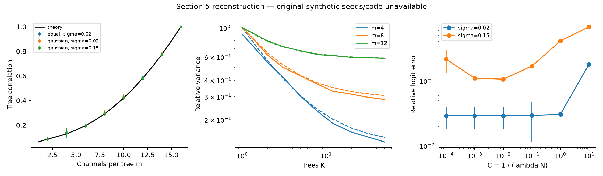

# Воспроизведение эксперимента «Риманов лес»

Эксперимент на ЭЭГ выполнен неизменённым опубликованным кодом автора. Синтетическая часть реконструирована по разделу 5: её исходники, seed и часть деталей не опубликованы. Таким образом, работа не является побитовым воспроизведением всей статьи.

## Таблица 2: измеренные результаты на PROTEUS

Метрика — сбалансированная точность, усреднённая по сессиям. Для LOSO указано среднее ± выборочное стандартное отклонение по восьми испытуемым.

| Модель | LOSO: статья | LOSO: повтор | Поздняя сессия: статья / повтор | Test: статья / повтор |
|---|---:|---:|---:|---:|
| Один касательный классификатор | 0.469 ± 0.114 | 0.469444 ± 0.114333 | 0.547 / 0.546962 | 0.455 / 0.454827 |
| Лес, m=12 | 0.511 ± 0.133 | 0.510785 ± 0.132683 | 0.614 / 0.613900 | — |
| Лес, m=20 | 0.531 ± 0.150 | 0.531430 ± 0.149736 | 0.669 / 0.668627 | 0.529 / 0.528622 |

**Все независимо пересчитанные значения моделей таблицы 2 совпали со статьёй при её точности представления — три знака после запятой.**

Расхождения указаны в `results/eeg/comparison.csv`; параметры не подбирались для совпадения с опубликованными числами.

## Что именно запускалось

- PROTEUS, NEMAR nm000290 v1.0.0; 41 канал, 4 секунды, 120 Гц.
- Исходная подготовка `bci.data`: notch 50/60 Гц, полоса 0.1–75 Гц до ресэмплинга, окно начинается через 1 секунду после подсказки.
- Разбиение по людям с random_state=33; train/val/test: 1521/379/755 окон, 6/2/2 человека.
- Baseline: полоса 4–40 Гц, C=0.01, prior_weight=5.
- Леса: 50 деревьев, m=12/20, шесть исходных полос, C=0.01, prior_weight=5, seed=0 (значение по умолчанию в опубликованных ноутбуках).
- 24 LOSO-задачи, 3 оценки поздней сессии, 2 оценки публичного test. Для test обучение только на train, как в исходных ноутбуках; m=12 на test не оценивался.
- В потоковом предсказании каждое окно подаётся отдельно; состояние сбрасывается между сессиями. Используется исходное накопительное среднее без добавления забывания.

Опубликованные результаты EEGNet/CTNet/REVE в статье использованы только как внешние ориентиры. Эти нейросети здесь не переобучались.

## Независимая проверка

- Все 29 файлов предсказаний повторно оценены кодом `benchmark_utils/metrics.py` официального соревнования; оценки совпали с сохранёнными при абсолютном допуске 1e-14.
- Проверены непересечение людей между исходными частями и между train/test каждого LOSO, число окон, форма, наличие классов и порядок окон.
- Дополнительно проверено совпадение пакетных и потоковых предсказаний исходных baseline/forest на искусственных окнах с несколькими потоками.
- Хеши подготовленных данных, версии библиотек и списки испытуемых: `results/eeg/manifest.json`.

## Таблица 1: реконструкция синтетического эксперимента

Здесь повторены 16 каналов, точные логарифмы ковариационных подматриц, 60 обучающих и 2000 тестовых окон, sigma=0.1, 50 деревьев, 10 задач и пять C от 0.01 до 100. Лучшее C выбирается по test, как явно сделано в статье; это оптимистичная оценка.

| Метод | m | Статья: среднее ± SD | Реконструкция: среднее ± SD |
|---|---:|---:|---:|
| Лес | 4 | 0.777 ± 0.037 | 0.78140 ± 0.02192 |
| Лес | 8 | 0.761 ± 0.021 | 0.76815 ± 0.01199 |
| Лес | 12 | 0.728 ± 0.024 | 0.73530 ± 0.01732 |
| Все каналы, логистическая регрессия | 16 | 0.702 ± 0.027 | 0.70255 ± 0.01666 |
| Структурированная регрессия | 4 | 0.794 ± 0.021 | 0.80520 ± 0.01301 |
| Структурированная регрессия | 8 | 0.761 ± 0.024 | 0.77290 ± 0.01488 |
| Структурированная регрессия | 12 | 0.730 ± 0.028 | 0.73535 ± 0.01594 |

Выбранные до запуска неопределённые детали, включая seed, число деревьев для рисунка 1а и способ усреднения дисперсии, перечислены в `results/synthetic/manifest.json`. Эти решения не выдаются за настройки автора.

## Рисунок 1: реконструкция

Максимальное абсолютное отклонение средней корреляции от теории: 0.01019. Максимальное абсолютное отклонение оценки относительной дисперсии от теории: 0.10219 (включая K=1; оценки получены ресэмплингом конечного пула).

При C=0.001 относительная ошибка эквивалентности леса и структурированной регрессии составила 2.92% при sigma=0.02 и 11.02% при sigma=0.15. В статье приведены примерно 1.3% и 10%; точное совпадение не получено.

## Ограничения точного воспроизведения

Большинство версий в requirements автора не закреплено; исходное окружение неизвестно. Текущие установленные версии закреплены в `environment.lock.txt`. Неизвестны исходные seed и часть процедур синтетики. На основании этих запусков нельзя утверждать, что вся статья воспроизведена один-в-один.

## Источники и файлы

- Статья: `../Riemannian_Forest (1).pdf`, раздел 5, страницы 14–17.
- Код автора: https://github.com/DorinDaniil/Brain-Decoding, commit 8d577af42619e5911cc5da8743c8a3e9b629014b.
- Код соревнования: https://github.com/neural-interfaces26/2026-competition, commit 2b53aec91c111f8b5423b6674f096c48cc1a99af.
- Данные: https://doi.org/10.82901/nemar.nm000290, лицензия CC-BY-4.0; Dreyer et al., PROTEUS BCI Bordeaux, v1.0.0.
- Команды повторного запуска: `README.md`.
- Все оценки по отдельным задачам: `results/eeg/fold_scores.csv`.
- Сырые данные реконструкции: `results/synthetic/*.csv`.

### Численные библиотеки

- numpy==2.5.4
- scipy==1.18.1
- scikit-learn==1.9.1
- pyriemann==0.12
- mne==1.13.2
- neuralbench==0.4.0
- pandas==3.1.0
- torch==2.15.0

### Дополнительная диагностика численного решателя

В отдельном запуске при C=0.001 уменьшение допуска tol с 1e-4 до 1e-10 дало относительные ошибки 1.38% и 10.28%. Это подтверждает чувствительность сравнения при сильной регуляризации к точности оптимизации. Основные результаты реконструкции выше оставлены без изменений; неизвестно, какой допуск использовал автор. Скрипт: scripts/diagnose_tolerance.py; данные: results/synthetic/tolerance_diagnostic.csv.

### Разбиение по испытуемым

- train: 1521 окон, 6 человек, IDs: Dreyer2026Proteus/P01, Dreyer2026Proteus/P02, Dreyer2026Proteus/P03, Dreyer2026Proteus/P06, Dreyer2026Proteus/P07, Dreyer2026Proteus/P10.
- val: 379 окон, 2 человек, IDs: Dreyer2026Proteus/P05, Dreyer2026Proteus/P08.
- test: 755 окон, 2 человек, IDs: Dreyer2026Proteus/P04, Dreyer2026Proteus/P09.
