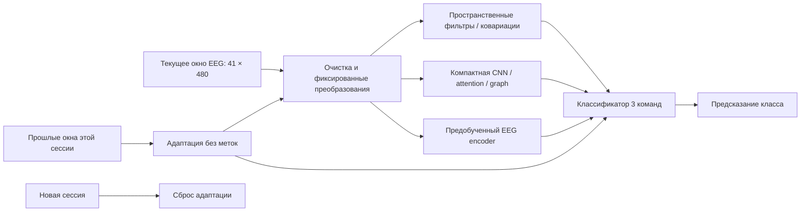

# Методы декодирования EEG и BCI: критический обзор научной литературы

**Дата поиска и проверки источников: 11 ноября 2026 года. Язык: русский. Контекст: Track 02 BCI Decoding / PROTEUS в `reproduction/`.**

Обзор объединяет классические методы обработки EEG, современные нейросети, self-supervised и foundation-модели, а также методы переноса между людьми и сессиями. Цель — объяснить, какие механизмы действительно исследованы в научной литературе и какие из них содержательно подходят для нашего соревнования. Публикация в сильной площадке подтверждает наличие рецензируемого исследования, но не означает, что метод доказанно лучше остальных на PROTEUS. Старые сильные методы включены как необходимые научные ориентиры; передовой фронт отдельно представлен работами 2024–2026 годов.

Под «детекцией EEG» здесь понимается обнаружение и распознавание информации **в уже зарегистрированном EEG**: выделение полезных компонентов и классификация когнитивной команды, события или состояния. Физические датчики и проектирование усилителей находятся вне обзора. Основная задача — не клиническая диагностика и не предсказание отдельных нейронных спайков. Методы стадирования сна, эмоционального состояния, ERP и SSVEP включены как смежные экспериментально подтверждённые направления; условия их переноса на mental-command BCI оговариваются явно.

## Как читать обзор

Каждая карточка содержит первичную публикацию, принцип метода, область экспериментальной проверки, ограничение и вывод о применимости к PROTEUS. Идентификаторы C обозначают классические методы, D — supervised deep learning, F — предобучение, T — перенос и адаптацию. Это каталог подходов, а не список независимых решений, которые следует одновременно включить в один ансамбль. Разные архитектуры одной семьи сохраняют собственные карточки, когда отличаются механизмом; изменение seed или ширины слоя отдельным подходом не считается. DeepConvNet и ShallowConvNet из одной статьи отмечены как две архитектуры, а не как две независимые публикации.

Основное ядро источников — официальные proceedings NeurIPS, ICLR, KDD и других конференций, а также журналы IEEE TBME, TNSRE, TNNLS, TII, TAFFC, JBHI, Journal of Neural Engineering, NeuroImage и Clinical Neurophysiology. Исторические и специализированные исключения подписаны собственными площадками: например, Frontiers, Neurocomputing и специализированные IEEE-конференции не переименованы в «топовую ML-конференцию». Воркшопная публикация не приравнивается к main conference; неподтверждённые журнальные версии препринтов не входят в основной подсчёт. Универсального объективного рейтинга «топовости» для всех этих дисциплин нет, поэтому точная площадка полезнее одного общего ярлыка.

Поиск выполнен по названиям методов, DOI и тематическим запросам: `EEG motor imagery spatial filtering`, `cross-subject EEG Riemannian adaptation`, `EEG compact convolution attention graph`, `EEG self-supervised foundation models`, `EEG test-time spectral normalization`. Для библиографической проверки использованы страницы издателей, proceedings, авторские полные тексты и записи PubMed; агрегаторы использовались как поисковые указатели, а не как основание технических выводов. У части IEEE/IOP/OpenReview-страниц автоматический доступ ограничен; тогда отдельно различаются прочитанный полный текст, доступная аннотация и проверенные метаданные. Глубина проверки указана в карточке при существенном ограничении и в сопутствующем JSON-аудите. Код и результаты всех работ в этом обзоре заново не воспроизводились.

Это **целевой критический обзор**, а не исчерпывающий systematic review по PRISMA. Нет фиктивных чисел просмотренных и исключённых статей; дата поиска не означает, что найдены все публикации до этой даты. Статус 2025–2026 годов проверялся по принятым публикациям, а не выводился из даты появления arXiv. Здесь нет общей таблицы «чужая accuracy → наш ожидаемый результат»: разные парадигмы, число классов, схемы калибровки и тестирования делают такую таблицу недостоверной.

## Нейрофизиологическая постановка: что именно извлекают методы

Важное различие проходит между вызванным потенциалом ERP, связанным по фазе с событием, и изменением мощности ритма ERD/ERS, которое не обязано быть фазово синхронизировано с подсказкой. Поэтому усреднение формы сигнала, спектральная энергия и ковариации отвечают на разные вопросы. Классическая работа Pfurtscheller и Lopes da Silva демонстрирует частотную и пространственную специфичность ERD/ERS в двигательных экспериментах; из неё нельзя вывести готовые однозначные нейромаркеры всех трёх команд PROTEUS. [Pfurtscheller, Lopes da Silva, *Event-related EEG/MEG synchronization and desynchronization: basic principles*, Clinical Neurophysiology, 1999](https://doi.org/10.1016/S1388-2457(99)00141-8).

Для motor imagery естественны пространственные и спектральные признаки сенсомоторных ритмов. Для mental subtraction и word generation следует допускать распределённые отличия мощности, временной динамики и межканальных зависимостей, а не заранее фиксировать один канал и одну полосу. Это **наша рабочая гипотеза о признаках**, а не установленная в обзоре специфическая нейрофизиологическая сигнатура PROTEUS. Аналогично функциональная связность между электродами не равна доказанной связи между источниками мозга: общий источник и объёмное проведение могут создавать корреляции без прямого взаимодействия областей.

Разница между классификационной полезностью и нейрофизиологической интерпретацией существенна. В экспериментальном multiverse-исследовании *How EEG preprocessing shapes decoding performance* показано, что артефакты, связанные с условиями эксперимента, могут улучшать decoding, а их удаление — снижать accuracy. Следовательно, высокий балл сам по себе не устанавливает, что модель использует мозговую активность нужного происхождения. Это аргумент для диагностических сравнений и проверки устойчивости, а не универсальное требование максимально очищать каждый сигнал. [Communications Biology, 2025](https://www.nature.com/articles/s42003-025-08464-3).

## Ограничения нашей задачи, определяющие применимость

PROTEUS даёт четыре секунды уже подготовленного сигнала: 41 scalp EEG-канал, 120 Гц, 480 отсчётов на канал, единицы — микровольты. Окно начинается через секунду после подсказки. Классы: кинестетическое воображение движения, мысленное вычитание и генерация слов. В локально подготовленных данных — 2655 окон от 10 людей; несколько сессий доступны только части участников. Это характеристики локальной подготовки, а не результаты библиографического поиска. См. [подготовку данных](../Brain-Decoding/track2_bci/bci/data.py), [отчёт воспроизведения](../REPORT.md).

На inference поступает одно окно за раз; порядок внутри participant-session хронологический. Меток и идентификаторов человека, интерфейса и run модель не получает. Любая адаптация использует только текущее и предыдущие окна текущей сессии; перед новой сессией модель возвращается к исходному состоянию. Весь уже поступивший четырёхсекундный фрагмент доступен целиком: внимание внутри него не нарушает контракт. Полный target-session whitening, пересчёт PCA по будущим окнам, персональная калибровка по истинным меткам и память между сессиями — другие условия эксперимента. Локальная версия [официального FAQ](../2026-competition/codabench/pages/scientific_faq_bci.md) задаёт этот контракт.

Основная метрика соревнования — balanced accuracy по participant × session × interface с равным усреднением ячеек. Наш текущий исследовательский приоритет — первая сессия полностью исключённого человека с равным весом людей; дополнительные сессии не должны увеличивать его основной вес. Конкретный протокол зафиксирован в [VALIDATION_PROTOCOL.md](../VALIDATION_PROTOCOL.md) и [описании 8/2 split](../custom_validation_20261110/PROTOCOL.md). Ни один опубликованный чужой LOSO-результат не заменяет проверку по этому протоколу.

*Схема — синтез обзора: блоки являются альтернативами и совместимыми компонентами, а не одной опубликованной архитектурой. Стрелка из истории не даёт доступа к будущему. Очистка не означает возможность запросить отсутствующие EOG/EMG.*

## Состав и навигация

В основном каталоге **62 подхода из 61 уникальной первичной публикации**: 18 классических, 16 supervised-архитектур, 16 SSL/foundation-подходов и 12 методов переноса или адаптации. Разница между числом методов и статей возникает из-за двух архитектур Schirrmeister et al. Три общих ML-метода — Tent, TTN и SWAD — явно выделены как перенос гипотез из computer vision; остальные карточки опираются на EEG/BCI либо непосредственно EEG-методологию. Непосредственно применимы к PROTEUS не все 62: смежные парадигмы намеренно размечены.

| Раздел | Карточки | Содержание |
|---|---|---|
| [Классические методы](#classical) | C01–C18 | Очистка, пространственные фильтры, геометрия, ERP/SSVEP |
| [Глубокие supervised-модели](#deep) | D01–D16 | Компактные CNN, TCN, attention, graph |
| [SSL и foundation-модели](#foundation) | F01–F16 | Предобучение, токенизация, большие EEG-энкодеры |
| [Перенос и адаптация](#transfer) | T01–T12 | Доменные сдвиги, нормализация и test-time learning |
| [Синтез и применимость](#synthesis) | — | Приоритеты для PROTEUS, математика, честная оценка |
| [Библиографический указатель](#bibliography) | Все 62 | Площадка, год, первичная ссылка |

## Классические методы обработки и декодирования EEG/BCI

Ниже различаются результаты исходных публикаций и гипотезы переноса на PROTEUS. Для PROTEUS рассматриваются три мысленные задачи, 41 скальповый канал и четырёхсекундные окна, начинающиеся через секунду после подсказки. Любое обучение предварительной обработки проводится внутри обучающей части; целевая адаптация использует только текущее и прошлые окна, со сбросом состояния для новой пары «участник — сессия». Метки целевой сессии и её будущие окна недоступны. Проверка переноса требует прежде всего новых участников на первой сессии с равным весом участников; опубликованные оценки других парадигм не являются оценками PROTEUS.

### C01. ICA для отделения артефактных источников

Анализ независимых компонент представляет многоканальную EEG как линейную смесь статистически независимых процессов. После оценки матрицы разделения компоненты с глазными, электрическими или мышечными признаками можно обнаруживать отдельно и исключать при обратном восстановлении сигнала. Это принципиально отличается от удаления загрязнённого временного интервала: полезная активность остальных компонент сохраняется. Delorme, Sejnowski и Makeig сравнили обнаружение искусственно добавленных артефактов в пространстве каналов и компонент, используя реальные фоновые EEG. Для большинства исследованных загрязнений компонентное представление облегчало обнаружение; для мышечных артефактов такого преимущества не получили. Следовательно, работа подтверждает определённый механизм очистки, а не универсальный рост точности любого декодера.

Для PROTEUS ICA полезна как проверяемая предварительная обработка перед спектральными или ковариационными признаками. Однако четырёхсекундное окно слишком коротко для надёжной независимой оценки большого разложения, а межличностная изменчивость ограничивает перенос матрицы разделения. Нужны обучение на разрешённых исходных данных, фиксированное правило выбора компонент и сравнение с обработкой без ICA. Оценивать разложение сразу по всей целевой сессии нельзя: это использует будущие наблюдения. **Источник:** Delorme A., Sejnowski T., Makeig S. [Enhanced detection of artifacts in EEG data using higher-order statistics and independent component analysis](https://doi.org/10.1016/j.neuroimage.2006.11.004). *NeuroImage*, 2007, 34(4):1443–1449.

### C02. Artifact Subspace Reconstruction: восстановление артефактных подпространств

Artifact Subspace Reconstruction, ASR, сопоставляет локальную ковариационную структуру EEG с относительно чистой опорной записью. Направления, в которых амплитуда значительно превышает ожидаемый уровень, рассматриваются как кратковременные загрязнения и реконструируются через допустимое подпространство. В отличие от обычного порога на отдельном электроде, решение учитывает совместное поведение каналов. Mullen и соавторы описали ASR в составе системы обработки носимой EEG с сухими электродами, включавшей также визуализацию источников, связность и классификацию когнитивного состояния. Их публикация подтверждает возможность включения метода в потоковую систему, но результаты всей системы нельзя приписывать одному модулю очистки.

В PROTEUS такой механизм интересен для подавления кратковременных выбросов, способных резко исказить ковариацию окна. Главная неопределённость связана с получением действительно чистой опоры у нового человека и сохранением полезных изменений мощности между тремя задачами. Слишком агрессивное восстановление может удалить сам различающий сигнал. Опору и пороги следует задавать по обучающим людям либо обновлять последовательно без будущих окон; состояние обязательно сбрасывается между участниками и сессиями. Нужна отдельная абляция очистки. **Источник:** Mullen T. R., Kothe C. A. E., Chi Y. M., Ojeda A., Kerth T., Makeig S., Jung T.-P., Cauwenberghs G. [Real-Time Neuroimaging and Cognitive Monitoring Using Wearable Dry EEG](https://doi.org/10.1109/TBME.2015.2481482). *IEEE Transactions on Biomedical Engineering*, 2015, 62(11):2553–2567.

### C03. Autoreject: автоматическая интерполяция плохих каналов в эпохах

Autoreject оценивает пороги размаха сигнала для отдельных датчиков, используя перекрёстную проверку и устойчивый критерий качества. В каждой эпохе определяются испорченные каналы; ограниченное число таких каналов восстанавливается интерполяцией, а чрезмерно загрязнённая эпоха исключается. Поэтому метод решает совместно задачи локального ремонта и отбора наблюдений, вместо одного глобального порога для всех электродов. Jas и соавторы проверили алгоритм на нескольких общедоступных наборах MEG и EEG, сопоставляя обработку с альтернативными процедурами и оценивая восстановление вызванных ответов. Эти результаты относятся прежде всего к качеству очистки и усреднённых ответов, а не к переносу классификатора мысленных задач.

Для PROTEUS полезна идея обучаемого правила интерполяции отдельных неисправных каналов при сохранении остальных. Однако обязательное предсказание для каждого окна не позволяет непосредственно перенести стратегию удаления эпох: необходим резервный классификатор или восстановление с контролем качества. Геометрия монтажа должна быть известна заранее, пороги подбираются только на обучающих людях. Подгонка порогов по полной целевой сессии нарушила бы хронологический протокол. Изменение доли исправленных каналов также стоит учитывать при анализе ошибок модели. **Источник:** Jas M., Engemann D. A., Bekhti Y., Raimondo F., Gramfort A. [Autoreject: Automated artifact rejection for MEG and EEG data](https://doi.org/10.1016/j.neuroimage.2017.06.030). *NeuroImage*, 2017, 159:417–429.

### C04. Регрессионное удаление глазных артефактов EMCP

Метод Gratton, Coles и Donchin оценивает распространение электрокулограммы на EEG и вычитает соответствующую составляющую из каждого канала. Существенная особенность EMCP состоит в предварительном удалении вариабельности, связанной со стимулом, при оценке коэффициентов: иначе регрессия могла бы принять настоящий вызванный ответ за глазной артефакт. Для морганий и движений глаз используются разные коэффициенты. В исходной работе скорректированные ERP лучше соответствовали опорному ответу, чем нескорректированные или случайно скорректированные записи; уменьшалась зависимость результата от выраженности глазной активности. Проверка касалась сохранения ERP и надёжности коррекции, а не современной межличностной классификации когнитивных состояний.

Вход PROTEUS содержит только 41 канал EEG: EOG и EMG при предсказании не предоставляются, поэтому обычная EOG-регрессия непосредственно недоступна. Использование фронтального EEG как заменителя EOG требует отдельного обоснования: там присутствует полезная мозговая активность при счёте или генерации слов. Исходная оценка по экспериментальной сессии также не переносится непосредственно в причинный режим. Возможные коэффициенты заменяющей модели следует фиксировать заранее либо оценивать по доступной истории, проверяя сохранность различающих спектральных признаков. Для текущего решения это метод сравнения требований к каналам, а не готовый модуль очистки. **Источник:** Gratton G., Coles M. G. H., Donchin E. [A new method for off-line removal of ocular artifact](https://doi.org/10.1016/0013-4694(83)90135-9). *Electroencephalography and Clinical Neurophysiology*, 1983, 55(4):468–484.

### C05. Поверхностный лапласиан на сферических сплайнах

Поверхностный лапласиан оценивает пространственную кривизну распределения потенциала и подчёркивает локальные источники относительно пространственно широких составляющих. Сферические сплайны Perrin и соавторов дают гладкую интерполяцию потенциалов по координатам электродов и позволяют вычислять приближение скальповой плотности тока. Это фиксированное геометрическое преобразование: ему не нужны метки классов или индивидуальное обучение дискриминативного фильтра. Первичная публикация обосновывает вычислительную процедуру и сопоставляет её с ранее применявшимися сплайнами. Она сообщает преимущества интерполяции и оценки плотности тока, но сама по себе не доказывает улучшения распознавания произвольной BCI-задачи или устойчивости между людьми.

В PROTEUS лапласиан может уменьшить влияние референса и широкого пространственного смешивания, выделив локальные сенсомоторные ритмы. Одновременно распределённые изменения при мысленном счёте и генерации слов могут ослабляться; поэтому нельзя заранее считать преобразование полезным всем трём классам. Требуются корректные координаты 41 электрода и осторожность на краях покрытия. Сглаживание выбирается по обучающим людям. Преимущество для протокола заключается в отсутствии необходимости оценивать преобразование по будущим окнам новой сессии. **Источник:** Perrin F., Pernier J., Bertrand O., Echallier J. F. [Spherical splines for scalp potential and current density mapping](https://doi.org/10.1016/0013-4694(89)90180-6). *Electroencephalography and Clinical Neurophysiology*, 1989, 72(2):184–187.

### C06. Shrinkage-LDA: регуляризация ковариации линейного декодера

Линейный дискриминантный анализ использует общую внутриклассовую ковариацию, обратная матрица которой становится неустойчивой при большом числе признаков и малом числе независимых проб. Shrinkage смешивает выборочную оценку с более простой структурой, уменьшая ошибку оценивания ценой контролируемого смещения. Это изменение статистической модели, а не подбор порога решения. Blankertz и соавторы подробно показали роль такой регуляризации при однопробной классификации ERP и связь весов декодера с пространственными фильтрами и различиями ответов. Статья имеет форму методического исследования с демонстрациями; её выводы о превосходстве регуляризованного варианта относятся к рассмотренным ERP-условиям, а не ко всем спектральным задачам.

В PROTEUS shrinkage-LDA уместна как простой декодер логарифмов мощности, CSP-признаков или векторов касательного пространства. Независимых людей здесь существенно меньше числа окон, поэтому ковариационная устойчивость особенно важна при переносе на нового участника. Однако регуляризация не устраняет сдвиг распределения между людьми и не превращает коррелирующие окна в независимые наблюдения. Коэффициент сжатия и набор признаков необходимо выбирать внутри проверки по людям, сохраняя одинаковый вес участников. Возможное преимущество должно подтверждаться именно на первых сессиях. **Источник:** Blankertz B., Lemm S., Treder M., Haufe S., Müller K.-R. [Single-trial analysis and classification of ERP components—A tutorial](https://doi.org/10.1016/j.neuroimage.2010.06.048). *NeuroImage*, 2011, 56(2):814–825.

### C07. Common Spatial Patterns: дискриминация по пространственной мощности

Common Spatial Patterns, CSP, ищет линейные проекции, максимизирующие отношение дисперсий двух классов. Обобщённое собственное разложение ковариационных матриц выделяет направления с противоположной выраженностью мощности, а логарифмы дисперсий проекций становятся компактными признаками. Метод использует различия второго порядка и хорошо согласуется с изменениями сенсомоторных ритмов при моторном воображении. Ramoser, Müller-Gerking и Pfurtscheller проверили его на различении воображаемых движений левой и правой руки у трёх испытуемых. Эта работа стала убедительной демонстрацией пространственно адаптивной обработки, однако небольшая выборка и индивидуальный режим обучения ограничивают выводы о переносе на ранее неизвестного человека.

Для PROTEUS CSP является содержательным базовым методом, поскольку один класс связан с кинестетическим воображением, а остальные могут иметь иной профиль пространственной мощности. Исходная постановка двухклассовая, поэтому для трёх задач нужна заранее заданная схема попарного разделения либо «один против остальных». Фильтры чувствительны к артефактам и индивидуальной топографии. Их следует оценивать только на обучающих людях, проверяя перенос и число компонент внутри вложенной валидации, без скрытой персональной калибровки целевого человека. **Источник:** Ramoser H., Müller-Gerking J., Pfurtscheller G. [Optimal spatial filtering of single trial EEG during imagined hand movement](https://doi.org/10.1109/86.895946). *IEEE Transactions on Rehabilitation Engineering*, 2000, 8(4):441–446.

### C08. Regularized CSP: структурные ограничения пространственных фильтров

Regularized CSP, RCSP, изменяет оптимизацию CSP, вводя априорные ограничения на ковариации или пространственные фильтры. Такое ограничение уменьшает вероятность того, что экстремальное отношение дисперсий отражает небольшой случайный выброс или переобучение. Lotte и Guan предложили единый теоретический язык для существующих регуляризованных вариантов и несколько новых алгоритмов, включая использование структурной информации. В сравнении на данных BCI-соревнований от семнадцати людей некоторые варианты превосходили обычный CSP и давали более правдоподобные пространственные паттерны. Это сравнительное свидетельство против безусловного использования нерегуляризованного фильтра, но результаты различались между вариантами и не устанавливают единственный оптимальный вид регуляризации.

В PROTEUS RCSP особенно мотивирован малым числом публичных участников и различием трёх задач. Предпочтительны простые ограничения, выбранные по исключённым людям, а не по случайно перемешанным окнам. Априорное объединение ковариаций разных людей может уменьшить дисперсию, но одновременно стереть полезную индивидуальную структуру; переносимый выигрыш необходимо измерять отдельно. RCSP следует рассматривать как самостоятельную стратегию контроля сложности CSP, а не считать каждый коэффициент регуляризации отдельным методом. Никакая целевая метка при оценке фильтра недоступна. **Источник:** Lotte F., Guan C. [Regularizing common spatial patterns to improve BCI designs: unified theory and new algorithms](https://doi.org/10.1109/TBME.2010.2082539). *IEEE Transactions on Biomedical Engineering*, 2011, 58(2):355–362.

### C09. Filter Bank CSP: совместный выбор частот и пространственных признаков

Filter Bank Common Spatial Pattern, FBCSP, обрабатывает EEG банком полосовых фильтров, отдельно строит CSP-признаки в каждой полосе и отбирает наиболее информативные признаки для классификации. Тем самым частотная локализация различающей активности становится частью обучения: заранее фиксированная широкая полоса не обязана одинаково подходить всем людям и задачам. Ang и соавторы подробно описали конвейер и его многоклассовые расширения, проверив их на наборах 2a и 2b BCI Competition IV. Опубликованное сравнение относится к моторному воображению и соответствующим схемам разделения данных. Оно подтверждает работоспособность сочетания банка и отбора признаков, но не равнозначно проверке обобщения на нового участника.

Для PROTEUS банк позволяет совместно учитывать сенсомоторные, лобные и другие ритмические признаки мысленных задач в пределах частот, доступных при 120 Гц. Цена такого расширения — рост размерности и риска выбора случайно удачной полосы на десяти людях. Поэтому частоты, число признаков и многоклассовая схема должны настраиваться совместно во внутренней проверке по участникам. Следует сравнивать FBCSP с простыми полосовыми мощностями, чтобы отделить пользу пространственной оптимизации от самого банка частот. **Источник:** Ang K. K., Chin Z. Y., Wang C., Guan C., Zhang H. [Filter Bank Common Spatial Pattern Algorithm on BCI Competition IV Datasets 2a and 2b](https://doi.org/10.3389/fnins.2012.00039). *Frontiers in Neuroscience*, 2012, 6:39.

### C10. Stationary CSP: штраф за нестационарные подпространства

Stationary CSP, sCSP, дополняет различение классов требованием устойчивости пространственного представления при изменении статистики записи. При обучении оцениваются направления, связанные с нестационарностью, после чего CSP регуляризуется в сторону более стационарных подпространств. В отличие от обычного сжатия ковариации, ограничение имеет конкретный смысл: подавить изменения, не совпадающие с устойчивым различием задач. Samek и соавторы сравнили sCSP с альтернативами на нескольких наборах моторного воображения и проанализировали причины улучшения. Работа показывает, что явный учёт дрейфа бывает полезен, особенно при затруднённом управлении BCI, но не гарантирует сохранения различимости при любом типе сдвига распределения.

Для PROTEUS это мотивирует извлечение устойчивых направлений по разрешённым обучающим сессиям и людям. Однако различия между людьми, настоящие различия задач и артефакты могут занимать пересекающиеся подпространства; удаление всего изменчивого сигнала способно ухудшить классификацию. Формирование временных блоков для оценки стационарности должно сохранять последовательность и доступность наблюдений. Полная целевая сессия не может служить скрытым источником оценки дрейфа. Предлагаемую устойчивость необходимо проверять по новым людям, отдельно от внутрисессионной адаптации. **Источник:** Samek W., Vidaurre C., Müller K.-R., Kawanabe M. [Stationary common spatial patterns for brain–computer interfacing](https://doi.org/10.1088/1741-2560/9/2/026013). *Journal of Neural Engineering*, 2012, 9(2):026013.

### C11. Common Spatio-Spectral Patterns через временное вложение

Common Spatio-Spectral Patterns, CSSP, расширяет пространство каналов задержанными копиями EEG и применяет дискриминативную пространственную оптимизацию к этому вложению. Линейная комбинация текущих и задержанных отсчётов одновременно задаёт пространственное смешивание и короткую временную фильтрацию, позволяя индивидуально выделять частотные составляющие. В отличие от FBCSP, частотная характеристика здесь возникает внутри совместной оптимизации, а не через независимые фиксированные полосы. Lemm и соавторы проверили такое расширение CSP на записях воображаемых движений конечностей и сообщили улучшение передачи информации на пробу относительно исходного метода. Область доказательности ограничена соответствующими записями и режимами обучения, без автоматического вывода о межличностном переносе.

В PROTEUS CSSP может учесть различие временно-спектральных характеристик трёх задач при умеренных вычислительных затратах. Однако временное вложение увеличивает число признаков и усиливает проблему малого числа независимых участников. Задержки должны определяться относительно частоты 120 Гц; использование отсчётов внутри текущего доступного окна допустимо, обращение к следующим окнам — нет. Регуляризацию, задержки и число компонент выбирают по обучающим людям. Сравнение с CSP и FBCSP покажет, нужна ли действительно совместная временная оптимизация. **Источник:** Lemm S., Blankertz B., Curio G., Müller K.-R. [Spatio-spectral filters for improving the classification of single trial EEG](https://doi.org/10.1109/TBME.2005.851521). *IEEE Transactions on Biomedical Engineering*, 2005, 52(9):1541–1548.

### C12. Spatio-Spectral Decomposition для выделения осцилляций

Spatio-Spectral Decomposition, SSD, максимизирует мощность пространственной проекции в интересующей частотной полосе относительно мощности в соседних полосах. Обобщённое собственное разложение выделяет компоненты с выраженным спектральным пиком, не используя метки классов. Поэтому SSD решает задачу повышения отношения осцилляторного сигнала к фону, тогда как CSP ищет именно различия задач. Nikulin, Nolte и Curio представили моделирование и реальные EEG, показав возможность выделять осцилляции при перекрытии источников и низком отношении сигнала к шуму. Их экспериментальная проверка на реальных записях касалась прежде всего ритмической активности покоя; улучшение классификации мысленных задач непосредственно из неё не следует.

В PROTEUS SSD можно применять перед оценкой мощности или ковариации, особенно если на обучающих людях обнаруживаются воспроизводимые сенсомоторные пики. Но наиболее выраженная осцилляция не обязательно наиболее различающая: сильный затылочный альфа-ритм может отражать состояние зрения, а не нужный класс. Подбор полосы и числа компонент требует внешней проверки переноса. Независимая оценка SSD на каждом коротком окне нестабильна, а оценка по всей целевой сессии нарушает хронологию; разумнее фиксированное обучение или последовательная адаптация. **Источник:** Nikulin V. V., Nolte G., Curio G. [A novel method for reliable and fast extraction of neuronal EEG/MEG oscillations on the basis of spatio-spectral decomposition](https://doi.org/10.1016/j.neuroimage.2011.01.057). *NeuroImage*, 2011, 55(4):1528–1535.

### C13. Source Power Comodulation: извлечение источников для регрессии

Source Power Comodulation, SPoC, ищет пространственные компоненты, мощность которых совместно изменяется с заданной непрерывной целевой переменной. В оптимизации используется ковариация EEG, взвешенная значениями этой переменной; это позволяет направить разделение источников на поведенчески значимый процесс. В отличие от ICA или SSD, нужная связь входит непосредственно в критерий обучения. Dähne и соавторы проверили подход в реалистичном моделировании и на EEG при слуховой стимуляции, выделяя компоненты, мощность которых связана с интенсивностью входного сигнала. Эти результаты подтверждают принцип контролируемого извлечения мощностных источников для регрессии; они не являются прямым доказательством эффективности для произвольной многоклассовой классификации.

В PROTEUS непрерывная поведенческая переменная не заявлена, поэтому исходный SPoC не следует включать как готовый трёхклассовый декодер. Полезность здесь методологическая: пространственные представления можно обучать под осмысленную зависимость мощности, если дополнительная разрешённая цель действительно имеется. Замена категорий числами один, два и три навязывает искусственный порядок и требует отдельного обоснования. Без такого обоснования CSP или римановы признаки являются более прямыми базовыми решениями. Любые дополнительные цели могут поступать только из разрешённой обучающей части. **Источник:** Dähne S., Meinecke F. C., Haufe S., Höhne J., Tangermann M., Müller K.-R., Nikulin V. V. [SPoC: A novel framework for relating the amplitude of neuronal oscillations to behaviorally relevant parameters](https://doi.org/10.1016/j.neuroimage.2013.07.079). *NeuroImage*, 2014, 86:111–122.

### C14. Риманова классификация ковариаций: MDM и касательное представление

Ковариация многоканального окна является симметричной положительно определённой матрицей, поэтому её можно классифицировать с учётом геометрии соответствующего многообразия. Minimum Distance to Mean, MDM, относит окно к ближайшему риманову среднему класса. В той же работе Barachant и соавторы представили отображение в касательное пространство с последующим линейным дискриминантом. Вместо выбора небольшого числа CSP-проекций этот подход использует совместную структуру каналов. Сравнение на многоклассовом моторном воображении подтвердило жизнеспособность обоих способов, однако результаты получены в конкретной BCI-парадигме. Здесь они рассматриваются как единое геометрическое семейство, а не как доказательство автоматической инвариантности к смене человека.

Для PROTEUS ковариации четырёхсекундных окон дают компактное представление мощности и линейных пространственных зависимостей. MDM служит особенно прозрачной отправной точкой, тогда как касательные признаки позволяют обучать более гибкую границу. При 41 канале размерность касательного пространства существенна, поэтому нужны сжатие ковариации и регуляризация декодера. Референсное среднее вычисляется только по обучающим данным либо доступной истории. Среднее полной целевой сессии скрыто использовало бы будущее. Стабильность на новом участнике проверяется отдельно. **Источник:** Barachant A., Bonnet S., Congedo M., Jutten C. [Multiclass brain-computer interface classification by Riemannian geometry](https://doi.org/10.1109/TBME.2011.2172210). *IEEE Transactions on Biomedical Engineering*, 2012, 59(4):920–928.

### C15. Риманово ядро и SVM для ковариационных признаков

Риманово ядро определяет сходство ковариаций через логарифмическое отображение относительно опорной положительно определённой матрицы. После такого определения метод опорных векторов может строить дискриминативную границу, сохраняя геометрический смысл входного представления. Barachant и соавторы вывели соответствующее ядро, обосновали его через скалярное произведение в касательном пространстве и сравнили несколько ядер на данных моторного воображения BCI-соревнования. Это отличается от MDM наличием обучаемой границы и опорных примеров. При этом базовое геометрическое ядро не следует автоматически называть нелинейным относительно касательных признаков: его выразительность зависит от конкретной последующей конструкции, которую необходимо явно указывать.

В PROTEUS такой подход позволяет проверить, ограничивает ли качество простая модель классов вокруг римановых средних. Возможная польза связана с дискриминативным обучением на ковариациях трёх задач, однако настройка регуляризации SVM легко переобучается на немногих людях. Опорную матрицу, масштабирование и параметры выбирают только внутри обучения; запрещено вычислять общую опору по будущим целевым окнам. Для интерпретации результата необходимо сравнение с MDM и линейным декодером тех же касательных признаков. Сам источник опубликован вне специализированного EEG-журнала, в *Neurocomputing*. **Источник:** Barachant A., Bonnet S., Congedo M., Jutten C. [Classification of covariance matrices using a Riemannian-based kernel for BCI applications](https://doi.org/10.1016/j.neucom.2012.12.039). *Neurocomputing*, 2013, 112:172–178.

### C16. xDAWN: пространственное усиление событийных потенциалов

xDAWN строит пространственные фильтры, усиливающие воспроизводимый вызванный ответ относительно общей активности EEG. В модели учитываются времена предъявления стимулов и соответствующая форма ответа; проекция в небольшое подпространство повышает его выраженность перед классификацией. В отличие от CSP, основной объект здесь — событийно синхронизированный потенциал, а не различие стационарных дисперсий двух классов. Rivet и соавторы проверили алгоритм на P300-интерфейсе набора текста с записями трёх людей и байесовским линейным дискриминантом. Это первичное свидетельство эффективности пространственного усиления в P300-парадигме. Оно не доказывает, что такие же фильтры выделяют устойчивое выполнение мысленного счёта, генерации слов или моторного воображения.

В PROTEUS окна начинаются через секунду после подсказки, поэтому значительная часть ранних событийных ответов уже отсутствует. Кроме того, при предсказании нет целевых меток, необходимых для обучения классовых шаблонов. xDAWN может служить ориентиром для исследования разрешённых событийных признаков только при наличии подходящей временной разметки и обучающих данных. Следует проверить, не распознаётся ли сама подсказка вместо мысленного действия. Без такого основания приоритет имеют мощностные и ковариационные модели, лучше соответствующие имеющимся четырёхсекундным фрагментам. **Источник:** Rivet B., Souloumiac A., Attina V., Gibert G. [xDAWN algorithm to enhance evoked potentials: application to brain-computer interface](https://doi.org/10.1109/TBME.2009.2012869). *IEEE Transactions on Biomedical Engineering*, 2009, 56(8):2035–2043.

### C17. Canonical Correlation Analysis для распознавания SSVEP

В SSVEP-интерфейсе зрительные стимулы мерцают с известными частотами, а вызванная EEG содержит соответствующие периодические составляющие. Canonical Correlation Analysis, CCA, ищет линейные комбинации многоканального сигнала и синусоидальных опор, максимально коррелирующие между собой. Для каждой частоты строится свой набор опор, включая гармоники, после чего выбирается наиболее согласованный вариант. Lin и соавторы показали преимущество такого распознавания над использованной ими оценкой спектра через FFT. Механизм сочетает пространственное объединение каналов и сильную известную временную структуру стимула. Доказательность относится именно к распознаванию частот стационарных зрительных вызванных ответов, а не к произвольному определению мысленной команды.

В PROTEUS нет заявленной системы мерцающих стимулов с частотным кодированием трёх задач. Поэтому стандартная SSVEP-CCA непосредственно к нему неприменима, а перенос опубликованной эффективности был бы необоснованным. Полезен общий принцип согласования пространственного сигнала с физически обоснованной опорой, но создание такой опоры для внутренних задач является уже новой гипотезой. Обычная визуальная подсказка не создаёт автоматически частотного кода класса. Метод включён в обзор для разграничения BCI-парадигм и требований к доступным экспериментальным данным. **Источник:** Lin Z., Zhang C., Wu W., Gao X. [Frequency recognition based on canonical correlation analysis for SSVEP-based BCIs](https://doi.org/10.1109/TBME.2006.889197). *IEEE Transactions on Biomedical Engineering*, 2007, 54(6):1172–1176.

### C18. Task-Related Component Analysis для воспроизводимых SSVEP

Task-Related Component Analysis, TRCA, оценивает пространственную проекцию, максимизирующую воспроизводимость сигнала между повторными пробами одного стимула. Общая событийно согласованная составляющая усиливается, а несогласованная фоновая EEG ослабляется. Затем ответ сравнивается с обученными шаблонами; ансамбль фильтров объединяет информацию разных стимулов. Nakanishi и соавторы оценили подход на многоклассовых SSVEP-записях и в онлайн-интерфейсе набора текста, сопоставив его с расширенным CCA. Работа подтверждает пользу межпробной воспроизводимости в условиях известной зрительной стимуляции и персональной калибровки. Высокая скорость такого интерфейса относится к его полному протоколу, включая стимулы, длительности и способ выбора символов, поэтому не переносится на другую парадигму автоматически.

Для PROTEUS главный барьер — отсутствие ожидаемой фазово воспроизводимой SSVEP-структуры при трёх внутренних мысленных задачах. Различение их по мощности не эквивалентно воспроизведению одного временного шаблона. Поэтому готовый SSVEP-TRCA не является обоснованным основным декодером, особенно без размеченной персональной калибровки. Метод полезен как пример обучения пространственного фильтра под конкретное свойство сигнала. Любая адаптация идеи потребует новой проверки: устойчивый результат между пробами может отражать визуальную подсказку или артефакт, а не выполнение задачи. **Источник:** Nakanishi M., Wang Y., Chen X., Wang Y.-T., Gao X., Jung T.-P. [Enhancing Detection of SSVEPs for a High-Speed Brain Speller Using Task-Related Component Analysis](https://doi.org/10.1109/TBME.2017.2694818). *IEEE Transactions on Biomedical Engineering*, 2018, 65(1):104–112.

## Глубокие supervised-подходы к EEG/BCI: 16 опубликованных архитектур

Срез библиографической проверки: 11 ноября 2026 года. В основном перечне 16 архитектур из 15 публикаций: DeepConvNet и ShallowConvNet описаны в одной статье. Это подборка ведущих профильных журналов, а не утверждение, что все работы опубликованы на NeurIPS/ICML/ICLR. IEEE SMC у EEG-TCNet обозначена отдельно как рецензируемая профильная конференция. Численные выигрыши между несопоставимыми протоколами не переносятся в PROTEUS. Применение к PROTEUS в каждом пункте — предлагаемая исследовательская адаптация, если прямо не сказано иное.

Здесь PROTEUS рассматривается как декодирование трёх команд — моторное воображение, мысленное вычитание и генерация слов — по четырёхсекундному окну из 41 EEG-канала при 120 Гц. Предлагаемые эксперименты сохраняют исключение участников, последовательную обработку B=1, сброс состояния между сессиями и отсутствие целевых меток, будущих окон и запрещённых метаданных. Эти ограничения задаются локальным экспериментальным контрактом и не приписываются перечисленным статьям.

Библиографическое примечание о FBCNet: полная работа Mane R., Chew E., Chua K., Ang K. K., Robinson N., Vinod A. P., Lee S.-W., Guan C. (2021), [FBCNet: A Multi-view Convolutional Neural Network for Brain-Computer Interface](https://arxiv.org/abs/2104.01233), найдена как препринт. [Институциональная запись HKUST](https://researchportal.hkust.edu.hk/en/publications/fbcnet-a-filter-bank-convolutional-neural-network-for-motor-image-2/) отмечает отдельный вариант о хроническом инсульте как peer-reviewed conference paper, но называет площадку Unknown Event. Поэтому FBCNet не включена в число проверенных журнальных подходов. Содержательно важны её filter-bank представление, обучаемая пространственная фильтрация и variance-агрегация; близкое направление с надёжно установленной журнальной публикацией представлено FBMSNet, но эти модели не отождествляются.

### D01. EEGNet

EEGNet разделяет обучение временных фильтров, частотно-зависимых пространственных проекций и компактного смешивания признаков посредством depthwise и separable convolutions. Это сильный исходный ориентир для небольших EEG-выборок: ограничение числа параметров задаётся архитектурой, а не только штрафом в функции потерь. В первичной работе проверены четыре BCI-парадигмы — P300, ERN, MRCP и сенсомоторные ритмы — во внутрисубъектных и межсубъектных экспериментах. Такая широта поддерживает выбор универсального baseline, но не доказывает устойчивость к любому сдвигу распределения.

Для PROTEUS предлагается сохранить факторизацию свёрток, заменить выход на три класса и пересчитать длины временных ядер в секундах при 120 Гц. Все 41 канала должны иметь фиксированный порядок, а нормализацию следует оценивать только по обучающим данным. Компактность не устраняет риск обучения на особенностях участника и оборудования. Поэтому сравнение требует исключения участников целиком, нескольких seed и средней balanced accuracy по установленным ячейкам оценки. Обновление BatchNorm по будущей части тестовой сессии недопустимо; при B=1 разумен первоначальный вариант с замороженной статистикой. Источник: Lawhern V. J., Solon A. J., Waytowich N. R., Gordon S. M., Hung C. P., Lance B. J. (2018). [EEGNet: a compact convolutional neural network for EEG-based brain–computer interfaces](https://doi.org/10.1088/1741-2552/aace8c). Journal of Neural Engineering, 15(5), 056013.

### D02. DeepConvNet

DeepConvNet строит иерархию признаков после раздельной временной и пространственной свёрток: последующие блоки увеличивают сложность временного представления. В работе Schirrmeister и соавторов этот вариант сопоставлен с FBCSP на BCI Competition IV-2a и наборе High-Gamma, включающем двигательные задачи. Исследуются обучение на вырезках и визуализация используемой информации. Важна возможность извлекать признаки без обязательного сведения каждого окна к одной ковариационной матрице; преимущество конкретной иерархии остаётся зависимым от частотного диапазона и экспериментального протокола.

На PROTEUS глубокий вариант проверяет гипотезу о пользе временной структуры поверх пространственного смешивания. Следует ограничить ширину слоёв, согласовать receptive field с четырьмя секундами и сравнить обучение на целых окнах с вырезками только внутри обучающей части. Соседние вырезки одного испытания нельзя разносить между train и validation. Малое число участников делает большую ёмкость существенным риском, поэтому архитектурное превосходство оценивается на исключённых людях. DeepConvNet и следующий ShallowConvNet считаются двумя опубликованными архитектурами, но происходят из одного исследования и не являются независимыми экспериментальными подтверждениями. Источник: Schirrmeister R. T., Springenberg J. T., Fiederer L. D. J., Glasstetter M., Eggensperger K., Tangermann M., Hutter F., Burgard W., Ball T. (2017). [Deep learning with convolutional neural networks for EEG decoding and visualization](https://doi.org/10.1002/hbm.23730). Human Brain Mapping, 38(11), 5391–5420.

### D03. ShallowConvNet

ShallowConvNet вводит полезный для EEG индуктивный сдвиг: временная и пространственная фильтрация сочетаются с возведением в квадрат, усреднением и логарифмированием. Получается обучаемый аналог извлечения мощности ритмов, близкий по назначению к CSP-признакам. В общей с DeepConvNet статье он исследуется на BCI Competition IV-2a и High-Gamma; результаты показывают практическую значимость неглубокой специализированной структуры. Следовательно, глубина сама по себе не является необходимым условием эффективного декодирования EEG, особенно когда целевая информация выражена в мощности.

Для PROTEUS это содержательный конкурент римановым признакам: обе модели используют второпорядковую информацию, но ShallowConvNet обучает её извлечение совместно с классификатором. Предлагается сохранить логарифмическую агрегацию, проверить ширину временного pooling и сопоставить общую спектральную полосу с несколькими заранее заданными диапазонами. Ограничение заключается в ослаблении информации о порядке событий внутри окна. Мысленный счёт и генерация слов могут требовать иных признаков, чем моторное воображение; это проверяемая гипотеза для исключённых участников, а не установленное свойство модели. Общий источник с D02 учитывается при подсчёте независимости литературы. Источник: Schirrmeister R. T., Springenberg J. T., Fiederer L. D. J., Glasstetter M., Eggensperger K., Tangermann M., Hutter F., Burgard W., Ball T. (2017). [Deep learning with convolutional neural networks for EEG decoding and visualization](https://doi.org/10.1002/hbm.23730). Human Brain Mapping, 38(11), 5391–5420.

### D04. FBMSNet

FBMSNet объединяет банк частотных фильтров, многомасштабные временные depthwise-свёртки и пространственную фильтрацию. Дополнительный center loss совместно с cross-entropy стягивает представления одного класса и разделяет разные классы. Первичная работа в IEEE TBME проверяет модель на BCI Competition IV-2a и OpenBMI, то есть на моторном воображении с различным числом классов. Это более строгий журнальный источник для семейства нейросетей с filter-bank представлением; он не подменяет отдельную библиографическую проверку FBCNet и не даёт прямых результатов на PROTEUS.

Для PROTEUS предлагается проверить, помогает ли явное разбиение спектра выделять различные мысленные команды при малой выборке. Полосы должны соответствовать частоте Найквиста 60 Гц после ресемплинга, а их выбор проводится на обучающих участниках. Center loss нуждается в отдельной абляции: компактность класса может подавлять устойчивые, но неоднородные стратегии выполнения задания разными людьми. Рекомендуется сравнение с тем же backbone без дополнительной функции потерь и без многомасштабных ветвей. Последовательное применение к уже полученному четырёхсекундному окну не требует накопления будущих испытаний или меток новой сессии. Источник: Liu K., Yang M., Yu Z., Wang G., Wu W. (2023). [FBMSNet: A Filter-Bank Multi-Scale Convolutional Neural Network for EEG-Based Motor Imagery Decoding](https://doi.org/10.1109/TBME.2022.3193277). IEEE Transactions on Biomedical Engineering, 70(2), 436–445.

### D05. EEG-TCNet

EEG-TCNet дополняет компактное EEGNet-подобное извлечение признаков временной свёрточной сетью с дилатациями и остаточными связями. Такой блок расширяет временной контекст без рекуррентного прохода и предназначен для экономичного исполнения на встроенных устройствах. Первичная конференционная работа включает BCI Competition IV-2a и проверку на нескольких MI-наборах через MOABB. Это рецензируемая IEEE SMC, а не ведущая общая ML-конференция; широта проверки полезна, но результаты индивидуального подбора параметров необходимо отделять от результатов общей архитектуры.

Для PROTEUS предлагается сохранить малую ширину сети, пересчитать дилатации и pooling для последовательности длиной 480 отсчётов и обучать общие параметры без доступа к меткам исключённого участника. Следует сравнить модель с исходным EEGNet при близком числе параметров, чтобы отделить эффект временного контекста от ёмкости. Каузальность TCN внутри окна не означает автоматически корректную потоковую адаптацию между окнами. На первом этапе состояние и статистика нормализации фиксируются, а любые последующие обновления используют только уже наблюдённые окна текущей сессии. Главная проверка — перенос между участниками, а не только вычислительная компактность. Источник: Ingolfsson T. M., Hersche M., Wang X., Kobayashi N., Cavigelli L., Benini L. (2020). [EEG-TCNet: An Accurate Temporal Convolutional Network for Embedded Motor-Imagery Brain–Machine Interfaces](https://doi.org/10.1109/SMC42975.2020.9283028). IEEE International Conference on Systems, Man, and Cybernetics (SMC).

### D06. ATCNet

ATCNet соединяет физиологически мотивированную свёрточную обработку, скользящие представления внутри испытания, многоголовое self-attention и временные свёрточные блоки. Attention выделяет информативные отношения между признаками, а TCN обрабатывает их временную динамику. В статье IEEE TII архитектура предложена для классификации моторного воображения; она относится к направлению EEG-TCNet, но добавляет отдельный механизм внимания и агрегацию нескольких представлений. Слово physics-informed здесь описывает предметно ориентированное проектирование: его нельзя автоматически понимать как решение физических дифференциальных уравнений с жёсткими ограничениями.

На PROTEUS полезно проверить, различаются ли информативные участки четырёхсекундного окна между моторным воображением, счётом и словами. Число внутренних окон и голов внимания следует ограничить по обучающей валидации; необходимы абляции attention и скользящей агрегации при общем протоколе. Главный риск — дополнительные ветви могут запоминать особенности субъектов, а не переносимые паттерны. Разрешено обрабатывать всё уже поступившее окно, но нельзя объединять его с будущими испытаниями тестовой сессии. Поэтому преимущества в обычном MI-benchmark рассматриваются как основание для эксперимента, а не как доказательство устойчивости к смене контекста. Источник: Altaheri H., Muhammad G., Alsulaiman M. (2023). [Physics-Informed Attention Temporal Convolutional Network for EEG-Based Motor Imagery Classification](https://doi.org/10.1109/TII.2022.3197419). IEEE Transactions on Industrial Informatics, 19(2), 2249–2258.

### D07. EEG Conformer

EEG Conformer сначала строит локальные временные и пространственные признаки свёртками, затем моделирует глобальные связи между полученными временными токенами посредством self-attention. Классификационная голова использует объединённое представление, а предложенная визуализация проецирует значимость признаков на топографию головы. Исследование в IEEE TNSRE включает три общедоступных набора моторного воображения и распознавания эмоций. Архитектурная идея состоит в разделении локального извлечения признаков и глобального взаимодействия; сам по себе Transformer не доказывает биологическую интерпретируемость найденных зависимостей.

Для PROTEUS необходимо согласовать размер временных токенов с 120 Гц и 480 отсчётами, сохранив достаточно токенов для анализа динамики. Предлагается сравнение с тем же свёрточным front-end без attention и с меньшей глубиной Transformer. На небольшом числе участников основное ограничение — переобучение глобальных связей и чувствительность к регуляризации. Карты внимания полезны как диагностика, но причинную значимость электродов проверяют маскированием или перестановочными экспериментами на отложенной выборке. Полное внимание внутри уже полученного окна совместимо с потоковым интерфейсом; внимание к ещё не поступившим окнам — отдельное нарушение протокола. Источник: Song Y., Zheng Q., Liu B., Gao X. (2023). [EEG Conformer: Convolutional Transformer for EEG Decoding and Visualization](https://doi.org/10.1109/TNSRE.2022.3230250). IEEE Transactions on Neural Systems and Rehabilitation Engineering, 31, 710–719.

### D08. TSception

TSception использует временные свёртки нескольких масштабов, пространственные операции с учётом полушарий и последующее объединение признаков. Предметная предпосылка заключается в том, что эмоциональное состояние проявляется одновременно в динамике ритмов и асимметрии пространственной активности. Журнальная версия в IEEE TAFFC оценивает распознавание эмоций, включая DEAP. Работа интересна как компактная архитектура с явно заданными временными и пространственными индуктивными предположениями. Однако успешность предположения об асимметрии в эмоциональных задачах не устанавливает его пригодность для произвольных команд BCI.

Для PROTEUS предлагается построить симметричный порядок доступных электродов и отделить срединные каналы, документируя все исключения из исходной схемы. Затем следует сравнить полушарное ветвление с обычной пространственной свёрткой при одинаковом обучении. Слова, счёт и моторное воображение могут иметь разные пространственные организации, поэтому асимметрия остаётся проверяемой гипотезой. Полезно сохранить многомасштабную временную часть даже при отрицательном результате пространственной абляции. Разбиение должно исключать людей и связанные испытания целиком: короткие фрагменты эмоциональных записей и независимые команды PROTEUS образуют разные статистические единицы. Журнальный год 2023 следует отличать от early access 2022. Источник: Ding Y., Robinson N., Zhang S., Zeng Q., Guan C. (2023). [TSception: Capturing Temporal Dynamics and Spatial Asymmetry From EEG for Emotion Recognition](https://doi.org/10.1109/TAFFC.2022.3169001). IEEE Transactions on Affective Computing, 14(3), 2238–2250.

### D09. DGCNN

DGCNN представляет электроды узлами графа и обучает матрицу смежности вместе с графовыми фильтрами и классификатором. В отличие от фиксированной регулярной сетки CNN, модель явно параметризует отношения между каналами. Первичная работа проверяет эмоциональную классификацию на SEED и DREAMER, включая межсубъектный вариант на SEED. Термин dynamical означает обучаемые межканальные отношения; его нельзя без проверки реализации трактовать как оценивание отдельного физиологического графа в каждый момент времени. Извлечённые связи являются дискриминативными параметрами модели, а не установленной картой причинных нейронных взаимодействий.

Для PROTEUS предлагается рассмотреть граф над 41 каналом с компактными спектральными признаками каждого окна и сравнить обучаемую смежность с фиксированной геометрической. Обучение графа выполняется на train, а его тестовое уточнение по меткам исключённого человека запрещено. Ограничение состоит в риске объяснять общие помехи и объёмное проведение как полезные межканальные связи. Поэтому нужны регуляризация смежности, проверка устойчивости к удалению электродов и сравнение с простым смешиванием каналов без графа. Перенос с эмоциональных записей на три мысленные команды — предлагаемая адаптация, не опубликованный результат. Журнальный выпуск — 2020, early access — 2018. Источник: Song T., Zheng W., Song P., Cui Z. (2020). [EEG Emotion Recognition Using Dynamical Graph Convolutional Neural Networks](https://doi.org/10.1109/TAFFC.2018.2817622). IEEE Transactions on Affective Computing, 11(3), 532–541.

### D10. RGNN

RGNN вводит нейрофизиологически мотивированную структуру графа, учитывающую локальные и дальние отношения электродов. В опубликованный метод также входят NodeDAT для уменьшения межсубъектных различий и EmotionDL для работы с неопределённостью эмоциональных меток. Эксперименты на SEED и SEED-IV подкрепляют сочетание топологического prior и регуляризации. От DGCNN модель отличается не сменой названия графовой свёртки, а способом задания отношений и специальными обучающими ограничениями. Источник — IEEE TAFFC; ошибочное отнесение этой статьи к AAAI следует исключить.

Для PROTEUS прежде всего интересен графовый backbone с ограниченной смежностью и общей supervised-функцией потерь. Эмоциональную структуру распределений меток нельзя механически переносить на счёт, слова и моторное воображение: потребуется самостоятельная мотивация либо отключение EmotionDL. NodeDAT относится к отдельной оси адаптации и сравнивается отдельно, с явным указанием доступных исходных доменов и отсутствия целевых меток. Чтобы не смешивать причины улучшения, необходимы варианты только с графом, с регуляризацией графа и с дополнительной доменной целью. Ни топология, ни адаптационный блок не отменяют ограничения на будущие окна сессии. Журнальный выпуск датирован 2022 годом, первая онлайн-публикация — 2020. Источник: Zhong P., Wang D., Miao C. (2022). [EEG-Based Emotion Recognition Using Regularized Graph Neural Networks](https://doi.org/10.1109/TAFFC.2020.2994159). IEEE Transactions on Affective Computing, 13(3), 1290–1301.

### D11. LGGNet

LGGNet сочетает временное извлечение признаков, локальную обработку групп электродов и глобальное взаимодействие между группами. Региональная организация уменьшает необходимость обучать все связи между каналами с нуля; глобальный граф дополняет её отношениями между областями. Работа IEEE TNNLS оценивает внимание, усталость и эмоциональные задачи на трёх общедоступных наборах. Это особенно полезный источник для рассмотрения EEG как распределённого когнитивного процесса, а не только сенсомоторной активности. Тем не менее подтверждённая область статьи отличается от классификации трёх команд у нового пользователя.

Для PROTEUS следует заранее сопоставить 41 электрод с региональными группами и определить обработку неполных групп. Названия каналов задают конструкцию модели; запрещённые метаданные участника и контекста не используются. Предлагается сравнить фиксированное региональное объединение с обучаемым и провести абляцию глобального графа. Сильный prior способен улучшить оценку при малых данных, но способен и навязать неверное разбиение для языковой или арифметической стратегии. Проверка должна учитывать изменение результата по исключённым людям, а не только среднее по окнам. В библиографии указан окончательный выпуск 2024 года; DOI содержит год ранней публикации 2023. Источник: Ding Y., Robinson N., Tong C., Zeng Q., Guan C. (2024). [LGGNet: Learning From Local-Global-Graph Representations for Brain–Computer Interface](https://doi.org/10.1109/TNNLS.2023.3236635). IEEE Transactions on Neural Networks and Learning Systems, 35(7), 9773–9786.

### D12. EEG-Inception для ERP

ERP-вариант EEG-Inception использует параллельные временные масштабы Inception для выявления вызванных потенциалов в компактной CNN. Архитектура разработана Santamaría-Vázquez и соавторами для ассистивных интерфейсов, где важны точность команды и объём калибровки. Статья IEEE TNSRE включает участников с двигательными нарушениями и обучение с переносом между людьми и последующей настройкой. Это отдельная публикация и модель, не одноимённый MI-вариант Zhang и соавторов. Подтверждение относится к ERP, связанным со стимулами, а не к любой форме произвольной мысленной активности.

Для PROTEUS можно перенять многомасштабное свёрточное извлечение, сохранив исходное окно и заменив классификационную голову. Ключевое ограничение — поздние после cue команды не обязаны содержать ERP, ради которых проектировалась модель. Поэтому перенос конструкции проверяется сравнением масштабов временных ядер, а не предположением о сохранении исходного механизма. Опубликованные результаты после supervised-калибровки нового пользователя нельзя сопоставлять с режимом без целевых меток. В первичном эксперименте PROTEUS следует обучать модель только на разрешённых людях. Библиографическая дата выпуска — 2020; PubMed отдельно указывает электронную публикацию в январе 2021, и это расхождение не скрывается. Источник: Santamaría-Vázquez E., Martínez-Cagigal V., Vaquerizo-Villar F., Hornero R. (2020). [EEG-Inception: A Novel Deep Convolutional Neural Network for Assistive ERP-Based Brain-Computer Interfaces](https://doi.org/10.1109/TNSRE.2020.3048106). IEEE Transactions on Neural Systems and Rehabilitation Engineering, 28(12), 2773–2782.

### D13. EEG-Deformer

EEG-Deformer развивает гибрид CNN–Transformer за счёт иерархической обработки временных закономерностей от грубого к мелкому масштабу. В Transformer включена ветвь fine-grained temporal learning, а Dense Information Purification объединяет очищенную информацию нескольких уровней. В IEEE JBHI представлены эксперименты по вниманию, водительской усталости и умственной нагрузке. Тем самым статья расширяет архитектурную мотивацию за пределы моторного воображения. Общность когнитивных задач делает её релевантной PROTEUS, но сама по себе не подтверждает перенос между конкретными командами, участниками и днями записи.

Для PROTEUS предлагается проверить небольшой вариант иерархии, сохраняющий достаточную временную детализацию после свёрточного front-end. Содержательный вопрос состоит в том, помогают ли разные масштабы различать счёт и слова без увеличения склонности к запоминанию человека. Необходимы абляции локальной ветви и dense-агрегации, а также сопоставление с EEG Conformer при близкой вычислительной стоимости. Модель следует обучать без меток и будущих окон тестовой сессии; очистка информации внутри сети не является доказательством удаления артефактов. Ранняя публикация датирована 2024 годом; окончательный том 29 относится к 2025 году. Источник: Ding Y., Li Y., Sun H., Liu R., Tong C., Liu C., Zhou X., Guan C. (2025). [EEG-Deformer: A Dense Convolutional Transformer for Brain-Computer Interfaces](https://doi.org/10.1109/JBHI.2024.3504604). IEEE Journal of Biomedical and Health Informatics, 29(3), 1909–1918.

### D14. EEGSym

EEGSym объединяет Inception-модули, остаточные связи и явное представление симметрии относительно срединной сагиттальной плоскости. Архитектура дополняется аугментацией и переносом между наборами данных. Первичная работа IEEE TNSRE проверяет межсубъектное распознавание воображения левой и правой руки на пяти открытых наборах. По сравнению с исследованием одного небольшого benchmark такая постановка лучше поддерживает интерес к переносимой пространственной структуре. При этом доказательства относятся к латерализованной моторной задаче, для которой симметрия имеет прямую предметную мотивацию.

Для PROTEUS допустимо перенести идею парного пространственного представления, предварительно установив симметричные пары среди 41 канала. Но зеркальная аугментация требует особой осторожности: перестановка полушарий не гарантирует сохранение смысла команды «слова» или «счёт». Начальный эксперимент должен отключить такую аугментацию и оценить только архитектурный prior, затем отдельно проверить обучающие преобразования. Результат с внешним предварительным обучением следует отделять от обучения только на PROTEUS и проверять допустимость внешних данных. Основное ограничение — несоответствие бинарной задачи рук трём командам; преимуществ модели на исходных наборах недостаточно для вывода об улучшении в новом протоколе. Источник: Pérez-Velasco S., Santamaría-Vázquez E., Martínez-Cagigal V., Marcos-Martínez D., Hornero R. (2022). [EEGSym: Overcoming Inter-Subject Variability in Motor Imagery Based BCIs With Deep Learning](https://doi.org/10.1109/TNSRE.2022.3186442). IEEE Transactions on Neural Systems and Rehabilitation Engineering, 30, 1766–1775.

### D15. CNN над временным представлением FBCSP

Sakhavi, Guan и Yan предлагают гибридный подход: модифицированное FBCSP формирует представление, сохраняющее временную информацию, после чего специально спроектированная CNN выполняет классификацию. Это самостоятельная опубликованная схема, отличная от end-to-end EEGNet и от нейросети над сырым сигналом. В IEEE TNNLS она проверена на четырёхклассовом BCI Competition IV-2a; анализ весов используется для изучения временных особенностей. Работа демонстрирует альтернативу противопоставлению ручных признаков и глубокого обучения: обучаемый классификатор может дополнять предметно обусловленную обработку.

Для PROTEUS предлагается оценить, сохраняет ли временное разбиение спектрально-пространственных признаков информацию, потерянную при одной ковариации на всё окно. Все supervised-пространственные фильтры обучаются заново внутри каждого training fold, до построения validation-признаков. При трёх классах необходимо явно определить многоклассовый вариант CSP, не используя целевые метки нового участника. Основное ограничение — ошибки и нестабильность предварительных фильтров наследуются CNN, а увеличение числа полос и временных частей быстро повышает размерность. Сравнение с временной римановой моделью следует проводить при одинаковых окнах, разделении участников и бюджете подбора. Это проверка гибридного представления, а не доказательство универсального превосходства CNN над геометрическими признаками. Источник: Sakhavi S., Guan C., Yan S. (2018). [Learning Temporal Information for Brain-Computer Interface Using Convolutional Neural Networks](https://doi.org/10.1109/TNNLS.2018.2789927). IEEE Transactions on Neural Networks and Learning Systems, 29(11), 5619–5629.

### D16. EEG-inception для motor imagery

MI-вариант EEG-inception разработан Zhang, Kim и Eskandarian на основе InceptionTime. Параллельные свёрточные масштабы позволяют извлекать временные признаки различной продолжительности непосредственно из EEG, а специальная аугментация направлена на ограниченный объём обучающих данных. В Journal of Neural Engineering модель исследуется на BCI Competition IV-2a и IV-2b. Это отдельная архитектура с собственной публикацией; совпадение названия с ERP EEG-Inception не означает общего исходного кода, одинаковой экспериментальной задачи или независимого подтверждения одного и того же метода.

Для PROTEUS предлагается сохранить многомасштабную temporal-часть, согласовав размеры ядер с 120 Гц и заменив выход на три команды. Аугментация должна использовать только обучающие испытания и сохранять их разбиение по участникам; искусственные примеры, составленные с участием validation или test, дают утечку. Основной риск состоит в том, что удачная масштабная структура для моторных ритмов может сглаживать другую когнитивную динамику. Поэтому нужны сравнение с одним временным масштабом, отдельная оценка аугментации и анализ каждого класса на исключённых людях. Задержка обработки окна и точность на MI не устанавливают устойчивость при смене сессий PROTEUS. Источник: Zhang C., Kim Y.-K., Eskandarian A. (2021). [EEG-inception: an accurate and robust end-to-end neural network for EEG-based motor imagery classification](https://doi.org/10.1088/1741-2552/abed81). Journal of Neural Engineering, 18(4), 046014.

## Самообучение и фундаментальные модели EEG/BCI: 16 подходов

Срез литературы: 11 ноября 2026 года. В основной счёт включены 16 самостоятельных подходов из рецензируемых конференций и журналов. Приоритет отдан ICLR и NeurIPS; TS-TCC включён как общий SSL-метод с непосредственной проверкой на scalp EEG сна. Семейство Banville считается одним подходом, а не тремя публикациями. BrainBERT и Brant исключены из основного счёта: их исходные результаты на интракраниальных записях не являются прямым доказательством переноса на scalp EEG. MAEEG не используется для заполнения квоты, поскольку исходная публикация — workshop. Статус REVE, LUNA, CSBrain и NeurIPT подтверждён в основном треке NeurIPS 2025; CodeBrain и ST-EEGFormer — в proceedings ICLR 2026.

Для PROTEUS здесь принят протокол: 41 scalp-канал, 120 Гц, окно 4 с, три класса MI/вычитание/слова, 10 открытых испытуемых и 2655 окон; последовательный inference B=1 со сбросом состояния на границе сессии. Использование всех отсчётов уже полученного четырёхсекундного окна допустимо; это не разрешает доступ к будущим окнам target-сессии. Поэтому двунаправленность внутри окна сама по себе не означает нарушения причинного протокола. Ни один рассмотренный результат не доказывает выигрыша непосредственно на PROTEUS; такие рекомендации ниже являются исследовательскими выводами обзора.

### F01. Banville SSL: относительное положение, перестановка времени и CPC

Работа Banville и соавторов задаёт раннюю содержательную альтернативу обучению EEG только по разметке. Свёрточный энкодер обучается различать близкие и далёкие временные окна, распознавать нарушение порядка последовательности либо предсказывать скрытые представления будущих фрагментов с помощью contrastive predictive coding. Положительные отношения получаются из временной структуры записи, поэтому экспертные метки не требуются. Основная гипотеза состоит в том, что физиологическое состояние меняется медленнее отдельных отсчётов, а соседние окна разделяют полезную информацию. Авторы исследуют классификацию стадий сна и обнаружение патологии на крупных клинических scalp EEG наборах; особенно существенен режим малого числа размеченных примеров.

Перенос к трёхклассовой когнитивной задаче ограничен: временная близость может отражать испытуемого или аппаратуру вместо нужного состояния, а нарушение порядка не обязательно связано с моторным воображением. Для PROTEUS подход полезен как дешёвое исходное SSL-предобучение на открытой обучающей части. Пары и триплеты следует формировать только внутри доступных исходных записей; при тестировании нельзя собирать их из всей скрытой target-сессии. Нужны разделение по людям и сравнение с тем же энкодером без предобучения.

Библиография: Hubert Banville, Omar Chehab, Aapo Hyvärinen, Denis-Alexander Engemann, Alexandre Gramfort. *Uncovering the structure of clinical EEG signals with self-supervised learning*. Journal of Neural Engineering, 18(4), 046020, 2021. [IOP, DOI: 10.1088/1741-2552/abca18](https://iopscience.iop.org/article/10.1088/1741-2552/abca18). [Авторская рукопись](https://pure.mpg.de/rest/items/item_3400043_4/component/file_3510743/content).

### F02. BENDR

BENDR переносит идею wav2vec-подобного предобучения на многоканальную EEG. Свёрточная сеть преобразует исходную запись в последовательность компактных векторов, после чего часть последовательности маскируется. Transformer должен отличить соответствующий скрытому месту исходный вектор от отрицательных примеров, выбранных из той же записи. В отличие от некоторых речевых моделей, целевые векторы здесь не квантуются в дискретный словарь. Предобучение использует большой клинический TUEG, а дальнейшая проверка охватывает новые scalp EEG наборы, устройства, испытуемых и задачи. Работа рассматривает как перенос свёрточных признаков, так и дообучение более полной архитектуры, поэтому не сводится к одному линейному классификатору.

Доказательство переносимости не означает, что большие модели всегда лучше компактных BCI-сетей: результат зависит от выбранной части архитектуры и режима дообучения. Клинический источник также отличается от когнитивных проб PROTEUS. Практический вариант — заранее получить признаки каждого четырёхсекундного окна и обучить небольшую голову на открытых метках. Согласование частоты, единиц амплитуды и каналов обязательно. Предобработка target должна использовать только текущее окно и разрешённое прошлое; общий масштаб скрытой сессии заранее оценивать нельзя.

Библиография: Demetres Kostas, Stéphane Aroca-Ouellette, Frank Rudzicz. *BENDR: Using Transformers and a Contrastive Self-Supervised Learning Task to Learn From Massive Amounts of EEG Data*. Frontiers in Human Neuroscience, 15, 653659, 2021. [Издатель, DOI: 10.3389/fnhum.2021.653659](https://www.frontiersin.org/journals/human-neuroscience/articles/10.3389/fnhum.2021.653659/full).

### F03. TS-TCC

TS-TCC обучает представления временных рядов через два взаимодополняющих контрастивных задания. Из одной записи создаются слабое и сильное аугментированные представления. Временной модуль использует контекст одного представления, чтобы предсказывать последующие скрытые векторы другого; контекстный модуль сближает итоговые контексты двух преобразований одного примера и раздвигает контексты разных примеров. Это заставляет модель сохранять временную структуру, устойчивую к выбранным искажениям. Метод опубликован в основном треке IJCAI и проверен на трёх наборах временных рядов, включая EEG для стадирования сна. Следовательно, прямая scalp-релевантность присутствует, но работа не представляет универсальный EEG-корпус или специализированную фундаментальную модель мозга.

Ограничение особенно важно для PROTEUS: сильные перестановки или масштабирование могут разрушать спектральные и пространственные признаки моторного воображения. Поэтому набор аугментаций нужно выбирать на разделении по исходным испытуемым, а не по скрытому тесту. Предсказание будущего в SSL допустимо на открытых исходных последовательностях; оно не разрешает подавать будущие target-окна в классификатор. Для четырёхсекундных проб разумно проверять сохранение топографии, умеренные амплитудные преобразования и замороженный энкодер против обучения с нуля.

Библиография: Emadeldeen Eldele, Mohamed Ragab, Zhenghua Chen, Min Wu, Chee Keong Kwoh, Xiaoli Li, Cuntai Guan. *Time-Series Representation Learning via Temporal and Contextual Contrasting*. IJCAI 2021, 2352–2359. [Proceedings, DOI: 10.24963/ijcai.2021/324](https://www.ijcai.org/proceedings/2021/324).

### F04. BIOT

BIOT решает проблему совместного обучения на биосигналах разных форматов. Каждый канал отдельно разбивается на короткие сегменты; локальные признаки превращаются в токены, а токены каналов объединяются в общую последовательность. Канальные и позиционные вложения сохраняют информацию об источнике и времени фрагмента. Такая организация позволяет работать с разным числом каналов, длиной примера и отсутствующими измерениями, что существенно для переноса между EEG-наборами. В SSL-режиме контрастивная цель сближает исходный пример и его версию с удалёнными каналами и токенами. Публикация проверяет EEG, ECG и сигналы человеческой активности. Поэтому её следует считать общим энкодером биосигналов с непосредственной scalp EEG валидацией, а не моделью исключительно моторного воображения.

Разнообразие модальностей расширяет применимость архитектуры, но не гарантирует полезности каждого внешнего источника для PROTEUS. Существенная часть свидетельств связана с клиническими задачами, включая обнаружение приступов, а не с различением слов и счёта. Практический интерес представляет обработка 41 канала без искусственного требования одинакового монтажа у всех источников. Воспроизводимый эксперимент должен фиксировать токенизацию, частоту ресемплинга и обученную голову. На target допускается независимое кодирование текущего окна; совместная обработка будущих проб скрытой сессии требует отдельного разрешения протокола и здесь исключена.

Библиография: Chaoqi Yang, M. Brandon Westover, Jimeng Sun. *BIOT: Biosignal Transformer for Cross-data Learning in the Wild*. Advances in Neural Information Processing Systems, 36, 78240–78260, 2023. [Основной трек NeurIPS](https://proceedings.neurips.cc/paper_files/paper/2023/hash/f6b30f3e2dd9cb53bbf2024402d02295-Abstract-Conference.html).

### F05. LaBraM

LaBraM использует двухступенчатое предобучение для унификации разнородных EEG. Сначала многоканальная запись разбивается на канальные патчи, а нейронный токенизатор обучается через векторно-квантованное предсказание спектра. Непрерывные фрагменты получают дискретные коды, которые выступают более компактными целями, чем исходная шумная осциллограмма. Затем Transformer восстанавливает коды замаскированных патчей. Разделение токенизатора и контекстной модели позволяет объединять записи разной длины и с разным числом электродов. Авторы сообщают предобучение примерно на 2500 часах из около двадцати наборов. Прямая scalp EEG проверка включает обнаружение патологии, классификацию событий, распознавание эмоций и предсказание походки; интракраниальные данные не используются здесь как основание применимости.

Выигрыш на этих задачах не доказывает сохранения нужной PROTEUS информации в дискретном словаре. Квантование может потерять слабые различия между когнитивными состояниями, а спектральная подготовка чувствительна к частоте дискретизации. Для PROTEUS полезен эксперимент с замороженными признаками и небольшой головой, затем ограниченное дообучение на исходных людях. Словарь и нормализацию необходимо зафиксировать до скрытого теста. Контекст Transformer можно строить внутри уже полученного окна, не добавляя последующие target-пробы или недоступные метаданные.

Библиография: Wei-Bang Jiang, Liming Zhao, Bao-liang Lu. *Large Brain Model for Learning Generic Representations with Tremendous EEG Data in BCI*. ICLR 2024. [Официальные proceedings](https://proceedings.iclr.cc/paper_files/paper/2024/hash/47393e8594c82ce8fd83adc672cf9872-Abstract-Conference.html).

### F06. EEG2Rep

EEG2Rep предлагает самопредсказание в пространстве скрытых представлений вместо прямого восстановления амплитуд исходной EEG. Полное представление служит целевой информацией, а модель по частично видимому сигналу учится восстанавливать скрытую семантику. Второй ключевой компонент — semantic subsequence preserving: маскирование сохраняет информативные непрерывные подпоследовательности, чтобы видимый вход содержал достаточно структуры. Такая конструкция мотивирована низким отношением сигнал/шум, межличностными различиями амплитуд и отсутствием естественной токенизации EEG. Публикация KDD проверяет метод на шести EEG-задачах с вариабельностью испытуемых, анализирует маскирование и устойчивость к шуму. Это непосредственное свидетельство для scalp EEG, хотя оценка переносимости не равнозначна единому доказательству универсальности на любом новом наборе.

Для PROTEUS метод особенно интересен как компактный вариант предобучения, которое можно повторить на открытых окнах. Однако оптимальная доля сохранённого сигнала зависит от задачи; результат авторов о сохранении половины записи нельзя автоматически объявлять оптимумом для четырёх секунд. Нужно сравнить качество скрытых признаков и конечного классификатора на отложенных людях. Учитель, маски и масштабирование обучаются без target-меток; целое скрытое множество нельзя предварительно пропускать через модель ради настройки представлений или выбора маскирования.

Библиография: Navid Mohammadi Foumani, Geoffrey Mackellar, Soheila Ghane, Saad Irtza, Nam Nguyen, Mahsa Salehi. *EEG2Rep: Enhancing Self-supervised EEG Representation Through Informative Masked Inputs*. KDD 2024, 5544–5555. [ACM, DOI: 10.1145/3637528.3671600](https://dl.acm.org/doi/10.1145/3637528.3671600). [Запись авторского университета с опубликованной версией](https://research.monash.edu/en/publications/eeg2rep-enhancing-self-supervised-eeg-representation-through-info/).

### F07. EEGPT

EEGPT объединяет восстановление сигнала и согласование пространственно-временных представлений в двойной задаче самообучения с маскированием. Мотивация состоит в том, что буквальное восстановление низкоамплитудной шумной EEG может обучать модель деталям, слабо связанным с конечной задачей. Дополнительная цель использует представления полного сигнала как более устойчивую информацию для предсказания скрытых частей. Иерархическая архитектура раздельно обрабатывает пространственную и временную структуру, облегчая согласование каналов и вычисления. Модель порядка десяти миллионов параметров предобучена на смешанном EEG-корпусе. В статье представлены scalp EEG результаты для моторного воображения, ERP и стадий сна, причём существенное место занимает линейное зондирование замороженного энкодера, а не только полное дообучение.

Наличие моторного воображения делает EEGPT близким кандидатом для PROTEUS, но классы счёта и слов остаются отдельным сдвигом задачи. Нужно проверить соответствие каналов, требуемой частоты и длины патча; простое увеличение частоты интерполяцией не добавляет исходной информации. Сначала целесообразно сравнить замороженные признаки с компактным supervised-базисом на тех же разбиениях по людям. Маскирование и учитель остаются частью предварительного обучения. Во время скрытой сессии используются текущее четырёхсекундное окно и заранее обученная голова, без подбора преобразований по будущим target-примерам.

Библиография: Guangyu Wang, Wenchao Liu, Yuhong He, Cong Xu, Lin Ma, Haifeng Li. *EEGPT: Pretrained Transformer for Universal and Reliable Representation of EEG Signals*. Advances in Neural Information Processing Systems, 37, 2024. [Основной трек NeurIPS](https://proceedings.neurips.cc/paper_files/paper/2024/hash/4540d267eeec4e5dbd9dae9448f0b739-Abstract-Conference.html). В HTML proceedings имя первого автора содержит опечатку «Guagnyu».

### F08. CBraMod

CBraMod моделирует пространственные и временные зависимости EEG двумя параллельными механизмами внимания в criss-cross Transformer. Такая факторизация учитывает, что отношения между электродами и отношения между моментами времени имеют разную структуру; полное смешивание всех патчей не обязательно является лучшим индуктивным предположением. Асимметричное условное позиционное кодирование помогает согласовывать разные форматы EEG, а предварительное обучение восстанавливает замаскированные патчи сигнала. Работа проверяет модель на десяти downstream BCI-задачах и двенадцати открытых наборах. Это широкое непосредственное свидетельство для scalp EEG и важный ориентир среди моделей умеренного размера. Вместе с тем результаты принадлежат конкретным режимам дообучения и подготовки данных, а не единой неизменной универсальной голове.

Для PROTEUS полезна возможность отдельно сохранять топографию 41 канала и временные ритмы четырёхсекундной пробы. Главные риски — несовпадение предварительной обработки и малое число независимых людей для выбора режима дообучения. Следует сопоставить замороженный энкодер, частичное дообучение и обучение той же архитектуры с нуля на одинаковых исходных разбиениях. Двунаправленное внимание внутри полученного окна совместимо с классификацией окна. Оценка нормировки или подбор головы по полной скрытой target-сессии, включая будущие пробы, с причинным PROTEUS-протоколом несовместимы.

Библиография: Jiquan Wang, Sha Zhao, Zhiling Luo, Yangxuan Zhou, Haiteng Jiang, Shijian Li, Tao Li, Gang Pan. *CBraMod: A Criss-Cross Brain Foundation Model for EEG Decoding*. ICLR 2025. [Официальные proceedings](https://proceedings.iclr.cc/paper_files/paper/2025/hash/bbbd6d915cb90be21c1254a82d45cedd-Abstract-Conference.html).

### F09. NeuroLM

NeuroLM связывает EEG-представления с языковой моделью и объединяет разные задачи через инструкции. Сначала временно-частотный векторно-квантованный токенизатор переводит EEG в дискретные нейронные токены и согласует их с текстовым пространством. Замороженный токенизатор подаёт последовательности в языковую модель, которая обучается многоканальному авторегрессионному предсказанию. Последующее instruction tuning связывает представления с несколькими задачами в одной модели. Авторы сообщают примерно 25 тысяч часов предварительного EEG-обучения, варианты вплоть до 1,7 миллиарда параметров и проверку на шести downstream наборах. Это scalp EEG результат; языковая часть здесь служит общей вычислительной и интерфейсной основой и не означает автоматического декодирования произвольной внутренней речи человека.

Для трёх фиксированных классов PROTEUS выгода языкового интерфейса неочевидна относительно стоимости большой модели. Инструкции и формат ответа добавляют дополнительные решения, которые легко переоптимизировать на малой выборке людей. Более чистый эксперимент сравнит EEG-представления NeuroLM с замороженными признаками EEGPT или CBraMod при одинаковой голове. Авторегрессионность не устраняет требования протокола: недоступные будущие target-окна, идентификаторы и истинные классы нельзя включать в контекст. Инструкции, преобразования и декодирование ответа необходимо выбрать по исходным данным до начала скрытой сессии.

Библиография: Wei-Bang Jiang, Yansen Wang, Bao-liang Lu, Dongsheng Li. *NeuroLM: A Universal Multi-task Foundation Model for Bridging the Gap between Language and EEG Signals*. ICLR 2025. [Официальные proceedings](https://proceedings.iclr.cc/paper_files/paper/2025/hash/8b4add8b0aa8749d80a34ca5d941c355-Abstract-Conference.html).

### F10. REVE

REVE непосредственно адресует разнородность EEG-монтажей через четырёхмерное позиционное кодирование, объединяющее пространственное положение электродов и время. Модель предварительно обучается маскированному восстановлению на более чем шестидесяти тысячах часов из 92 наборов, охватывающих примерно 25 тысяч людей. Большое разнообразие источников должно уменьшать зависимость представлений от одного клинического устройства или схемы отведений. В официальной публикации NeurIPS 2025 представлены десять downstream EEG-задач, включая моторное воображение, обнаружение приступов, стадии сна, когнитивную нагрузку и эмоции. Это непосредственная scalp EEG проверка, а не перенос выводов с интракраниальной регистрации. Работа интересна также анализом качества при небольшом объёме дообучения и использовании готовых признаков.

Широкое предобучение требует отдельного аудита пересечения исходных корпусов с будущим benchmark: внешнее обучение нельзя автоматически считать независимым от каждого тестового набора. Для PROTEUS первоочередны соответствие координат 41 электрода, единиц амплитуды и ресемплинга. Координаты допустимы как заранее известное описание аппаратуры, но не как скрытые метаданные человека или сессии. Сравнение замороженного REVE с небольшим классификатором позволит проверить ценность масштаба без дорогой адаптации. Нормировку по полной target-сессии и использование будущих окон нужно исключить даже при неизменных весах модели.

Библиография: Yassine El Ouahidi, Jonathan Lys, Philipp Thölke, Nicolas Farrugia, Bastien Pasdeloup, Vincent Gripon, Karim Jerbi, Giulia Lioi. *REVE: A Foundation Model for EEG — Adapting to Any Setup with Large-Scale Pretraining on 25,000 Subjects*. Advances in Neural Information Processing Systems, 38, 2025. [Основной трек NeurIPS](https://papers.neurips.cc/paper_files/paper/2025/hash/20a917f77773ac0fa8bea2bdd6606b66-Abstract-Conference.html).

### F11. LUNA

LUNA сжимает многоканальную EEG в скрытое пространство фиксированного размера с помощью обучаемых запросов и перекрёстного внимания. Последующие Transformer-блоки работают преимущественно с этим пространством, а не с числом входных электродов. Такая организация направлена одновременно на устойчивость к различным монтажам и снижение вычислительной нагрузки, особенно при большом числе каналов. Предварительное обучение восстанавливает замаскированные патчи TUEG и Siena; авторы указывают более 21 тысячи часов исходных записей. Прямая scalp EEG проверка охватывает обнаружение патологии, артефактов, замедления и эмоций. Официальный основной трек NeurIPS 2025 подтверждает публикационный статус; её не следует путать с работами, использующими то же сокращение в других областях.

Для PROTEUS сильная сторона — контролируемая стоимость при 41 канале, но исходная валидация не содержит прямого доказательства для сочетания MI, счёта и слов. Сжатие может удалить слабые локальные признаки, поэтому полезно сравнить несколько размеров скрытого пространства на исходных людях. Заявленные авторами ускорения относятся к их конкретным сравнениям и оборудованию; задержку B=1 нужно измерить отдельно. Запросы, преобразование монтажа и классификатор фиксируются заранее. Нельзя формировать общее скрытое представление полной target-сессии, если оно объединяет текущее окно с ещё не полученными будущими пробами.

Библиография: Berkay Döner, Thorir Mar Ingolfsson, Luca Benini, Yawei Li. *LUNA: Efficient and Topology-Agnostic Foundation Model for EEG Signal Analysis*. Advances in Neural Information Processing Systems, 38, 2025. [Основной трек NeurIPS](https://proceedings.neurips.cc/paper_files/paper/2025/hash/66969a9e6bd7a26dfeccea7227178ca7-Abstract-Conference.html).

### F12. CSBrain

CSBrain вводит масштаб как явное предположение об устройстве EEG-представлений. Cross-scale Spatiotemporal Tokenization объединяет признаки нескольких масштабов внутри локальных временных интервалов и анатомических областей. Structured Sparse Attention затем связывает разные интервалы и регионы, ограничивая плотное взаимодействие потенциально ложных зависимостей. Чередование этих операций учитывает короткие локальные активации и медленные распределённые ритмы; предварительное обучение восстанавливает замаскированные EEG-фрагменты. Работа опубликована в основном треке NeurIPS 2025 и содержит проверку на одиннадцати EEG-задачах из шестнадцати наборов. Это прямое свидетельство для scalp EEG, охватывающее больше одного применения. Масштабная архитектура рассматривается как общий энкодер для последующего декодирования, а не как готовая без настройки классификация любых состояний.

На PROTEUS четырёхсекундное окно ограничивает доступный диапазон временных масштабов, поэтому перенос длинных контекстных зависимостей нельзя считать гарантированным. Региональная группировка также должна соответствовать фактическим 41 каналам, иначе часть выигрыша может исчезнуть. Приоритетный эксперимент — замороженный энкодер против CBraMod с одинаковой головой и разбиением по людям. Выбор масштабов выполняется только по открытым данным. Пространственные области можно задать по известной схеме электродов; нельзя восстанавливать скрытые идентификаторы сессий или объединять будущие target-окна ради построения более длинного контекста.

Библиография: Yuchen Zhou, Jiamin Wu, Zichen Ren, Zhouheng Yao, Weiheng Lu, Kunyu Peng, Qihao Zheng, Chunfeng Song, Wanli Ouyang, Chao Gou. *CSBrain: A Cross-scale Spatiotemporal Brain Foundation Model for EEG Decoding*. Advances in Neural Information Processing Systems, 38, 2025. [Основной трек NeurIPS](https://proceedings.neurips.cc/paper_files/paper/2025/hash/7e199ad8ae40eb19b2980f61f659cb07-Abstract-Conference.html).

### F13. NeurIPT

NeurIPT объединяет три компонента для межзадачного и межличностного переноса EEG. Amplitude-Aware Masked Pretraining выбирает маски с учётом амплитуды, чтобы восстановление требовало содержательной структуры вместо простой локальной интерполяции. Прогрессивная смесь экспертов добавляет специализированные подсети на более глубоких уровнях и моделирует разнообразие временных характеристик. Пространственная часть использует физические трёхмерные координаты электродов; при дообучении intra-inter lobe pooling агрегирует информацию внутри долей и между ними. Основной трек NeurIPS 2025 содержит scalp EEG оценку на девяти downstream BCI-наборах с сопоставлением дообучения и обучения с нуля. Тем самым подтверждается полезность конкретного сочетания архитектуры и предобучения в исследованных условиях, а не универсальная независимость от аппаратуры.

Для PROTEUS потенциально полезны координатное согласование 41 канала и разделение неоднородных временных паттернов. Одновременно амплитудное маскирование может зависеть от единиц измерения, артефактов и принятой нормировки; это требует проверки до скрытого теста. Нельзя отождествлять экспертов с классами MI, счёта и слов без отдельного анализа. Настройку маршрутизации и pooling следует выполнять на исходных людях. На target используются координаты известного монтажа и текущее окно; статистики амплитуд будущих окон и недоступные идентификаторы сессии для выбора эксперта исключаются.

Библиография: Zitao Fang, Chenxuan Li, Hongting Zhou, Shuyang Yu, Guodong Du, Ashwaq Qasem, Yang Lu, Jing Li, Junsong Zhang, Sim Kuan Goh. *NeurIPT: Foundation Model for Neural Interfaces*. Advances in Neural Information Processing Systems, 38, 2025. [Основной трек NeurIPS](https://proceedings.neurips.cc/paper_files/paper/2025/hash/dd9c5ce8803e1898d438e636fbae0236-Abstract-Conference.html).

### F14. EEGMamba

EEGMamba проверяет, может ли модель пространства состояний заменить Transformer при построении общих EEG-представлений. Двунаправленный Mamba-энкодер моделирует зависимости между пространственно-временными патчами, а предварительное обучение восстанавливает замаскированные фрагменты EEG. Такой выбор сохраняет контекстное обучение, предлагая другую организацию вычислений для длинных последовательностей. Статья опубликована в Neural Networks, том 192, статья 107816, 2025; это журнальная публикация, а не только доступный препринт. Авторы указывают предобучение на 16 724 часах из пяти наборов и downstream проверку на шести BCI-задачах по шести открытым наборам. Доказательства относятся к scalp EEG и пригодности общего энкодера при конкретном переносе и подготовке входных сигналов.

Для PROTEUS интерес представляет сравнение архитектур при одинаковой SSL-цели, а не предположение о безусловном превосходстве Mamba. На коротком четырёхсекундном окне преимущество в обработке длинных последовательностей может оказаться небольшим; задержку и память B=1 нужно измерять непосредственно. Предобученные веса следует сравнивать с той же сетью без внешнего обучения, сохраняя размер классификатора. Двунаправленность допустима внутри уже полученного окна. Однако скрытое состояние между target-окнами должно соблюсти требование сброса сессий; прогон полной target-последовательности в обе стороны создаст недопустимый доступ к будущему.

Библиография: Jiquan Wang, Sha Zhao, Zhiling Luo, Yangxuan Zhou, Shijian Li, Gang Pan. *EEGMamba: An EEG foundation model with Mamba*. Neural Networks, 192, 107816, 2025. [Elsevier, DOI: 10.1016/j.neunet.2025.107816](https://www.sciencedirect.com/science/article/pii/S0893608025006963).

### F15. ST-EEGFormer

ST-EEGFormer представлен в работе ICLR 2026, которая проверяет действительную пользу EEG foundation models относительно традиционных декодеров. Собственная модель авторов намеренно проста: Vision Transformer предварительно обучается маскированному автокодированию исходной EEG на более чем восьми миллионах сегментов. Основной вклад включает также широкий benchmark, шесть протоколов оценки и статистические сравнения. Результаты показывают зависимость выигрыша от режима: полное дообучение помогает при достаточном числе групповых данных, тогда как линейное зондирование и обучение на малых индивидуальных выборках часто не превосходят компактные сети или классические методы. Это непосредственная scalp EEG проверка и полезный противовес представлению, будто масштаб предварительного обучения сам по себе гарантирует устойчивый перенос.

Для PROTEUS работа важна прежде всего требованиями к честной оценке: 2655 окон от десяти людей не превращаются в тысячи независимых субъектов. Нужны одинаковые головы, исходные разбиения по людям, несколько повторов и контроль случайной инициализации. ST-EEGFormer стоит использовать как простой MAE-ориентир рядом с более сложными токенизаторами. Протоколы статьи нельзя автоматически приравнивать к причинному B=1 тесту. Каждая target-проба обрабатывается после получения её полного окна; будущее сессии, target-метки и настройки по скрытому тестовому качеству исключены.

Библиография: Liuyin Yang, Qiang Sun, Ang Li, Marc M. Van Hulle. *Are EEG Foundation Models Worth It? Comparative Evaluation with Traditional Decoders in Diverse BCI Tasks*. ICLR 2026. [Официальные proceedings](https://proceedings.iclr.cc/paper_files/paper/2026/hash/f0f39b7686634fc81ca0112566b2c05f-Abstract-Conference.html).

### F16. CodeBrain

CodeBrain разделяет временную и частотную информацию в дискретном представлении и объединяет глобальную и локальную обработку EEG. На первой стадии TFDual-Tokenizer формирует раздельные коды для неоднородных временных и спектральных характеристик. Такая композиция расширяет пространство представлений и позволяет анализировать связи кодов с ритмами или событиями. Затем EEGSSM предсказывает коды скрытых патчей, сочетая структурированную глобальную свёртку и внимание скользящего окна для моделирования дальних и локальных зависимостей. Статус подтверждён официальными proceedings ICLR 2026. Авторы проверяют scalp EEG перенос на восьми задачах и десяти наборах, включая распределительные сдвиги, и представляют архитектурные абляции. Заявленная интерпретируемость относится к анализу представлений, а не к доказанной причинной локализации нейронных процессов.

Для PROTEUS интересно проверить, сохраняет ли раздельная токенизация слабые различия MI, счёта и слов лучше единого словаря LaBraM. Ограничения связаны с согласованием спектральной сетки при 120 Гц, размером предобученного словаря и необходимостью надёжного выбора головы по десяти людям. Сравнение должно фиксировать число обучаемых параметров и исходные разбиения, иначе сложность архитектуры смешивается с эффектом SSL. Токенизатор и спектральные преобразования настраиваются заранее. Глобальная обработка относится к текущему окну и доступному исходному контексту; она не разрешает совместное кодирование будущих target-проб или получение скрытых метаданных.

Библиография: Jingying Ma, Feng Wu, Qika Lin, Yucheng Xing, Chenyu Liu, Ziyu Jia, Mengling Feng. *CodeBrain: Bridging Decoupled Tokenizer and Multi-Scale Architecture for EEG Foundation Model*. ICLR 2026. [Официальные proceedings](https://proceedings.iclr.cc/paper_files/paper/2026/hash/86d1ab582afb247ccaa84bec4a7e24f7-Abstract-Conference.html).

## Практический вывод для воспроизводимых опытов

Первая очередь для PROTEUS: EEGPT, CBraMod и REVE как готовые scalp EEG энкодеры с непосредственной BCI-релевантностью; EEG2Rep и ST-EEGFormer как контролируемые SSL-ориентиры. CodeBrain, CSBrain и NeurIPT расширяют сравнение механизмов, но должны добавляться после проверки простых базисов. Для каждого кандидата нужны одинаковое разделение по людям, контроль внешних данных и случайной инициализации, фиксированная голова, измеренная задержка B=1 и отсутствие доступа к будущим target-окнам. Это приоритеты исследования, а не опубликованный рейтинг на PROTEUS.

Проверка источников отражена в отдельном JSON. Страницы IOP и ACM блокируют автоматическое чтение; для F01 и F06 идентичность публикации дополнительно проверена по авторским институциональным записям и DOI. Для F14 издательская страница доступна в поисковом индексе, но прямое открытие отвечает 403. Эти ограничения доступа не заменены предположениями о статусе публикации.

## Перенос между людьми и сессиями, адаптация при предсказании

### T01. Euclidean Alignment: выравнивание ковариаций входного сигнала

**Источник:** He He, Dongrui Wu. *Transfer Learning for Brain–Computer Interfaces: A Euclidean Space Data Alignment Approach*. IEEE Transactions on Biomedical Engineering, 67(2), 399–410, **2020**; online-first 2019. [DOI: 10.1109/TBME.2019.2913914](https://doi.org/10.1109/TBME.2019.2913914), [авторская реализация](https://github.com/hehe03/EA). **Доказательства:** непосредственно EEG/BCI; перенос между людьми.

EA оценивает среднюю ковариацию сигналов отдельного домена и преобразует каждое окно умножением слева на обратный квадратный корень этой матрицы. После такой операции средняя ковариация приближается к единичной: часть различий масштаба и пространственного смешивания между людьми уменьшается. Это нормализация входа, поэтому после неё можно применять CSP, линейную модель или CNN. Важное достоинство — отсутствие необходимости знать целевые классы при вычислении преобразования; обучение самого классификатора остаётся размеченным. Работа представляет экспериментальную поддержку именно переноса EEG, а не аналогию с компьютерным зрением.

Для PROTEUS это один из наиболее содержательных базовых методов. Однако среднее по **всей** новой сессии использует будущее. Причинный вариант должен оценивать матрицу по текущему и предыдущим окнам, смешивать её с source-приором и сбрасываться перед новой сессией. Такой вариант требует собственной проверки и не наследует опубликованные результаты автоматически. Whitening способен удалить часть классовой информации, когда средняя ковариация меняется из-за состава команд. Небольшое число независимых окон в начале сессии дополнительно требует регуляризации.

### T02. Riemannian Procrustes Analysis: согласование геометрии доменов

**Источник:** Pedro Luiz Coelho Rodrigues, Christian Jutten, Marco Congedo. *Riemannian Procrustes Analysis: Transfer Learning for Brain–Computer Interfaces*. IEEE Transactions on Biomedical Engineering, 66(8), 2390–2401, **2019**. [DOI: 10.1109/TBME.2018.2889705](https://doi.org/10.1109/TBME.2018.2889705), [код авторов](https://github.com/plcrodrigues/RPA). **Доказательства:** непосредственно EEG/BCI; несколько парадигм.

RPA представляет окна симметричными положительно определёнными ковариационными матрицами и согласует распределения геометрическими операциями: переносом центра, изменением разброса и вращением. Преобразования учитывают геометрию SPD-многообразия, а не рассматривают все элементы матрицы как независимые числа. Авторы проверяют подход на симуляциях и восьми публичных BCI-наборах, охватывающих три экспериментальные парадигмы. Поэтому это сильный источник для идеи согласования доменов; он не устанавливает универсальность одного режима переноса для всех новых людей.

Для PROTEUS полезно различать безметочное центрирование и **полную** процедуру с вращением по классовым ориентирам. Истинные средние целевых классов без калибровочных меток недоступны. Их использование нарушило бы контракт, а замена псевдометками меняет алгоритм и создаёт риск самоподтверждения ошибок. Полносессионные оценки центра и разброса также требуют причинной переработки. Практический приоритет — сравнить корректный префиксный recentering с EA и исходной геометрией; вращение оставить отдельной гипотезой, а не считать бесплатной операцией без меток.

### T03. MEKT: геометрическое выравнивание и перенос в касательном пространстве

**Источник:** Wen Zhang, Dongrui Wu. *Manifold Embedded Knowledge Transfer for Brain–Computer Interfaces*. IEEE Transactions on Neural Systems and Rehabilitation Engineering, 28(5), 1117–1127, **2020**. [DOI: 10.1109/TNSRE.2020.2985996](https://doi.org/10.1109/TNSRE.2020.2985996), [авторский полный текст](https://lab.bciml.cn/wp-content/uploads/2020/08/Manifold-Embedded-Knowledge-Transfer-for-Brain-Computer-Interfaces.pdf). **Доказательства:** непосредственно EEG/BCI; offline unsupervised cross-subject adaptation.

MEKT сначала выравнивает ковариации на SPD-многообразии, затем переносит их в касательное пространство и обучает отображения, уменьшающие рассогласование source и target. Помимо близости распределений учитывается сохранение геометрической структуры данных. Тем самым метод идёт дальше простого whitening: он старается согласовать представления, в которых обучается классификация. Работа проверяет алгоритм на четырёх EEG-наборах из двух BCI-парадигм. Дополнительная оценка переносимости доменов помогает выбирать подходящих source-участников, когда их много.

Условия статьи явно **offline**: доступен набор неразмеченных целевых окон. В PROTEUS первые предсказания нельзя отложить до получения всей сессии. Следовательно, полный MEKT нельзя непосредственно сравнивать с причинным классификатором как равноправный submission. Для реализации потребуются источник данных в допустимой форме, ограниченный префикс target и расписание переоценки отображения. С десятью публичными людьми усложнение оценки переносимости может оказаться нестабильным. Метод полезен как научный ориентир для проверки необходимости дополнительного согласования после геометрической нормализации, а не как гарантированный следующий лидер.

### T04. TSMNet и SPDDSMBN: обучаемая геометрия с доменной нормализацией

**Источник:** Reinmar Kobler, Jun-ichiro Hirayama, Qibin Zhao, Motoaki Kawanabe. *SPD domain-specific batch normalization to crack interpretable unsupervised domain adaptation in EEG*. **NeurIPS 2022, main conference**. [Публикация](https://papers.neurips.cc/paper_files/paper/2022/hash/28ef7ee7cd3e03093acc39e1272411b7-Abstract-Conference.html), [код](https://github.com/rkobler/TSMNet). **Доказательства:** непосредственно EEG/BCI; межсессионный и межсубъектный перенос.

TSMNet объединяет обучаемые временные и пространственные преобразования, ковариационное представление и классификацию после отображения в касательное пространство. Ключевой вклад — domain-specific momentum batch normalization на SPD-многообразии, которая приводит доменные ковариации к согласованному представлению. Таким образом, геометрическая статистика включена в обучение сети, а не добавлена только перед готовым классификатором. Авторы исследуют несколько EEG/BCI-наборов и рассматривают multi-source и online UDA. Наличие прямых EEG-экспериментов и официальной реализации делает это одним из основных мостов между римановыми методами и deep learning.

Для PROTEUS архитектура особенно релевантна, но её название нельзя присваивать любой CNN с матричным логарифмом. Существенны точные SPD-операции, способ обновления доменных статистик и режим обучения. Обучение может использовать source-идентификаторы; на новой сессии нужно работать без передаваемого ID, с отдельным состоянием текущего потока. Любой вычисляемый по target момент должен опираться на разрешённый префикс. Эксперимент с самодельной log-Euclidean нормализацией проверяет родственную идею, но сам по себе не воспроизводит опубликованный TSMNet.

### T05. SPDIM: адаптация на SPD при условном и классовом сдвиге

**Источник:** Shanglin Li, Motoaki Kawanabe, Reinmar Kobler. *SPDIM: Source-Free Unsupervised Conditional and Label Shift Adaptation in EEG*. **ICLR 2025, conference**. [Публикация](https://proceedings.iclr.cc/paper_files/paper/2025/hash/fc6cd575b8340be6ee70beaed9ca4015-Abstract-Conference.html), [код](https://github.com/fightlesliefigt/SPDIM). **Доказательства:** непосредственно EEG; BCI и стадии сна.

SPDIM рассматривает проблему, которую простое выравнивание маргинальных ковариаций может скрывать: изменение долей классов способно изменить общую статистику домена, даже если это не аппаратный шум. В предложенной генеративной модели авторы показывают условия, при которых прежнее выравнивание помогает либо мешает. Для адаптации оптимизируется малое число параметров, в частности SPD-параметр доменного смещения, при фиксированных feature extractor и classifier. Целевая функция использует принцип максимизации информации. Экспериментальная часть включает EEG/BCI и sleep staging, а не только общие benchmark-картинки.

Это сильное обоснование исследовать сдержанную адаптацию вместо безусловного полного whitening. Однако опубликованный эксперимент оценивает градиенты по **всему target-домену** и выполняет несколько проходов оптимизации; это прямо указано в разделе реализации. В PROTEUS требуется новый online-вариант, ограниченный текущим префиксом и временем inference. Максимизация разнообразия предсказаний также не должна превращаться в навязывание равных классов каждой короткой части сессии. Публикация поддерживает механизм и постановку риска label shift, но не доказывает качество причинного SPDIM на наших трёх командах.

### T06. DRDA: доменно-адверсариальные признаки и компактность классов

**Источник:** He Zhao, Qingqing Zheng, Kai Ma, Huiqi Li, Yefeng Zheng. *Deep Representation-Based Domain Adaptation for Nonstationary EEG Classification*. IEEE Transactions on Neural Networks and Learning Systems, 32(2), 535–545, **2021**; DOI содержит год early access 2020. [DOI: 10.1109/TNNLS.2020.3010780](https://doi.org/10.1109/TNNLS.2020.3010780), [авторский полный текст](https://zhengqq.github.io/files/DRDA_2020.pdf). **Доказательства:** непосредственно motor-imagery EEG.

DRDA обучает feature extractor, классификатор и discriminator домена. Адверсариальная цель уменьшает различия source/target в скрытом пространстве; center loss дополнительно стягивает признаки одного класса. Пространственные и временные свёртки учитывают структуру EEG. Исследование на BCI Competition IV 2a и 2b включает режимы с целевой разметкой и отдельный вариант с псевдометками, когда истинные target labels отсутствуют. Это важное различие: результаты персонализированного обучения не следует описывать как полностью безметочный перенос.

Для PROTEUS полезен принцип обучения признаков, устойчивых к source-участникам, и осторожное применение class-conditional ограничений. Истинный центр нового класса недоступен без меток, а псевдометки ненадёжны при начальном сильном сдвиге. Кроме того, domain discriminator в исходной постановке видит target-данные при адаптации: полностью новый человек без накопленного префикса — иная ситуация. Возможный эксперимент использует известные source ID при обучении и ограниченные обновления только по прошлым окнам target. Нельзя считать уменьшение различимости людей достаточным доказательством сохранения информации о командах.

### T07. RUNet: объединение self-supervision, ковариаций и римановой сети

**Источник:** Jing Jin et al. *RUNet: A Zero-Calibration Framework for Cross-Domain EEG Decoding via Riemannian and Unsupervised Representation Learning*. IEEE Transactions on Biomedical Engineering, **2026**; online January, выпуск 73(10), 3384–3399. [DOI: 10.1109/TBME.2026.3653024](https://doi.org/10.1109/TBME.2026.3653024), [издатель](https://ieeexplore.ieee.org/document/11346009/). **Доказательства:** непосредственно MI EEG. **Глубина проверки:** библиография и авторская аннотация; полный текст издателя недоступен через автоматический просмотр.

RUNet соединяет multiscale пространственно-временной CNN, регуляризованное ковариационное представление и Riemannian Affine Log Mapping. Отдельная стадия использует contrastive self-supervised предобучение на resting-state EEG, после чего модель дообучается на задаче. Авторы сообщают эксперименты переноса между сессиями и людьми на BCI IV 2a/2b, PhysioNet и собственной выборке. Интерес представляет именно связка prior из неразмеченного покоя с геометрией и обучаемыми фильтрами, а не очередная замена CNN на Transformer.

Для PROTEUS это мотивирует использовать доступные записи покоя для source-предобучения, если состав участников и разделение строго контролируются. Успех на различении воображаемых движений не гарантирует перенос на subtraction и word generation. Термин zero-calibration не устанавливает автоматически причинность всех нормализаций: перед реализацией нужно отдельно проверить, использовалась ли статистика всей target-сессии. Здесь не приводятся численные преимущества и не утверждается полное воспроизведение архитектуры: без полного текста остаются неопределёнными детали оптимизации и точные условия доступа к target.

### T08. CMMN: оптимальный транспорт спектральной плотности

**Источник:** Théo Gnassounou, Rémi Flamary, Alexandre Gramfort. *Convolution Monge Mapping Normalization for learning on sleep data*. **NeurIPS 2023, main conference**. [Proceedings](https://papers.neurips.cc/paper_files/paper/2023/hash/21718991f6acf19a42376b5c7a8668c5-Abstract-Conference.html), [PDF](https://proceedings.neurips.cc/paper_files/paper/2023/file/21718991f6acf19a42376b5c7a8668c5-Paper-Conference.pdf), [код](https://github.com/PythonOT/convolutional-monge-mapping-normalization). В PDF заголовок начинается с *Convolutional*, в репозитории встречается окончание *biosignals*; речь об одной работе. **Доказательства:** EEG сна, а не command BCI.

CMMN оценивает power spectral density сигналов и строит свёрточное преобразование, приближающее их спектр к Wasserstein-барицентру source-доменов. Это работа с временной корреляцией, которая не сводится к поканальному вычитанию среднего и делению на стандартное отклонение. Метод допускает преобразование нового домена без переобучения основного классификатора; проверка выполнена на переносе sleep EEG между участниками, записями и наборами с разным оборудованием. Он дополняет пространственное ковариационное выравнивание, обращаясь к иной составляющей сдвига.

В нашей задаче спектральная нормализация опасна тем, что мощность ритмов сама несёт информацию о команде. Поэтому гипотеза состоит в удалении стабильного доменного спектра при сохранении относительных классовых различий. Барицентр следует оценить только на source; target PSD — по текущему окну либо накопленному префиксу. Средняя PSD целой новой сессии и длинные двусторонние фильтры через будущие окна недопустимы. Проверка на sleep staging поддерживает направление исследования, но не устанавливает полезность на четырёхсекундном PROTEUS.

### T09. PSDNorm: спектральная нормализация скрытых признаков

**Источник:** Théo Gnassounou, Antoine Collas, Rémi Flamary, Alexandre Gramfort. *PSDNorm: Temporal Normalization for Deep Learning in Sleep Staging*. **ICLR 2026, conference**. [Официальная публикация](https://proceedings.iclr.cc/paper_files/paper/2026/hash/44cd688095d790b7de1de45ae9ce0852-Abstract-Conference.html), [метод и код авторов](https://tgnassou.github.io/PSDNorm_webpage/). **Доказательства:** EEG/полисомнография сна; перенос между наборами, не mental-command classification.

PSDNorm переносит идею спектрального согласования внутрь сети: нормализация feature maps учитывает временную автокорреляцию, которую обычные moment-based слои игнорируют. Через оценку PSD и Monge mapping согласуется временная структура активаций. Длина фильтра контролирует охват временной зависимости; операция поэтому отличается и от обычной BatchNorm, и от CMMN как внешней предобработки. Авторы исследуют U-Net и Transformer backbones в большой многодатасетной задаче стадий сна. Это пример современного подхода к временной нормализации, подтверждённого main-conference публикацией.

Для PROTEUS возможна проверка коротких спектральных преобразований в компактной CNN. При переносе нужно учитывать, что четырёхсекундное окно содержит существенно меньше низкочастотных циклов, чем sleep epoch, и что число каналов и частота отличаются. Нельзя переносить настроенную на сон длину контекста без анализа. Использование всех отсчётов уже поступившего окна разрешено нашим контрактом; использование будущих окон — нет. Преимущество PSDNorm в исходной задаче не означает, что нормализация не удалит discriminative ERD/ERS; это должно решать source-only validation.

### T10. Tent: безметочное уменьшение энтропии при предсказании

**Источник:** Dequan Wang, Evan Shelhamer, Shaoteng Liu, Bruno Olshausen, Trevor Darrell. *Tent: Fully Test-Time Adaptation by Entropy Minimization*. **ICLR 2021, conference**. [Полный текст](https://openreview.net/pdf?id=uXl3bZLkr3c), [код авторов](https://github.com/DequanWang/tent). **Доказательства:** общий ML, в оригинальной работе computer vision; перенос на EEG здесь является гипотезой.

Tent адаптирует нормализационные статистики и аффинные параметры сети по неразмеченным test-примерам, минимизируя энтропию предсказаний. Идея состоит в том, что после согласования с новым доменом модель должна давать более уверенные решения. Основной классификатор не требует полного повторного supervised training. Работа важна как базовый механизм test-time adaptation и эталон для сравнения более сложных процедур. Она не доказывает, что рост уверенности сам по себе означает снижение ошибки на BCI.

В PROTEUS высокий риск связан с B=1, коррелированными последовательными окнами и ошибочной исходной уверенностью. Минимизация энтропии может закрепить неверный класс и привести к коллапсу. Если метод проверяется, обновления нужно ограничить разрешённым префиксом, малым числом параметров и заранее выбранным source-only расписанием; состояние сбрасывается между сессиями. Необходимо сравнивать balanced accuracy и NLL, а не только значение адаптационного loss. Первые окна и люди с наиболее низким исходным качеством должны анализироваться отдельно: именно для них ошибочный self-training особенно правдоподобен.

### T11. TTN: смешивание source и target нормализационных статистик

**Источник:** Hyesu Lim, Byeonggeun Kim, Jaegul Choo, Sungha Choi. *TTN: A Domain-Shift Aware Batch Normalization in Test-Time Adaptation*. **ICLR 2023, conference**. [Полный текст](https://openreview.net/attachment?id=EQfeudmWLQ&name=pdf), [авторский препринт](https://arxiv.org/abs/2302.05155). **Доказательства:** общий ML, computer vision; не EEG-валидация.

TTN рассматривает компромисс между фиксированными source-моментами и статистиками текущей test batch. Только source плохо описывает сдвинувшийся домен; только target даёт шумные оценки при малых и не-iid batch. Метод интерполирует статистики с учётом чувствительности нормализационных слоёв к сдвигу. Это содержательная альтернатива двум крайностям, а не утверждение, что target всегда важнее source. Оригинальная статья исследует различные размеры batch и режимы shift на общих benchmark-задачах.

Для EEG естественна гипотеза source-приора и накопления статистик по префиксу сессии. При этом 480 коррелированных отсчётов нельзя считать 480 независимыми примерами нового человека. Выбор осей усреднения и эффективного веса source должен проходить внутреннюю проверку по людям. Простое фиксированное смешивание mean/std не является полным TTN: в нём отсутствует исходная процедура определения чувствительности. Полезно отдельно проверить ограничение величины коррекции, долю остаточного исходного сигнала и поведение в начале сессии, сохраняя честное название нашей модификации.

### T12. SWAD: устойчивость к новому домену через усреднение весов

**Источник:** Junbum Cha et al. *SWAD: Domain Generalization by Seeking Flat Minima*. **NeurIPS 2021, conference**. [Публикация](https://proceedings.neurips.cc/paper_files/paper/2021/hash/bcb41ccdc4363c6848a1d760f26c28a0-Abstract.html), [код](https://github.com/khanrc/swad). **Доказательства:** общий ML, visual domain generalization; прямой EEG-эксперимент в исходной работе отсутствует.

SWAD плотно усредняет веса вдоль участка траектории оптимизации, выбранного с контролем переобучения. Мотивация связана с более плоскими минимумами и лучшим поведением вне обучающих доменов. В отличие от Tent и статистической target-адаптации, изменения выполняются при source-обучении: для предсказания нового человека не нужны target-метки или накопление всей сессии. Это преимущество для строгого первого окна. Нельзя, однако, считать любые усреднённые checkpoints реализацией SWAD: существенен выбор интервала усреднения.

Для PROTEUS source-доменами являются люди либо их сессии; интервал и stopping следует выбирать на внутренних отложенных source-людях. Выбор лучшего усреднения по внешнему тестовому человеку создаёт утечку. Полезное сравнение — одна и та же CNN и одинаковый training budget с обычным checkpoint, простым SWA и SWAD. Так можно отделить эффект усреднения от архитектуры и числа запусков. Оригинальная публикация обеспечивает обоснование общего механизма, а окончательное свидетельство пользы для наших команд должно исходить из собственных полностью исключённых людей.

## Синтез: что составляет передовой фронт и что переносится на PROTEUS

Наиболее содержательная тенденция последних лет — совместное решение трёх разных проблем: какие признаки извлекать, как обучать их на неоднородных неразмеченных записях и как согласовывать новую сессию с обучающим распределением. EEG Conformer меняет способ моделирования зависимостей внутри окна; LaBraM и EEGPT меняют источники обучающего сигнала и представления; TSMNet и SPDIM меняют механизм доменного согласования. Эти направления взаимодействуют, но не заменяют друг друга. Хороший энкодер может страдать от несовпадения масштаба входа, а эффективный alignment не восстановит информацию, уничтоженную токенизацией.

Разнообразие команд PROTEUS особенно важно. Большая часть классических MI-работ различает воображаемые движения разных конечностей. У нас один класс — моторное воображение, а два других относятся к счёту и словам. Поэтому полоса и топография, подобранные под left-versus-right MI, являются лишь исходной гипотезой. Прямыми кандидатами служат многополосные и пространственно-временные модели, допускающие распределённую классовую информацию. Напротив, перенос частотных шаблонов SSVEP или персонально обученного P300 speller без соответствующей стимуляции не имеет достаточного основания.

Работы 2024–2026 годов расширяют фронт по нескольким осям. EEG2Rep учит скрытое представление, не требуя точного восстановления шумной осциллограммы. CBraMod разделяет временное и пространственное моделирование. REVE и NeurIPT используют положение электродов для работы с неодинаковыми монтажами. LUNA ограничивает размер скрытого контекста, CSBrain вводит масштаб и разреженные взаимодействия, CodeBrain разносит временные и спектральные коды. Это различные гипотезы об устройстве EEG, а не доказательство, что самая большая или самая новая модель выиграет на наших десяти людях. Детали и первичные ссылки приведены в соответствующих F-карточках.

Существенный противовес гонке архитектур — сравнительная работа ICLR 2026 со ST-EEGFormer. В ней преимущество foundation-моделей зависит от задачи, количества данных и режима дообучения; linear probing не даёт универсального решения. Для нашего небольшого размеченного набора это поддерживает необходимость сравнения с компактной CNN и римановыми признаками. Оно не доказывает, что foundation-модель обязательно проиграет на PROTEUS, и не оправдывает отказ от проверки доступных готовых весов. [Yang et al., *Are EEG Foundation Models Worth It?*, ICLR 2026](https://proceedings.iclr.cc/paper_files/paper/2026/hash/f0f39b7686634fc81ca0112566b2c05f-Abstract-Conference.html).

Сдвиг распределения также нельзя свести к безусловной стандартизации. EA и геометрические методы исправляют определённые виды вариабельности, CMMN и PSDNorm работают с временной корреляцией и спектром, а SPDIM отдельно показывает важность условий о составе классов. При этом обработка всей target-сессии существенно облегчает оценивание и не эквивалентна нашему потоку. Внутри каждого метода нужно различать опубликованный алгоритм и нашу возможную причинную модификацию; последнее слово в сравнении остаётся за одинаковым локальным протоколом.

## Сопоставление направлений для нашей задачи

Оценки приоритета и вычислительной нагрузки в следующей таблице — **экспертный синтез этого обзора**, а не опубликованный рейтинг. «Низкая» или «высокая» нагрузка относительны; конкретные milliseconds и память B=1 необходимо измерять. Под использованием готовых весов понимается source-only настройка головы и preprocessing, а не переобучение foundation-модели с нуля на наших 2655 окнах.

| Направление | Карточки | Что проверять на PROTEUS | Главный барьер | Предварительный приоритет |
|---|---|---|---|---|
| Ковариации и касательное пространство | C14–C15 | Сильный малодатный ориентир, регуляризация головы | Перенос между людьми, размерность | Высокий, базовое сравнение |
| Многополосная пространственная мощность | C07–C11 | Нужны ли обучаемые пространственные фильтры и временные лаги | Источников мало, классы шире обычного MI | Высокий как контроль механизма |
| EA и геометрическая доменная нормализация | T01–T04 | Выигрыш от причинной коррекции и его развитие по ходу сессии | Шум в начале; полносессионные реализации непричинны | Высокий для строгих ablation |
| Компактные CNN | D-карточки EEGNet, ShallowConvNet, FBMSNet | Нелинейные признаки при ограниченной ёмкости | Нестабильность по людям и seed | Высокий |
| Attention и Conformer | D-карточки EEG Conformer, ATCNet, EEG-Deformer | Важны ли дополнительные зависимости поверх CNN | Переобучение и больший tuning budget | Средний, после matched CNN |
| Graph EEG | D-карточки DGCNN, RGNN, LGGNet | Добавляет ли явная пространственная структура полезную информацию | Emotion-протокол не равен mental-command BCI | Средний, условный |
| EEGPT и CBraMod | F07–F08 | Готовые признаки, затем ограниченное source fine-tuning | Частота, каналы, амплитуда, источник pretraining | Высокий для новой pretrained-ветки |
| REVE | F10 | Польза гибкого монтажа и большого pretraining | Нужна точная адаптация входа; больший encoder | Высокий для отдельной проверки |
| Контролируемое self-supervision | F01, F03, F06, F15 | Есть ли польза сверх той же архитектуры без pretraining | Независимых source-людей мало | Средний; полезно для исследования механизма |
| Новые универсальные архитектуры | F11–F14, F16 | Сжатие, масштабы, MoE, SSM, раздельные токены | Сложно отделить архитектуру от объёма pretraining | Вторая очередь |
| Спектральная нормализация | T08–T09 | Дополняет ли temporal alignment пространственное | Может удалить сам различающий ритм | Средний; только причинная реализация |
| Безметочные градиенты при inference | T05–T06, T10 | Есть ли устойчивая добавка к статистической адаптации | Ошибочные псевдометки и коллапс | Ограниченный исследовательский |
| Обучение с усреднением весов | T12 | Устойчивость той же CNN к новому человеку | Source-only выбор интервала | Высокий как training-контроль |
| ICA, ASR, интерполяция | C01–C03 | Чувствительность классификации к артефактам | Короткие окна; необходимость ответа для каждого окна | Диагностический и вспомогательный |
| EOG-регрессия, SPoC, xDAWN | C04, C13, C16 | Только если выполнены дополнительные предпосылки | Нужная модальность/цель/ERP отсутствует или не заявлена | Низкий непосредственно для PROTEUS |
| SSVEP CCA и TRCA | C17–C18 | Ориентиры для другого вида BCI | Нет частотного кода стимуляции | Не переносить как готовый декодер |

## Минимальная математика, связывающая семейства

Для окна \(X\in\mathbb{R}^{C\times T}\) простое ковариационное представление после временного центрирования имеет вид \(S=XX^\top/(T-1)\). При \(C=41\) симметричная матрица содержит \(41\cdot42/2=861\) уникальный элемент. Многополосность и добавление временных лагов увеличивают размерность, поэтому «мало параметров относительно нейросети» не означает «невозможно переобучиться». Кроме того, 480 последовательных отсчётов коррелированы: это не 480 независимых реализаций ковариации. Shrinkage вида \(\widehat S=(1-\lambda)S+\lambda\tau I\) стабилизирует оценку, но само по себе не обеспечивает перенос между людьми.

CSP ищет направления \(w\), для которых отношение \(w^\top S_1w / w^\top(S_1+S_2)w\) велико либо мало; классификатор затем работает с логарифмами мощностей проекций. Риманов подход вместо нескольких направлений использует матрицу целиком: MDM сравнивает её с центрами классов, а касательное представление линеаризует геометрию возле опоры \(R\), например через \(\log(R^{-1/2}SR^{-1/2})\). Эти формулы поясняют семьи C07 и C14; точные определения метрик, нормировок и векторизации следует брать из первичных источников этих карточек.

EA применяет \(\widetilde X=R^{-1/2}X\). Для причинной гипотезы в нашей задаче \(R_t\) должен зависеть только от source и \(X_1,\ldots,X_t\), а не от \(X_{t+1},\ldots\). Аналогичное ограничение относится к mean/std нейросети и PSD. Это не требование оценивать каждое окно независимо: история в пределах сессии разрешена. Внешний источник статистики необходимо учитывать и при сравнении результатов: метод с текущим окном и метод с накопленным префиксом располагают различным количеством информации, хотя оба могут соответствовать контракту.

В foundation-подходах классификатор имеет вид \(p(y\mid X)=h_\phi(f_\theta(X))\), где \(f_\theta\) предварительно обучен на других данных. Linear probe фиксирует \(\theta\), fine-tuning изменяет его, а случайная инициализация убирает пользу готового pretraining. Сравнивать эти три режима содержательно важнее, чем сравнивать только разные имена моделей с разными головами и бюджетами. Masked modeling, contrastive learning и latent prediction отличаются тем, какую информацию требуют сохранить в \(f_\theta\); их нельзя объединять в одно объяснение «Transformer обучился на EEG».

## Как проверять выводы обзора без завышения качества

Единица основного обобщения здесь — **человек**, а не окно. Внешний участник полностью исключается из обучения энкодера, классификатора, scaler, CSP, source PCA, геометрических опор и выбора эпох. Для решения о stopping используется внутренний source split. Если из открытых данных ранее многократно выбирались архитектуры и веса ансамбля, новое переименование этих людей в test не создаёт независимого подтверждения. Наш зафиксированный 8/2 протокол нужен для сопоставления source-наборов и чувствительности, но не превращает исследованную публичную выборку в скрытый финал.

Основной отчёт должен сохранять первую сессию с равным весом людей, official-style all-session cellBA как отдельный показатель, качество по людям и классам, худших участников, NLL и задержку inference. Начало сессии следует анализировать отдельными срезами с сохранением естественного прошлого: не сбрасывать модель искусственно между bins. Для сравнений «метод A против B» полезны парные изменения на тех же людях; доверительные интервалы должны учитывать малое число независимых участников, а не использовать тысячи коррелированных окон как независимую выборку.

Эти требования согласуются с выводами первичного MOABB benchmark: сравнение на многих EEG-наборах показывает, что успех на одном наборе недостаточен для универсального утверждения о методе. Обучение, подбор и многосидовая оценка всего пайплайна также могут менять вывод сильнее одной архитектурной замены. Эти работы включены как методологические источники и **не увеличивают число алгоритмов** в каталоге. [Jayaram, Barachant, *MOABB: trustworthy algorithm benchmarking for BCIs*, JNE, 2018](https://doi.org/10.1088/1741-2552/aadea0); [Borra, Magosso, Ravanelli, *A protocol for trustworthy EEG decoding with neural networks*, Neural Networks, 2025](https://doi.org/10.1016/j.neunet.2024.106847).

Особое место занимает подготовка pretrained-входа. Нужно проверить порядок электродов и координаты, ожидаемую частоту, единицы, длину патча и нормировку. Приведение 120 Гц к частоте конкретного encoder не восстанавливает информацию выше исходного Nyquist 60 Гц; это согласование формата. Отсутствующие электроды нельзя без объяснения заменить одинаковыми нулевыми каналами, если опубликованный метод использовал иной mask. Внешнее предобучение, supervised-метки внешних задач и возможное пересечение людей или записей с оценочной выборкой должны быть явно описаны.

## Что обзор позволяет утверждать

Литература предоставляет несколько сильных и разных оснований для дальнейшей работы: стабильные пространственно-спектральные статистики, обучаемые представления, большие неоднородные источники предобучения и адаптацию к новой сессии. Для PROTEUS наиболее обоснованно сопоставлять риманов базис, компактную CNN и несколько готовых EEG-энкодеров при одной схеме исключения людей; причинное выравнивание оценивать как отдельный компонент. Выбор конкретного следующего эксперимента дополнительно должен учитывать уже выполненные локальные проверки в `reproduction/`, чтобы не выдавать старый отрицательный результат за новую непроверенную идею.

Обзор **не устанавливает единственный state of the art на PROTEUS**, не приписывает чужие проценты нашему соревнованию и не подменяет рецензируемую статью названием репозитория. Для последних моделей 2025–2026 годов главным подтверждением здесь служат принятые primary papers; накопленной независимой репликационной базы у них меньше, чем у CSP или ковариационных методов. Практический результат обзора — карта проверяемых механизмов и условий применимости, по которой можно строить содержательные сравнения вместо перебора названий архитектур.

## Библиографический указатель всех подходов

Полные названия и авторы приведены в карточках; таблица предназначена для быстрого поиска. Для D02 и D03 ссылка ведёт на одну общую статью. Аудит глубины проверки сохранён в [сопутствующем JSON](EEG_BCI_LITERATURE_REVIEW_2026_11_11.sources.json).

| ID | Подход | Год | Площадка и первичный источник |
|---|---|---:|---|
| C01 | ICA для отделения артефактных источников | 2007 | [NeuroImage](https://doi.org/10.1016/j.neuroimage.2006.11.004) |
| C02 | Artifact Subspace Reconstruction: восстановление артефактных подпространств | 2015 | [IEEE Transactions on Biomedical Engineering](https://doi.org/10.1109/TBME.2015.2481482) |
| C03 | Autoreject: автоматическая интерполяция плохих каналов в эпохах | 2017 | [NeuroImage](https://doi.org/10.1016/j.neuroimage.2017.06.030) |
| C04 | Регрессионное удаление глазных артефактов EMCP | 1983 | [Electroencephalography and Clinical Neurophysiology](https://doi.org/10.1016/0013-4694(83)90135-9) |
| C05 | Поверхностный лапласиан на сферических сплайнах | 1989 | [Electroencephalography and Clinical Neurophysiology](https://doi.org/10.1016/0013-4694(89)90180-6) |
| C06 | Shrinkage-LDA: регуляризация ковариации линейного декодера | 2011 | [NeuroImage](https://doi.org/10.1016/j.neuroimage.2010.06.048) |
| C07 | Common Spatial Patterns: дискриминация по пространственной мощности | 2000 | [IEEE Transactions on Rehabilitation Engineering](https://doi.org/10.1109/86.895946) |
| C08 | Regularized CSP: структурные ограничения пространственных фильтров | 2011 | [IEEE Transactions on Biomedical Engineering](https://doi.org/10.1109/TBME.2010.2082539) |
| C09 | Filter Bank CSP: совместный выбор частот и пространственных признаков | 2012 | [Frontiers in Neuroscience](https://doi.org/10.3389/fnins.2012.00039) |
| C10 | Stationary CSP: штраф за нестационарные подпространства | 2012 | [Journal of Neural Engineering](https://doi.org/10.1088/1741-2560/9/2/026013) |
| C11 | Common Spatio-Spectral Patterns через временное вложение | 2005 | [IEEE Transactions on Biomedical Engineering](https://doi.org/10.1109/TBME.2005.851521) |
| C12 | Spatio-Spectral Decomposition для выделения осцилляций | 2011 | [NeuroImage](https://doi.org/10.1016/j.neuroimage.2011.01.057) |
| C13 | Source Power Comodulation: извлечение источников для регрессии | 2014 | [NeuroImage](https://doi.org/10.1016/j.neuroimage.2013.07.079) |
| C14 | Риманова классификация ковариаций: MDM и касательное представление | 2012 | [IEEE Transactions on Biomedical Engineering](https://doi.org/10.1109/TBME.2011.2172210) |
| C15 | Риманово ядро и SVM для ковариационных признаков | 2013 | [Neurocomputing](https://doi.org/10.1016/j.neucom.2012.12.039) |
| C16 | xDAWN: пространственное усиление событийных потенциалов | 2009 | [IEEE Transactions on Biomedical Engineering](https://doi.org/10.1109/TBME.2009.2012869) |
| C17 | Canonical Correlation Analysis для распознавания SSVEP | 2007 | [IEEE Transactions on Biomedical Engineering](https://doi.org/10.1109/TBME.2006.889197) |
| C18 | Task-Related Component Analysis для воспроизводимых SSVEP | 2018 | [IEEE Transactions on Biomedical Engineering](https://doi.org/10.1109/TBME.2017.2694818) |
| D01 | EEGNet | 2018 | [Journal of Neural Engineering, 15(5), 056013](https://doi.org/10.1088/1741-2552/aace8c) |
| D02 | DeepConvNet | 2017 | [Human Brain Mapping, 38(11), 5391–5420](https://doi.org/10.1002/hbm.23730) |
| D03 | ShallowConvNet | 2017 | [Human Brain Mapping, 38(11), 5391–5420](https://doi.org/10.1002/hbm.23730) |
| D04 | FBMSNet | 2023 | [IEEE Transactions on Biomedical Engineering, 70(2), 436–445](https://doi.org/10.1109/TBME.2022.3193277) |
| D05 | EEG-TCNet | 2020 | [2020 IEEE International Conference on Systems, Man, and Cybernetics (SMC)](https://doi.org/10.1109/SMC42975.2020.9283028) |
| D06 | ATCNet | 2023 | [IEEE Transactions on Industrial Informatics, 19(2), 2249–2258](https://doi.org/10.1109/TII.2022.3197419) |
| D07 | EEG Conformer | 2023 | [IEEE Transactions on Neural Systems and Rehabilitation Engineering, 31, 710–719](https://doi.org/10.1109/TNSRE.2022.3230250) |
| D08 | TSception | 2023 | [IEEE Transactions on Affective Computing, 14(3), 2238–2250](https://doi.org/10.1109/TAFFC.2022.3169001) |
| D09 | DGCNN | 2020 | [IEEE Transactions on Affective Computing, 11(3), 532–541](https://doi.org/10.1109/TAFFC.2018.2817622) |
| D10 | RGNN | 2022 | [IEEE Transactions on Affective Computing, 13(3), 1290–1301](https://doi.org/10.1109/TAFFC.2020.2994159) |
| D11 | LGGNet | 2024 | [IEEE Transactions on Neural Networks and Learning Systems, 35(7), 9773–9786](https://doi.org/10.1109/TNNLS.2023.3236635) |
| D12 | EEG-Inception для ERP | 2020 | [IEEE Transactions on Neural Systems and Rehabilitation Engineering, 28(12), 2773–2782](https://doi.org/10.1109/TNSRE.2020.3048106) |
| D13 | EEG-Deformer | 2025 | [IEEE Journal of Biomedical and Health Informatics, 29(3), 1909–1918](https://doi.org/10.1109/JBHI.2024.3504604) |
| D14 | EEGSym | 2022 | [IEEE Transactions on Neural Systems and Rehabilitation Engineering, 30, 1766–1775](https://doi.org/10.1109/TNSRE.2022.3186442) |
| D15 | CNN над временным представлением FBCSP | 2018 | [IEEE Transactions on Neural Networks and Learning Systems, 29(11), 5619–5629](https://doi.org/10.1109/TNNLS.2018.2789927) |
| D16 | EEG-inception для motor imagery | 2021 | [Journal of Neural Engineering, 18(4), 046014](https://doi.org/10.1088/1741-2552/abed81) |
| F01 | Banville SSL: относительное положение, перестановка времени и CPC | 2021 | [Journal of Neural Engineering 18(4), 046020](https://iopscience.iop.org/article/10.1088/1741-2552/abca18) |
| F02 | BENDR | 2021 | [Frontiers in Human Neuroscience 15, 653659](https://www.frontiersin.org/journals/human-neuroscience/articles/10.3389/fnhum.2021.653659/full) |
| F03 | TS-TCC | 2021 | [IJCAI 2021, Main Track, 2352–2359](https://www.ijcai.org/proceedings/2021/324) |
| F04 | BIOT | 2023 | [NeurIPS 2023, Advances in Neural Information Processing Systems 36, 78240–78260](https://proceedings.neurips.cc/paper_files/paper/2023/hash/f6b30f3e2dd9cb53bbf2024402d02295-Abstract-Conference.html) |
| F05 | LaBraM | 2024 | [ICLR 2024](https://proceedings.iclr.cc/paper_files/paper/2024/hash/47393e8594c82ce8fd83adc672cf9872-Abstract-Conference.html) |
| F06 | EEG2Rep | 2024 | [KDD 2024, 5544–5555](https://dl.acm.org/doi/10.1145/3637528.3671600) |
| F07 | EEGPT | 2024 | [NeurIPS 2024, Advances in Neural Information Processing Systems 37](https://proceedings.neurips.cc/paper_files/paper/2024/hash/4540d267eeec4e5dbd9dae9448f0b739-Abstract-Conference.html) |
| F08 | CBraMod | 2025 | [ICLR 2025](https://proceedings.iclr.cc/paper_files/paper/2025/hash/bbbd6d915cb90be21c1254a82d45cedd-Abstract-Conference.html) |
| F09 | NeuroLM | 2025 | [ICLR 2025](https://proceedings.iclr.cc/paper_files/paper/2025/hash/8b4add8b0aa8749d80a34ca5d941c355-Abstract-Conference.html) |
| F10 | REVE | 2025 | [NeurIPS 2025, Advances in Neural Information Processing Systems 38, Main Conference Track](https://papers.neurips.cc/paper_files/paper/2025/hash/20a917f77773ac0fa8bea2bdd6606b66-Abstract-Conference.html) |
| F11 | LUNA | 2025 | [NeurIPS 2025, Advances in Neural Information Processing Systems 38, Main Conference Track](https://proceedings.neurips.cc/paper_files/paper/2025/hash/66969a9e6bd7a26dfeccea7227178ca7-Abstract-Conference.html) |
| F12 | CSBrain | 2025 | [NeurIPS 2025, Advances in Neural Information Processing Systems 38, Main Conference Track](https://proceedings.neurips.cc/paper_files/paper/2025/hash/7e199ad8ae40eb19b2980f61f659cb07-Abstract-Conference.html) |
| F13 | NeurIPT | 2025 | [NeurIPS 2025, Advances in Neural Information Processing Systems 38, Main Conference Track](https://proceedings.neurips.cc/paper_files/paper/2025/hash/dd9c5ce8803e1898d438e636fbae0236-Abstract-Conference.html) |
| F14 | EEGMamba | 2025 | [Neural Networks 192, 107816](https://www.sciencedirect.com/science/article/pii/S0893608025006963) |
| F15 | ST-EEGFormer | 2026 | [ICLR 2026](https://proceedings.iclr.cc/paper_files/paper/2026/hash/f0f39b7686634fc81ca0112566b2c05f-Abstract-Conference.html) |
| F16 | CodeBrain | 2026 | [ICLR 2026](https://proceedings.iclr.cc/paper_files/paper/2026/hash/86d1ab582afb247ccaa84bec4a7e24f7-Abstract-Conference.html) |
| T01 | Euclidean Alignment: выравнивание ковариаций входного сигнала | 2020 | [IEEE Transactions on Biomedical Engineering](https://doi.org/10.1109/TBME.2019.2913914) |
| T02 | Riemannian Procrustes Analysis: согласование геометрии доменов | 2019 | [IEEE Transactions on Biomedical Engineering](https://doi.org/10.1109/TBME.2018.2889705) |
| T03 | MEKT: геометрическое выравнивание и перенос в касательном пространстве | 2020 | [IEEE Transactions on Neural Systems and Rehabilitation Engineering](https://doi.org/10.1109/TNSRE.2020.2985996) |
| T04 | TSMNet и SPDDSMBN: обучаемая геометрия с доменной нормализацией | 2022 | [NeurIPS main conference](https://papers.neurips.cc/paper_files/paper/2022/hash/28ef7ee7cd3e03093acc39e1272411b7-Abstract-Conference.html) |
| T05 | SPDIM: адаптация на SPD при условном и классовом сдвиге | 2025 | [ICLR conference](https://proceedings.iclr.cc/paper_files/paper/2025/hash/fc6cd575b8340be6ee70beaed9ca4015-Abstract-Conference.html) |
| T06 | DRDA: доменно-адверсариальные признаки и компактность классов | 2021 | [IEEE Transactions on Neural Networks and Learning Systems](https://doi.org/10.1109/TNNLS.2020.3010780) |
| T07 | RUNet: объединение self-supervision, ковариаций и римановой сети | 2026 | [IEEE Transactions on Biomedical Engineering](https://doi.org/10.1109/TBME.2026.3653024) |
| T08 | CMMN: оптимальный транспорт спектральной плотности | 2023 | [NeurIPS main conference](https://papers.neurips.cc/paper_files/paper/2023/hash/21718991f6acf19a42376b5c7a8668c5-Abstract-Conference.html) |
| T09 | PSDNorm: спектральная нормализация скрытых признаков | 2026 | [ICLR conference](https://proceedings.iclr.cc/paper_files/paper/2026/hash/44cd688095d790b7de1de45ae9ce0852-Abstract-Conference.html) |
| T10 | Tent: безметочное уменьшение энтропии при предсказании | 2021 | [ICLR conference](https://openreview.net/pdf?id=uXl3bZLkr3c) |
| T11 | TTN: смешивание source и target нормализационных статистик | 2023 | [ICLR conference](https://openreview.net/attachment?id=EQfeudmWLQ&name=pdf) |
| T12 | SWAD: устойчивость к новому домену через усреднение весов | 2021 | [NeurIPS conference](https://proceedings.neurips.cc/paper_files/paper/2021/hash/bcb41ccdc4363c6848a1d760f26c28a0-Abstract.html) |
