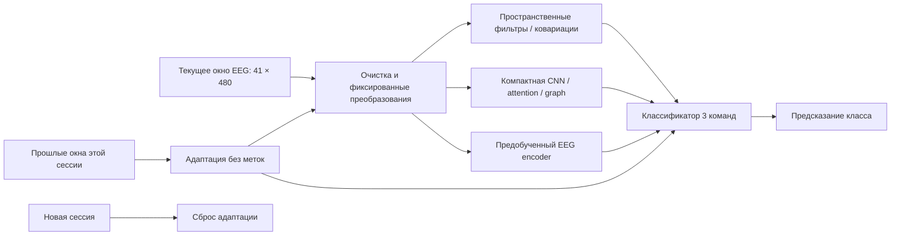

# Методы декодирования EEG и BCI: критический обзор научной литературы

**Дата поиска и проверки источников: 11 ноября 2026 года. Язык: русский. Контекст: Track 02 BCI Decoding / PROTEUS в `reproduction/`.**

Обзор объединяет классические методы обработки EEG, современные нейросети, self-supervised и foundation-модели, а также методы переноса между людьми и сессиями. Цель — объяснить, какие механизмы действительно исследованы в научной литературе и какие из них содержательно подходят для нашего соревнования. Публикация в сильной площадке подтверждает наличие рецензируемого исследования, но не означает, что метод доказанно лучше остальных на PROTEUS. Старые сильные методы включены как необходимые научные ориентиры; передовой фронт отдельно представлен работами 2024–2026 годов.

Под «детекцией EEG» здесь понимается обнаружение и распознавание информации **в уже зарегистрированном EEG**: выделение полезных компонентов и классификация когнитивной команды, события или состояния. Физические датчики и проектирование усилителей находятся вне обзора. Основная задача — не клиническая диагностика и не предсказание отдельных нейронных спайков. Методы стадирования сна, эмоционального состояния, ERP и SSVEP включены как смежные экспериментально подтверждённые направления; условия их переноса на mental-command BCI оговариваются явно.

## Как читать обзор

Каждая карточка содержит первичную публикацию, принцип метода, область экспериментальной проверки, ограничение и вывод о применимости к PROTEUS. Идентификаторы C обозначают классические методы, D — supervised deep learning, F — предобучение, T — перенос и адаптацию. Это каталог подходов, а не список независимых решений, которые следует одновременно включить в один ансамбль. Разные архитектуры одной семьи сохраняют собственные карточки, когда отличаются механизмом; изменение seed или ширины слоя отдельным подходом не считается. DeepConvNet и ShallowConvNet из одной статьи отмечены как две архитектуры, а не как две независимые публикации.

Основное ядро источников — официальные proceedings NeurIPS, ICLR, KDD и других конференций, а также журналы IEEE TBME, TNSRE, TNNLS, TII, TAFFC, JBHI, Journal of Neural Engineering, NeuroImage и Clinical Neurophysiology. Исторические и специализированные исключения подписаны собственными площадками: например, Frontiers, Neurocomputing и специализированные IEEE-конференции не переименованы в «топовую ML-конференцию». Воркшопная публикация не приравнивается к main conference; неподтверждённые журнальные версии препринтов не входят в основной подсчёт. Универсального объективного рейтинга «топовости» для всех этих дисциплин нет, поэтому точная площадка полезнее одного общего ярлыка.

Поиск выполнен по названиям методов, DOI и тематическим запросам: `EEG motor imagery spatial filtering`, `cross-subject EEG Riemannian adaptation`, `EEG compact convolution attention graph`, `EEG self-supervised foundation models`, `EEG test-time spectral normalization`. Для библиографической проверки использованы страницы издателей, proceedings, авторские полные тексты и записи PubMed; агрегаторы использовались как поисковые указатели, а не как основание технических выводов. У части IEEE/IOP/OpenReview-страниц автоматический доступ ограничен; тогда отдельно различаются прочитанный полный текст, доступная аннотация и проверенные метаданные. Глубина проверки указана в карточке при существенном ограничении и в сопутствующем JSON-аудите. Код и результаты всех работ в этом обзоре заново не воспроизводились.

Это **целевой критический обзор**, а не исчерпывающий systematic review по PRISMA. Нет фиктивных чисел просмотренных и исключённых статей; дата поиска не означает, что найдены все публикации до этой даты. Статус 2025–2026 годов проверялся по принятым публикациям, а не выводился из даты появления arXiv. Здесь нет общей таблицы «чужая accuracy → наш ожидаемый результат»: разные парадигмы, число классов, схемы калибровки и тестирования делают такую таблицу недостоверной.

## Нейрофизиологическая постановка: что именно извлекают методы

Важное различие проходит между вызванным потенциалом ERP, связанным по фазе с событием, и изменением мощности ритма ERD/ERS, которое не обязано быть фазово синхронизировано с подсказкой. Поэтому усреднение формы сигнала, спектральная энергия и ковариации отвечают на разные вопросы. Классическая работа Pfurtscheller и Lopes da Silva демонстрирует частотную и пространственную специфичность ERD/ERS в двигательных экспериментах; из неё нельзя вывести готовые однозначные нейромаркеры всех трёх команд PROTEUS. [Pfurtscheller, Lopes da Silva, *Event-related EEG/MEG synchronization and desynchronization: basic principles*, Clinical Neurophysiology, 1999](https://doi.org/10.1016/S1388-2457(99)00141-8).

Для motor imagery естественны пространственные и спектральные признаки сенсомоторных ритмов. Для mental subtraction и word generation следует допускать распределённые отличия мощности, временной динамики и межканальных зависимостей, а не заранее фиксировать один канал и одну полосу. Это **наша рабочая гипотеза о признаках**, а не установленная в обзоре специфическая нейрофизиологическая сигнатура PROTEUS. Аналогично функциональная связность между электродами не равна доказанной связи между источниками мозга: общий источник и объёмное проведение могут создавать корреляции без прямого взаимодействия областей.

Разница между классификационной полезностью и нейрофизиологической интерпретацией существенна. В экспериментальном multiverse-исследовании *How EEG preprocessing shapes decoding performance* показано, что артефакты, связанные с условиями эксперимента, могут улучшать decoding, а их удаление — снижать accuracy. Следовательно, высокий балл сам по себе не устанавливает, что модель использует мозговую активность нужного происхождения. Это аргумент для диагностических сравнений и проверки устойчивости, а не универсальное требование максимально очищать каждый сигнал. [Communications Biology, 2025](https://www.nature.com/articles/s42003-025-08464-3).

## Ограничения нашей задачи, определяющие применимость

PROTEUS даёт четыре секунды уже подготовленного сигнала: 41 scalp EEG-канал, 120 Гц, 480 отсчётов на канал, единицы — микровольты. Окно начинается через секунду после подсказки. Классы: кинестетическое воображение движения, мысленное вычитание и генерация слов. В локально подготовленных данных — 2655 окон от 10 людей; несколько сессий доступны только части участников. Это характеристики локальной подготовки, а не результаты библиографического поиска. См. [подготовку данных](../Brain-Decoding/track2_bci/bci/data.py), [отчёт воспроизведения](../REPORT.md).

На inference поступает одно окно за раз; порядок внутри participant-session хронологический. Меток и идентификаторов человека, интерфейса и run модель не получает. Любая адаптация использует только текущее и предыдущие окна текущей сессии; перед новой сессией модель возвращается к исходному состоянию. Весь уже поступивший четырёхсекундный фрагмент доступен целиком: внимание внутри него не нарушает контракт. Полный target-session whitening, пересчёт PCA по будущим окнам, персональная калибровка по истинным меткам и память между сессиями — другие условия эксперимента. Локальная версия [официального FAQ](../2026-competition/codabench/pages/scientific_faq_bci.md) задаёт этот контракт.

Основная метрика соревнования — balanced accuracy по participant × session × interface с равным усреднением ячеек. Наш текущий исследовательский приоритет — первая сессия полностью исключённого человека с равным весом людей; дополнительные сессии не должны увеличивать его основной вес. Конкретный протокол зафиксирован в [VALIDATION_PROTOCOL.md](../VALIDATION_PROTOCOL.md) и [описании 8/2 split](../custom_validation_20261110/PROTOCOL.md). Ни один опубликованный чужой LOSO-результат не заменяет проверку по этому протоколу.

*Схема — синтез обзора: блоки являются альтернативами и совместимыми компонентами, а не одной опубликованной архитектурой. Стрелка из истории не даёт доступа к будущему. Очистка не означает возможность запросить отсутствующие EOG/EMG.*

