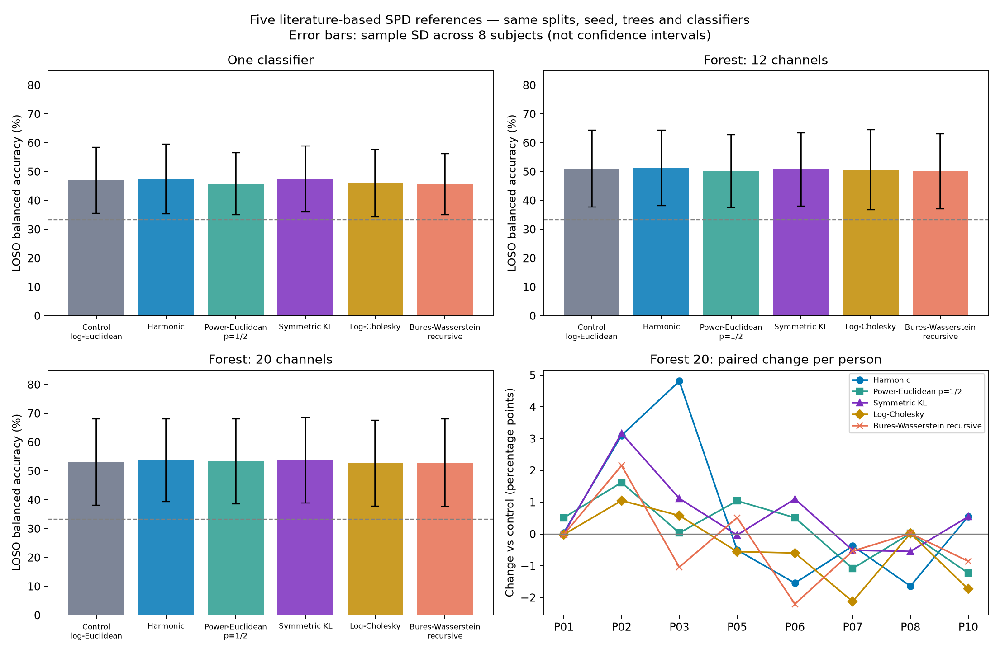

# Ещё пять опорных матриц из литературы: PROTEUS

Выполнены **145 новых оценок**: пять вариантов × тот же протокол из 29 задач. Добавлены прежние 116 оценок для совместного сравнения девяти способов построения опорной матрицы. Все сохранённые предсказания (261 файл) независимо проверены официальным кодом метрик.

Это опубликованные методы оценивания SPD-матриц, применённые здесь как сессионные опорные матрицы в том же EEG-пайплайне. Это не воспроизведение пяти полных опубликованных систем распознавания ЭЭГ.

## Результаты пяти новых вариантов

Метрика — сбалансированная точность, средняя по сессиям. LOSO: среднее ± выборочное SD по восьми людям. Δ — парная разность с исходным лог-евклидовым накопительным вариантом, в процентных пунктах.

### Один классификатор

| Опорная матрица | LOSO | Δ LOSO, п.п. | Лучше / равно / хуже по людям | Поздняя сессия | Test |
|---|---:|---:|---:|---:|---:|
| Лог-евклидово, накопительное (контроль) | 0.469444 ± 0.114333 | +0.00 | — | 0.546962 | 0.454827 |
| Гармоническое | 0.474006 ± 0.120641 | +0.46 | 4 / 0 / 4 | 0.577190 | 0.440127 |
| Степенное евклидово, p=1/2 | 0.457855 ± 0.107467 | -1.16 | 3 / 0 / 5 | 0.556988 | 0.452073 |
| Симметричная KL / Jeffreys | 0.474514 ± 0.115094 | +0.51 | 7 / 0 / 1 | 0.557063 | 0.438909 |
| Log-Cholesky | 0.459695 ± 0.117274 | -0.97 | 2 / 0 / 6 | 0.497136 | 0.445162 |
| Bures–Wasserstein, рекурсивное | 0.456256 ± 0.105750 | -1.32 | 3 / 0 / 5 | 0.547188 | 0.448212 |

### Лес, 12 каналов

| Опорная матрица | LOSO | Δ LOSO, п.п. | Лучше / равно / хуже по людям | Поздняя сессия | Test |
|---|---:|---:|---:|---:|---:|
| Лог-евклидово, накопительное (контроль) | 0.510785 ± 0.132683 | +0.00 | — | 0.613900 | — |
| Гармоническое | 0.513575 ± 0.130918 | +0.28 | 5 / 0 / 3 | 0.608096 | — |
| Степенное евклидово, p=1/2 | 0.501560 ± 0.126255 | -0.92 | 2 / 0 / 6 | 0.609076 | — |
| Симметричная KL / Jeffreys | 0.507770 ± 0.126725 | -0.30 | 2 / 1 / 5 | 0.613825 | — |
| Log-Cholesky | 0.506461 ± 0.139024 | -0.43 | 2 / 0 / 6 | 0.583974 | — |
| Bures–Wasserstein, рекурсивное | 0.500617 ± 0.129859 | -1.02 | 2 / 0 / 6 | 0.594000 | — |

### Лес, 20 каналов

| Опорная матрица | LOSO | Δ LOSO, п.п. | Лучше / равно / хуже по людям | Поздняя сессия | Test |
|---|---:|---:|---:|---:|---:|
| Лог-евклидово, накопительное (контроль) | 0.531430 ± 0.149736 | +0.00 | — | 0.668627 | 0.528622 |
| Гармоническое | 0.536975 ± 0.143382 | +0.55 | 4 / 0 / 4 | 0.658149 | 0.505426 |
| Степенное евклидово, p=1/2 | 0.533211 ± 0.147721 | +0.18 | 6 / 0 / 2 | 0.643751 | 0.519040 |
| Симметричная KL / Jeffreys | 0.537488 ± 0.147713 | +0.61 | 5 / 0 / 3 | 0.653626 | 0.514176 |
| Log-Cholesky | 0.527208 ± 0.148501 | -0.42 | 3 / 0 / 5 | 0.624001 | 0.512019 |
| Bures–Wasserstein, рекурсивное | 0.528960 ± 0.152275 | -0.25 | 3 / 0 / 5 | 0.623775 | 0.523053 |

## Наблюдения

- Один классификатор: лучший LOSO среди пяти новых вариантов — «Симметричная KL / Jeffreys», 0.474514, Δ +0.51 п.п.; среди всех девяти вариантов максимум у «Риманово, рекурсивное», 0.479216.
- Лес, 12 каналов: лучший LOSO среди пяти новых вариантов — «Гармоническое», 0.513575, Δ +0.28 п.п.; среди всех девяти вариантов максимум у «Риманово, рекурсивное», 0.513874.
- Лес, 20 каналов: лучший LOSO среди пяти новых вариантов — «Симметричная KL / Jeffreys», 0.537488, Δ +0.61 п.п.; среди всех девяти вариантов максимум у «Симметричная KL / Jeffreys», 0.537488.

Сопоставление на публичном test для леса с 20 каналами:

- Гармоническое: 0.505426, Δ к контролю -2.32 п.п.
- Степенное евклидово, p=1/2: 0.519040, Δ к контролю -0.96 п.п.
- Симметричная KL / Jeffreys: 0.514176, Δ к контролю -1.44 п.п.
- Log-Cholesky: 0.512019, Δ к контролю -1.66 п.п.
- Bures–Wasserstein, рекурсивное: 0.523053, Δ к контролю -0.56 п.п.

## Все девять вариантов: лес с 20 каналами

| Опорная матрица | LOSO | Поздняя сессия | Test |
|---|---:|---:|---:|
| Лог-евклидово, накопительное (контроль) | 0.531430 ± 0.149736 | 0.668627 | 0.528622 |
| Арифметическое, накопительное | 0.520789 ± 0.144418 | 0.623850 | 0.522773 |
| Риманово, рекурсивное | 0.529726 ± 0.151627 | 0.658601 | 0.520829 |
| Лог-евклидово, забывание 0,95 | 0.528442 ± 0.146955 | 0.698477 | 0.508733 |
| Гармоническое | 0.536975 ± 0.143382 | 0.658149 | 0.505426 |
| Степенное евклидово, p=1/2 | 0.533211 ± 0.147721 | 0.643751 | 0.519040 |
| Симметричная KL / Jeffreys | 0.537488 ± 0.147713 | 0.653626 | 0.514176 |
| Log-Cholesky | 0.527208 ± 0.148501 | 0.624001 | 0.512019 |
| Bures–Wasserstein, рекурсивное | 0.528960 ± 0.152275 | 0.623775 | 0.523053 |

## Источники и точные формулы

Обозначения: общий prior M0=exp(L0), где L0 — среднее логарифмов обучающих ковариаций; n=5+t; A=(5 M0+Σ R_i)/n; H=((5 M0⁻¹+Σ R_i⁻¹)/n)⁻¹. Начальная матрица и вес 5 одинаковы с предыдущим экспериментом.

1. **Гармоническое среднее:** M=H. Это усреднение в пространстве обратных ковариаций. Формула H дана в [Nielsen (2024), Appendix A](https://pmc.ncbi.nlm.nih.gov/articles/PMC11675394/), с отсылкой к [Moakher & Batchelor (2006)](https://link.springer.com/chapter/10.1007/3-540-31272-2_17).

2. **Степенное евклидово, p=1/2:** M=((5 M0^(1/2)+Σ R_i^(1/2))/n)^2. [Dryden, Pennec & Peyrat (2010), section 2.1](https://arxiv.org/abs/1009.3045). Это power-Euclidean mean, а не неявно определяемое риманово power mean; p=.5 зафиксировано до запусков.

3. **Симметричная KL / Jeffreys:** M=A#H, где # — середина аффинно-инвариантной геодезической. Это центр для ковариаций нормальных распределений с одинаковым средним. [Nielsen (2024), Theorem A1, equation A5](https://pmc.ncbi.nlm.nih.gov/articles/PMC11675394/). Проверено также уравнение M H⁻¹ M=A. Это не формула центроида произвольных гистограмм.

4. **Log-Cholesky:** для C_i=chol(R_i) строго нижние элементы C_i усредняются арифметически, а диагонали — через среднее логарифмов; затем M=Cbar Cbarᵀ. [Lin (2019), section 4.2, equation 4.3](https://arxiv.org/abs/1908.09326). Вес prior включён в тех же координатах. Порядок каналов сохранён; эта геометрия от него зависит.

5. **Bures–Wasserstein, рекурсивное:** M_t=γ_BW(M_(t−1),R_t,1/(5+t)). [Bhatia, Jain & Lim (2019), section 4, equations 38–41](https://arxiv.org/abs/1712.01504). Геодезическая проверена независимой формулой оптимального переноса. Рекурсивный запуск — наша потоковая адаптация геодезической, не точный batch-барицентр всех окон.

У первых четырёх вариантов вычисляется точное соответствующее взвешенное среднее/центр текущего префикса с массой prior 5. Все формулы применяются только к текущему и прошлым окнам сессии. Касательные признаки по-прежнему vec√2(log(M⁻¹/² R M⁻¹/²)); геометрия классификатора не заменялась.

## Сохранённый протокол

- Те же версии библиотек и подготовленные PROTEUS-файлы, проверенные SHA-256.
- Те же 1521/379/755 окон, 6/2/2 человека, восемь LOSO-разбиений и единственная поздняя сессия.
- C=.01, seed=0, 50 деревьев, m=12/20, исходные шесть полос, OAS и бутстреп-код автора.
- Те же полосы и наборы каналов каждого дерева проверены сравнением с контрольными JSON.
- Новое обновление используется и в обучении, и в предсказании; scaler/классификатор переобучаются с прежними настройками.
- Текущее окно включается до классификации; состояние сбрасывается между сессиями.
- Для public test обучение только на train; forest12 test не добавлялся, как и раньше.
- Синтетическая часть с фиксированной единичной опорной точкой не изменялась.

## Проверки и пределы вывода

- Официальными метриками проверены все предсказания (261 файл): 145 новых, 87 из прошлого сравнения и 29 исходных; все четыре метрики совпали при atol=1e-14.
- Исходный код, данные и все предыдущие результаты остались неизменными; их хеши проверены.
- Проверены скалярные ответы вручную, некоммутирующие взвешенные средние, уравнение KL-центра, формула BW-переноса, SPD, причинность, сброс сессий, пакетный/потоковый ответ и точное равенство контрольного адаптера.
- Параметры пяти вариантов зафиксированы до получения новых оценок. Подбора по test не было.
- Один seed, восемь dev-испытуемых, одна поздняя сессия и два public-test испытуемых. Результаты исследовательские: перебор нескольких методов и повторное использование открытого test не дают независимого подтверждения универсального превосходства. SD — разброс по людям, не доверительный интервал.

## Файлы

- `README.md`: команды запуска.
- `experiment.json`: формулы, первоисточники, зафиксированные параметры и хеши.
- `comparison.csv`: контроль + пять новых вариантов, 18 строк.
- `combined_comparison.csv`: все девять вариантов, 27 строк.
- `paired_loso.csv`: 120 новых парных разностей; `combined_paired_loso.csv`: 192 разности.
- `fold_scores.csv`: 261 оценка; `results/<variant>/*_predictions.npz`: 145 новых файлов предсказаний.
- `verification.json`, `verified_jobs.json`: независимая проверка метрик.
