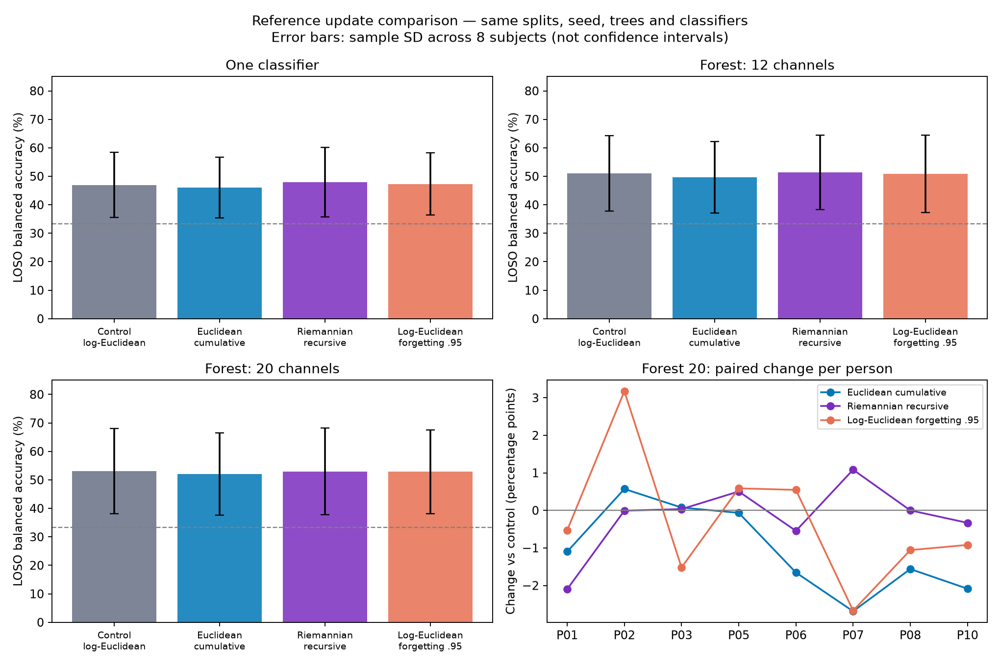

# Сравнение опорных матриц на PROTEUS

Повторён потоковый эксперимент таблицы 2: три новых способа обновления опорной матрицы, 87 новых оценок и 29 ранее воспроизведённых контрольных оценок. Все предсказания независимо пересчитаны официальными метриками соревнования.

## Результаты

Сбалансированная точность, средняя по сессиям. LOSO: среднее ± выборочное SD по восьми людям. Δ — разность с тем же классификатором при исходном лог-евклидовом накопительном обновлении, в процентных пунктах. Плюс означает улучшение.

### Один классификатор

| Опорная матрица | LOSO | Δ LOSO, п.п. | Улучшение / равенство / ухудшение по людям | Поздняя сессия | Test |
|---|---:|---:|---:|---:|---:|
| Лог-евклидово, накопительное (контроль) | 0.469444 ± 0.114333 | +0.00 | — | 0.546962 | 0.454827 |
| Арифметическое, накопительное | 0.460574 ± 0.106003 | -0.89 | 3 / 0 / 5 | 0.567466 | 0.424015 |
| Риманово, рекурсивное | 0.479216 ± 0.121959 | +0.98 | 7 / 0 / 1 | 0.562038 | 0.444094 |
| Лог-евклидово, забывание 0,95 | 0.473326 ± 0.109408 | +0.39 | 5 / 0 / 3 | 0.532112 | 0.454470 |

### Лес, 12 каналов

| Опорная матрица | LOSO | Δ LOSO, п.п. | Улучшение / равенство / ухудшение по людям | Поздняя сессия | Test |
|---|---:|---:|---:|---:|---:|
| Лог-евклидово, накопительное (контроль) | 0.510785 ± 0.132683 | +0.00 | — | 0.613900 | — |
| Арифметическое, накопительное | 0.496949 ± 0.125119 | -1.38 | 3 / 0 / 5 | 0.614277 | — |
| Риманово, рекурсивное | 0.513874 ± 0.130248 | +0.31 | 5 / 0 / 3 | 0.613825 | — |
| Лог-евклидово, забывание 0,95 | 0.508427 ± 0.135828 | -0.24 | 3 / 0 / 5 | 0.623474 | — |

### Лес, 20 каналов

| Опорная матрица | LOSO | Δ LOSO, п.п. | Улучшение / равенство / ухудшение по людям | Поздняя сессия | Test |
|---|---:|---:|---:|---:|---:|
| Лог-евклидово, накопительное (контроль) | 0.531430 ± 0.149736 | +0.00 | — | 0.668627 | 0.528622 |
| Арифметическое, накопительное | 0.520789 ± 0.144418 | -1.06 | 2 / 0 / 6 | 0.623850 | 0.522773 |
| Риманово, рекурсивное | 0.529726 ± 0.151627 | -0.17 | 3 / 1 / 4 | 0.658601 | 0.520829 |
| Лог-евклидово, забывание 0,95 | 0.528442 ± 0.146955 | -0.30 | 3 / 0 / 5 | 0.698477 | 0.508733 |

## Что показало сравнение

- Один классификатор: наибольшее среднее LOSO у варианта «Риманово, рекурсивное», 0.479216; Δ к контролю +0.98 п.п.
- Лес, 12 каналов: наибольшее среднее LOSO у варианта «Риманово, рекурсивное», 0.513874; Δ к контролю +0.31 п.п.
- Лес, 20 каналов: наибольшее среднее LOSO у варианта «Лог-евклидово, накопительное (контроль)», 0.531430; Δ к контролю +0.00 п.п.

Для леса с 20 каналами изменения на публичном test:

- Арифметическое, накопительное: 0.522773, Δ -0.58 п.п.
- Риманово, рекурсивное: 0.520829, Δ -0.78 п.п.
- Лог-евклидово, забывание 0,95: 0.508733, Δ -1.99 п.п.

## Точные определения вариантов

Для всех вариантов начальная матрица **одинакова**: M0=exp(L0), где L0 — среднее логарифмов обучающих ковариаций, как у автора. Вес prior=5. Меняется только правило сессионного обновления; это не сравнение разных оценок начального prior.

1. **Контроль:** L_t=(5 L0+Σ log R_i)/(5+t); M_t=exp(L_t).
2. **Арифметическое:** M_t=(5 M0+Σ R_i)/(5+t).
3. **Риманово рекурсивное:** M_t=M_(t−1) #_(1/(5+t)) R_t, где A #_a B=A^(1/2)(A^(−1/2)BA^(−1/2))^a A^(1/2). Это индуктивная оценка, которая при некоммутирующих матрицах не равна точному среднему Фреше по всей истории.
4. **Лог-евклидово с забыванием:** S_t=0.95 S_(t−1)+log R_t, n_t=0.95 n_(t−1)+1, L_t=S_t/n_t; S0=5 L0,n0=5. Это нормализованные экспоненциальные веса; шаг стремится к 0.05, но во время разогрева не постоянен. Период полураспада веса окна — 13.51 окна, а не фиксированное число секунд.

Каждое текущее окно включается в опорную матрицу до его классификации, как в исходном коде. Новое правило применяется и к обучающим сессиям, и к предсказанию. Классификатор и StandardScaler переобучаются на соответствующих признаках, а их настройки сохраняются.

## Что сохранено из исходного эксперимента

- PROTEUS v1.0.0; те же npz-файлы с проверенными SHA-256, 41 канал, 480 отсчётов на окно.
- Те же train/val/test: 1521/379/755 окон и 6/2/2 человека; те же восемь LOSO-разбиений и поздняя сессия.
- Те же полосовые фильтры, OAS, определение касательных признаков, C=0.01, prior_weight=5 и seed=0.
- Те же 50 деревьев и подмножества по 12/20 каналов; исходный код выбора полос, каналов и бутстрепа не переписан.
- Совпадение списков полос и каналов каждого дерева с контролем проверено для всех лесов.
- Потоковая подача одного окна, тот же порядок записей и сброс состояния в начале каждой сессии.
- Для test обучение только на шести train-испытуемых; как в исходном протоколе, test есть только для logreg и forest20.

Синтетические проверки статьи не изменялись: у них фиксированная единичная опорная точка и отсутствует исходное сессионное обновление. Подстановка нового обновления туда означала бы другой синтетический эксперимент.

## Проверки и ограничения

- Официальным кодом заново оценены **116** файлов предсказаний; все четыре метрики совпали с сохранёнными при абсолютном допуске 1e-14.
- Исходные репозитории, подготовленные данные и все 29 исходных результатов остались неизменными.
- Аналитические тесты проверяют матричные формулы, нормировку prior, затухание весов, положительную определённость, отсутствие влияния будущих окон и равенство пакетного/потокового ответа.
- Контрольный адаптер даёт те же коэффициенты и ответы, что исходный код, на проверочном наборе.
- Варианты и decay=0.95 зафиксированы до вычисления результатов; подбора скорости забывания по test не было.
- Это исследовательское сравнение с одним seed, восемью dev-испытуемыми, одной поздней сессией и двумя public-test испытуемыми. Среднее улучшение не доказывает универсальное превосходство метода. SD на графике — разброс людей, не доверительный интервал; парные разности доступны отдельно.
- Открытый test уже использовался в предыдущем воспроизведении; этот эксперимент не заменяет закрытую финальную оценку соревнования.

## Файлы и повторный запуск

- `README.md`: команды запуска и структура файлов.
- `experiment.json`: зафиксированные формулы, хеши кода/данных/контроля и окружение.
- `comparison.csv`: итоговые средние, SD и изменения к контролю.
- `paired_loso.csv`: 72 парных изменения по испытуемым.
- `fold_scores.csv`: все 116 оценок, включая контроль.
- `results/<variant>/*_predictions.npz`: новые предсказания для каждого окна.
- `verification.json`, `verified_jobs.json`: независимая проверка результатов.

## Источники формул и кода

- [pyRiemann: арифметическое среднее](https://pyriemann.readthedocs.io/en/latest/generated/pyriemann.geometry.mean.mean_euclid.html).
- [pyRiemann: аффинно-инвариантная геодезическая](https://pyriemann.readthedocs.io/en/latest/generated/pyriemann.geometry.geodesic.geodesic_riemann.html).
- [Код автора](https://github.com/DorinDaniil/Brain-Decoding), commit `8d577af42619e5911cc5da8743c8a3e9b629014b`.
- [Код соревнования](https://github.com/neural-interfaces26/2026-competition), commit `2b53aec91c111f8b5423b6674f096c48cc1a99af`.
- Предыдущий отчёт: `../REPORT.md`; исходный протокол — раздел 5 статьи в рабочей папке.
