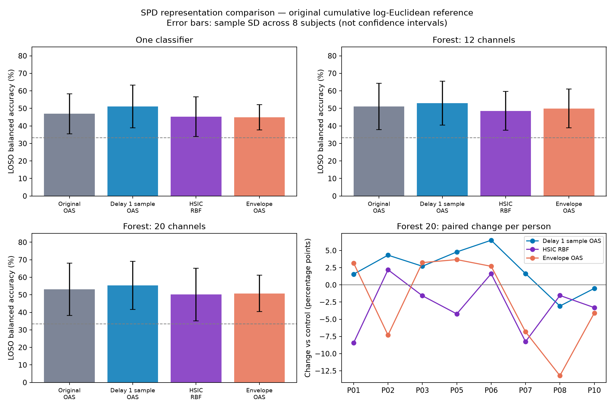

# Замена оконной матрицы R(X) в исходном пайплайне PROTEUS

Выполнены 87 новых оценок: ковариация с задержкой, HSIC Gram и ковариация амплитудных огибающих. Сравнение с 29 исходными оценками; накопительное лог-евклидово обновление опорной матрицы сохранено. Все 116 файлов предсказаний заново оценены официальным кодом соревнования.

## Результаты

Метрика — balanced accuracy, средняя по сессиям (`session_mean`), как в воспроизведённой таблице 2. LOSO: среднее ± выборочное SD по восьми людям. Δ — изменение относительно исходного представления для того же классификатора, в процентных пунктах. SD отражает разброс людей, а не доверительный интервал.

### Один классификатор

| Представление R(X) | LOSO | Δ LOSO, п.п. | Лучше / равно / хуже по людям | Поздняя сессия | Test |
|---|---:|---:|---:|---:|---:|
| Исходная OAS-ковариация | 0.469444 ± 0.114333 | +0.00 | — | 0.546962 | 0.454827 |
| Ковариация с задержкой 1 отсчёт | 0.510873 ± 0.122203 | +4.14 | 8 / 0 / 0 | 0.562415 | 0.469165 |
| HSIC, Gaussian RBF | 0.452442 ± 0.113573 | -1.70 | 3 / 0 / 5 | 0.467285 | 0.453297 |
| Ковариация огибающих | 0.448946 ± 0.072517 | -2.05 | 2 / 0 / 6 | 0.451379 | 0.404412 |

### Лес, 12 каналов

| Представление R(X) | LOSO | Δ LOSO, п.п. | Лучше / равно / хуже по людям | Поздняя сессия | Test |
|---|---:|---:|---:|---:|---:|
| Исходная OAS-ковариация | 0.510785 ± 0.132683 | +0.00 | — | 0.613900 | — |
| Ковариация с задержкой 1 отсчёт | 0.529321 ± 0.125049 | +1.85 | 6 / 0 / 2 | 0.648801 | — |
| HSIC, Gaussian RBF | 0.485922 ± 0.111032 | -2.49 | 2 / 0 / 6 | 0.638248 | — |
| Ковариация огибающих | 0.499690 ± 0.111337 | -1.11 | 3 / 0 / 5 | 0.563169 | — |

### Лес, 20 каналов

| Представление R(X) | LOSO | Δ LOSO, п.п. | Лучше / равно / хуже по людям | Поздняя сессия | Test |
|---|---:|---:|---:|---:|---:|
| Исходная OAS-ковариация | 0.531430 ± 0.149736 | +0.00 | — | 0.668627 | 0.528622 |
| Ковариация с задержкой 1 отсчёт | 0.553871 ± 0.137630 | +2.24 | 6 / 0 / 2 | 0.693728 | 0.544350 |
| HSIC, Gaussian RBF | 0.502061 ± 0.150277 | -2.94 | 2 / 0 / 6 | 0.523443 | 0.487374 |
| Ковариация огибающих | 0.508136 ± 0.104349 | -2.33 | 4 / 0 / 4 | 0.588723 | 0.452911 |

## Наблюдения

- Один классификатор: максимальное среднее LOSO у «Ковариация с задержкой 1 отсчёт», 0.510873; Δ к исходному представлению +4.14 п.п.
- Лес, 12 каналов: максимальное среднее LOSO у «Ковариация с задержкой 1 отсчёт», 0.529321; Δ к исходному представлению +1.85 п.п.
- Лес, 20 каналов: максимальное среднее LOSO у «Ковариация с задержкой 1 отсчёт», 0.553871; Δ к исходному представлению +2.24 п.п.

Для леса с 20 физическими электродами на публичном test:

- Ковариация с задержкой 1 отсчёт: 0.544350, Δ +1.57 п.п.
- HSIC, Gaussian RBF: 0.487374, Δ -4.12 п.п.
- Ковариация огибающих: 0.452911, Δ -7.57 п.п.

## Что именно изменено

В авторском коде исходное R(X) уже вычисляется оценкой **OAS**, а не буквально необработанным XXᵀ. Чтобы сравнивать преобразование сигнала, OAS сохранён для задержек и огибающих. Следовательно, эти два варианта — регуляризованные ковариации OAS, а не точное Cov+εI из обсуждения. Для HSIC применяется указанная ниже добавка εI.

Перед каждым представлением — исходный Butterworth bandpass порядка 4 и sosfiltfilt, для тех же шести полос: 4–40, 4–8, 8–13, 13–20, 20–30 и 30–40 Гц.

1. **Исходная OAS:** Covariances('oas') на отфильтрованных 41×480 отсчётах.
2. **Задержка:** z_i(t)=[x_i(t),x_i(t−1)], t=1,…,479, затем OAS. При частоте 120 Гц задержка равна 8.333 мс. Это один фиксированный лаг; поиск лага и глубины не проводился. Обе копии каждого электрода выбираются вместе, физические наборы деревьев совпадают с исходными.
3. **HSIC:** для каждого канала K_i(t,s)=exp(−(x_i(t)−x_i(s))²/(2σ_i²)), σ_i — медиана |x_i(t)−x_i(s)| по всем t<s внутри этого окна; при σ_i≤1e−12 используется 1. G_i=HK_iH, H=I−11ᵀ/T; S_ij=tr(G_iG_j)/T²; R=S+εI, ε=max(1e−12,1e−6·mean(diag(S))). Используются **все 480 отсчётов**, без прореживания, random Fourier features или Nyström. Упаковка симметричных ядер сохраняет их точное скалярное произведение Фробениуса. SPD гарантирована Gram-конструкцией и ε>0.
4. **Огибающая:** a_i(t)=abs(hilbert(x_i))(t), затем OAS по всем 480 отсчётам. Считается ковариация огибающих; нормировка до корреляции не добавляется.

### Размерность

| R(X) | Полная матрица | Матрица дерева 12 / 20 электродов | Признаки logreg / forest12 / forest20 |
|---|---:|---:|---:|
| Исходная / HSIC / огибающая | 41×41 | 12×12 / 20×20 | 861 / 78 / 210 |
| С задержкой | 82×82 | 24×24 / 40×40 | 3403 / 300 / 820 |

## Опорная матрица и обучение

Для каждого разбиения и полосы prior переоценивается на **обучающих** новых матрицах: L₀=mean(log R_train). Исходный SessionRecentering наследуется без замены: L_t=(5L₀+Σᵢ₌₁ᵗ log R_i)/(5+t), M_t=exp(L_t). Текущее окно входит в обновление до классификации. В начале каждой сессии состояние сбрасывается к prior. Численное значение prior меняется вместе с представлением; формула и вес 5 остаются исходными. StandardScaler и классификатор переобучаются.

- Те же данные PROTEUS v1.0.0: train/val/test = 1521/379/755 окон, 6/2/2 человека, 41 канал, 4 секунды.
- Те же восемь LOSO на train+val, поздняя сессия и public test; тот же порядок окон и правила сброса.
- Test обучается только на исходных шести train-испытуемых; forest12 test отсутствует, как в исходной таблице.
- Те же C=0.01, seed=0, 50 деревьев, 12/20 физических электродов, полосы и исходный код бутстрепа.
- Ни одна из ранее проверенных альтернативных опорных матриц здесь не используется.
- Синтетическая часть статьи этим запуском не изменялась; воспроизводится тот же EEG-протокол таблицы 2.

## Кэш и проверки

Чистое преобразование отдельного окна кэшируется до обучения. Для 2655 окон рассчитаны 18 наборов матриц (3 представления × 6 полос). Преобразование не использует метки, другие окна или обучаемые статистики; bandwidth HSIC берётся только из своего окна. Наличие test в таком кэше не переносит его информацию в обучающий prior или StandardScaler. Поиск окна — по точному хешу исходного float32 массива; неизвестное окно вызывает ошибку, а не подменяется похожим.

- Официальным кодом заново оценены 116 файлов: session_mean, cell_mean, pooled balanced accuracy и accuracy совпали с сохранёнными при atol=1e−14.
- Проверены хеши всех 18 файлов матриц, положительность минимального собственного значения каждого окна, размерности признаков, порядок окон, физические электроды и группировка временных копий.
- Все исходные 29 результатов, оба предыдущих сравнения опорных матриц, данные и авторские репозитории неизменны.
- 65 тестов: исходные проверки, прошлые методы опорной матрицы и новые аналитические проверки HSIC, задержек, огибающих, SPD, пакетного/потокового ответа, причинности по порядку окон, равенства живого и кэшированного обучения, возобновления прерванного кэша.

## Пределы вывода

Параметры lag=1, медианный bandwidth и ridge зафиксированы до результатов; оптимизация по public test не проводилась. Это сравнение конкретных конфигураций на восьми dev-испытуемых и двух public-test испытуемых с одним seed; оно не проверяет все задержки или все способы моделирования нелинейных связей. Изменение размерности задержанного варианта также меняет число признаков при прежнем C. Отдельной настройки регуляризации не проводилось.

HSIC измеряет силу зависимости без знака обычной корреляции. Медианный bandwidth по каждому окну/каналу в значительной мере убирает информацию об абсолютной мощности; порядок отсчётов внутри окна не моделируется. Огибающая также изменяет доступную фазовую информацию. Прирост задержанного варианта получен одновременно с увеличением числа признаков; этот эксперимент не отделяет вклад задержек от роста ёмкости модели.

Кэш рассчитан офлайн для сравнения точности. Время fit в JSON использует готовые матрицы и не является полной задержкой реального приложения. SOS-фильтрация и Hilbert используют всё доступное 4-секундное окно, как оконный протокол, без заявления о причинности внутри окна. Открытый test уже использовался ранее и не заменяет закрытую финальную оценку соревнования.

## Файлы

- `README.md`: команды повторного запуска.
- `representations.py`: три определения R(X), адаптеры исходных моделей и группировка каналов.
- `matrix_cache.py`, `prepare_cache.py`: точный возобновляемый кэш; `cache_inventory.json`: его хеши и SPD-проверки.
- `experiment.json`: исходные хеши, окружение, параметры и формулы до получения результатов.
- `comparison.csv`, `fold_scores.csv`, `paired_loso.csv`: 12 итоговых строк, 116 отдельных оценок, 72 парных изменения.
- `results/<variant>/*_predictions.npz`: новые предсказания каждого окна.
- `verification.json`, `verified_jobs.json`: независимая проверка.

## Источники

- [Carrara & Papadopoulo, 2023 — Augmented Covariance Matrix](https://arxiv.org/abs/2302.04508): мотивирует временное расширение. Здесь фиксирован один лаг, без воспроизведения их поиска параметров.
- [Gretton et al., 2005 — HSIC](https://www.cs.cmu.edu/~arthurg/papers/GreBouSmoSch05.pdf): основа меры зависимости. Используемая здесь SPD-матрица между каналами — предложенная в переписке Gram-конструкция, а не опубликованный алгоритм-победитель соревнования.
- [Corsi et al., FUCONE](https://arxiv.org/html/2111.03122v2): рассматривает amplitude envelope correlation. Здесь проверяется предложенная ковариация огибающих; полный FUCONE не воспроизводится.
- [Код автора](https://github.com/DorinDaniil/Brain-Decoding), commit `8d577af42619e5911cc5da8743c8a3e9b629014b`.
- [Официальный код соревнования](https://github.com/neural-interfaces26/2026-competition), commit `2b53aec91c111f8b5423b6674f096c48cc1a99af`.
