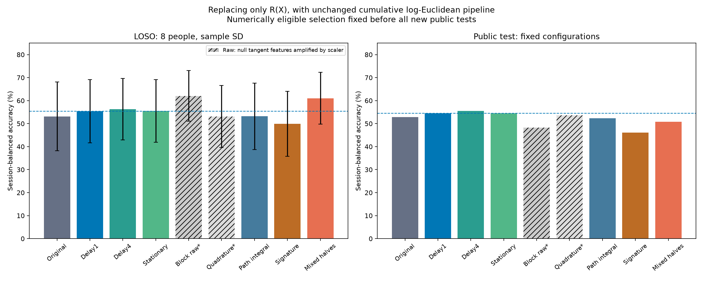

# Итог: замена R(X) при неизменном бейзлайне

Заранее выбранный по forest20 LOSO численно допустимый вариант: **Две половины: сумма/разность**. LOSO=0.610376, public test=0.507398. Изменение к прежнему delay1: +5.65 п.п. LOSO и -3.70 п.п. test. Улучшение LOSO у 6/8 людей. Выбор зафиксирован до всех новых test-оценок.

**Public test не подтвердил преимущество CV-лидера**: разность с delay1 -3.70 п.п. Поэтому его нельзя объявлять общим оптимумом.

Наиболее сбалансированный кандидат в ретроспективном сравнении фиксированных функций — **задержка 4**: LOSO=0.562801, test=0.555407; изменения к delay1 +0.89 и +1.11 п.п. Это интерпретация после просмотра test, а не новый ослеплённый выбор. Лаг 4 был зафиксирован до расчётов и после test не подбирался. Для подтверждения рекомендации нужен новый независимый набор.

Исследованы шесть литературно мотивированных функций и один корректирующий вариант после численной диагностики. Всего 203 новых оценки и 58 сохранённых контролей; все 261 файла предсказаний проверены официальными метриками. Исходные репозитории и бейзлайн не изменены.

## Сравнение

Balanced accuracy, средняя по сессиям. LOSO — среднее ± выборочное SD восьми людей. Δ — разность с прежним лидером delay1. Звёздочка обозначает сырой результат функции с проблемными нулевыми координатами; он сохранён для прозрачности, но не участвует в численно допустимом ранжировании.

### Один классификатор

| R(X) | LOSO | Δ к delay1, п.п. | Лучше delay1 | Поздняя сессия | Public test |
|---|---:|---:|---:|---:|---:|
| Исходная OAS | 0.469444 ± 0.114333 | -4.14 | 0/8 | 0.546962 | 0.454827 |
| Задержка 1 | 0.510873 ± 0.122203 | +0.00 | 0/8 | 0.562415 | 0.469165 |
| Задержка 4 | 0.546365 ± 0.111773 | +3.55 | 6/8 | 0.622720 | 0.464519 |
| Стационарная тёплицева | 0.510873 ± 0.122203 | +0.00 | 0/8 | 0.562415 | 0.469165 |
| Две половины: сырая блочная* | 0.502314 ± 0.120433 | -0.86 | 3/8 | 0.612996 | 0.420298 |
| Квадратурная* | 0.493939 ± 0.124866 | -1.69 | 2/8 | 0.547716 | 0.463323 |
| Интегральная ковариация пути | 0.467266 ± 0.112757 | -4.36 | 0/8 | 0.511910 | 0.448192 |
| OAS + сигнатурный Gram | 0.418086 ± 0.093527 | -9.28 | 0/8 | 0.406453 | 0.364812 |
| Две половины: сумма/разность | 0.502783 ± 0.117557 | -0.81 | 5/8 | 0.633198 | 0.460227 |

### Лес,12 электродов

| R(X) | LOSO | Δ к delay1, п.п. | Лучше delay1 | Поздняя сессия | Public test |
|---|---:|---:|---:|---:|---:|
| Исходная OAS | 0.510785 ± 0.132683 | -1.85 | 2/8 | 0.613900 | — |
| Задержка 1 | 0.529321 ± 0.125049 | +0.00 | 0/8 | 0.648801 | — |
| Задержка 4 | 0.539681 ± 0.126267 | +1.04 | 6/8 | 0.723579 | — |
| Стационарная тёплицева | 0.529321 ± 0.125049 | +0.00 | 0/8 | 0.648801 | — |
| Две половины: сырая блочная* | 0.605495 ± 0.099567 | +7.62 | 8/8 | 0.703980 | — |
| Квадратурная* | 0.507863 ± 0.129812 | -2.15 | 2/8 | 0.643751 | — |
| Интегральная ковариация пути | 0.501103 ± 0.138996 | -2.82 | 1/8 | 0.608774 | — |
| OAS + сигнатурный Gram | 0.485168 ± 0.115713 | -4.42 | 0/8 | 0.563244 | — |
| Две половины: сумма/разность | 0.612483 ± 0.103990 | +8.32 | 8/8 | 0.719056 | — |

### Лес,20 электродов

| R(X) | LOSO | Δ к delay1, п.п. | Лучше delay1 | Поздняя сессия | Public test |
|---|---:|---:|---:|---:|---:|
| Исходная OAS | 0.531430 ± 0.149736 | -2.24 | 2/8 | 0.668627 | 0.528622 |
| Задержка 1 | 0.553871 ± 0.137630 | +0.00 | 0/8 | 0.693728 | 0.544350 |
| Задержка 4 | 0.562801 ± 0.133246 | +0.89 | 5/8 | 0.723730 | 0.555407 |
| Стационарная тёплицева | 0.555193 ± 0.136590 | +0.13 | 3/8 | 0.693728 | 0.544350 |
| Две половины: сырая блочная* | 0.620296 ± 0.110197 | +6.64 | 7/8 | 0.734509 | 0.481984 |
| Квадратурная* | 0.530906 ± 0.134456 | -2.30 | 4/8 | 0.723805 | 0.536431 |
| Интегральная ковариация пути | 0.531734 ± 0.144407 | -2.21 | 1/8 | 0.668627 | 0.523288 |
| OAS + сигнатурный Gram | 0.499496 ± 0.141233 | -5.44 | 0/8 | 0.633876 | 0.461485 |
| Две половины: сумма/разность | 0.610376 ± 0.112563 | +5.65 | 6/8 | 0.774160 | 0.507398 |

## Основной кандидат для следующей проверки: augmented covariance, lag4

Для x(t)∈R^h строим z(t)=[x(t),x(t−4)] и R(X)=OAS(z). При 120 Гц это 33.333 мс; используются 476 совмещённых отсчётов. R имеет 82×82, как у предыдущей задержки 1, а дерево 20 видит 40×40. Те же формулы опорного логсреднего, scaler, C и физические электроды. Основание — [Carrara & Papadopoulo, 2023](https://arxiv.org/abs/2302.04508).

## CV-лидер: устойчивая функция временной ковариации

Разделим текущее 4-секундное окно на две половины по 240 отсчётов. После исходного полосового фильтра вычислим A=OAS(X₁), B=OAS(X₂), U=(A+B)/2, V=(A−B)/2. Затем

$$R(X)=\begin{pmatrix}U&V\\V&U\end{pmatrix} = Q\,\operatorname{diag}(A,B)\,Q^\top,\qquad Q=\frac1{\sqrt2}\begin{pmatrix}I&I\\I&-I\end{pmatrix}.$$

Q ортогональна, поэтому собственные значения и обе исходные ковариации сохраняются, а SPD следует из SPD A и B. В коде координаты чередуются по физическому электроду. Матрица имеет размер 82×82; дерево с 20 электродами видит 40×40, как у прежнего delay1. Число окон, один шаг обновления на окно и исходное накопительное логсреднее не меняются. Матрицы A,B и преобразование не используют метки или другие окна.

Литературный источник временного разбиения — [Hussein et al., 2013, temporal hierarchy of covariance descriptors](https://www.ijcai.org/Proceedings/13/Papers/363.pdf). Упаковка в одну SPD-матрицу и ортогональная запись для данного бейзлайна — наша адаптация, не полное воспроизведение Cov3DJ.

## Почему сырой результат 62,03% не принят автоматически

В точной арифметике diag(A,B) порождает нулевые межблочные касательные координаты. На реальных данных eigendecomposition/logm оставляли ошибки округления:400 таких признаков имели дисперсии до 4.53×10⁻²⁷. Исходный StandardScaler превращал их в признаки с единичной дисперсией и значениями до 22.0. Поэтому высокая точность сырой блочной записи не была достаточным основанием объявить победу.

Перед test был зарегистрирован отдельный H7-протокол. Менялась только запись R(X) через фиксированную Q; сам scaler и исходный классификатор остались прежними. В минимальной проверке минимальная дисперсия стала 0.00194, а во всех 29 итоговых H7-оценках отсутствуют координаты с дисперсией ниже 10⁻²⁰. Численная диагностика: [block_numerics_probe.json](block_numerics_probe.json), [mixed_numerics_probe.json](mixed_numerics_probe.json).

Ортогональное преобразование сохраняет информацию, но покомпонентное масштабирование и регуляризация классификатора не обязаны быть инвариантны к нему. Поэтому разницу точности нельзя целиком приписать ошибкам округления. Мы показываем численно корректный вариант функции, а не причинную декомпозицию прироста. Квадратурная форма также имеет вынужденно нулевые собственные межквадратурные координаты и оставлена как сырой, нерекомендуемый вариант.

## Что дала литература и проверка непрерывности

- Задержанное вложение: [Carrara & Papadopoulo, 2023](https://arxiv.org/abs/2302.04508). Проверен lag4 при той же размерности, что lag1.
- Стационарная автоковариация: [Wu & Xiao, 2011](https://www.stat.uchicago.edu/~wbwu/papers/cov-reviewJune15-2011-2.pdf) и [Hallac et al.,TICC](https://arxiv.org/abs/1706.03161). Заимствована структура, кластеризация и graphical lasso не добавлялись.
- Комплексные ковариации: [von Sachs, 2020](https://doi.org/10.1146/annurev-statistics-031219-041138). Проверена оконная квадратурная адаптация, без замены классификатора.
- Непрерывный путь и упорядоченные интегралы: [Király & Oberhauser, 2019](https://jmlr.org/papers/v20/16-314.html). Проверены предложенные здесь интегральная ковариация линейного интерполянта и OAS+локальный сигнатурный Gram.

Точная интегральная ковариация вычислялась двумя Gauss-узлами на каждом линейном интервале, без прореживания. Это явная модель непрерывного пути между отсчётами. Она остаётся 41×41. Сигнатурная функция также 41×41; однако её Gram-проекция теряет полное направление времени: обращение времени ортогонально меняет глубину 2 и оставляет Gram прежним. Это проверено отдельно без меток и без изменения фильтрации в модельных экспериментах. Гарантии полного сигнатурного ядра не переносятся на такую компактную упаковку.

Ни непрерывность, ни свойство SPD сами по себе не обеспечивают хорошего распознавания. Результаты относятся к конкретным функциям; они не доказывают бесполезность производных, других интерполянтов, более глубоких сигнатур или других лагов. Временное разбиение позволяет сохранить различие локальных статистик, но отдельного доказательства, что именно абсолютный порядок половин вызвал прирост, этот эксперимент не даёт.

Полный обзор девяти первичных работ: [literature/survey.md](literature/survey.md). Точные формулы первых шести функций и их полные сырые результаты: [REPORT.md](REPORT.md).

## Проверки и пределы вывода

- Официальным кодом перепроверены 261 файл и четыре метрики, atol=1e−14; сохранены те же люди, окна, деревья, полосы, C=.01,seed0 и prior_weight5.
- Все предыдущие результаты и исходные репозитории неизменны. Для test обучение только на исходных шести train-людях.
- 101 тест проверяет исходный код, прошлые функции, новые формулы, SPD, потоковость, кэш и ортогональную запись; полный лог — logs/final-tests.log.
- 36 базовых наборов кэша содержат 95 580 проверенных SPD-матриц. H7 применяет ортогональную конгруэнцию к тем же матрицам, без нового обучения или межоконных статистик.
- Выбор максимума среди нескольких функций на восьми dev-людях исследовательский и оптимистичен. Новый test не использовался для выбора, но public test уже был просмотрен в прошлых сериях. Закрытая независимая оценка остаётся необходимой для окончательной проверки.
- При исключении одного человека из усреднения тот же лидер сохраняется в 8/8 случаев. Это описательная устойчивость ранжирования, не вложенная кросс-валидация.
- Один seed, фиксированные настройки функций. Ранжирование относится к LOSO; общий оптимум всех SPD-представлений не установлен.
- Время fit использует готовый кэш; это не полная задержка приложения. Все функции используют только доступное текущее окно, а исходная память модели и границы сессий сохраняются.

## Артефакты

[final_comparison.csv](final_comparison.csv), [final_fold_scores.csv](final_fold_scores.csv), [final_verification.json](final_verification.json), [followup_mixed/selection.json](followup_mixed/selection.json), [followup_mixed/PROTOCOL.md](followup_mixed/PROTOCOL.md), [followup_mixed/mixed_features.py](followup_mixed/mixed_features.py). Команды исходных стадий — в [README.md](README.md).
