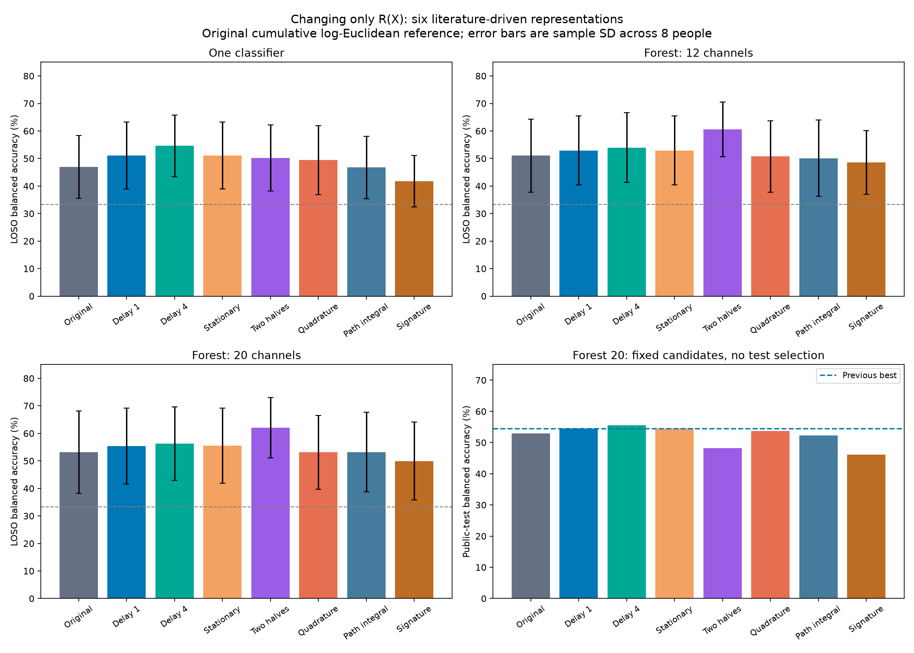

# Исследование функции R(X): временная структура и непрерывность

Наибольшее сырое среднее LOSO леса с 20 физическими электродами до численной фильтрации: **Две половины окна**. Выбор зафиксирован до новых test-оценок. Это сырое ранжирование первого этапа. У блочного и квадратурного представлений обнаружены теоретически нулевые касательные координаты, усиливаемые исходным scaler; рекомендацию см. в FINAL_REPORT.md и протоколе followup_mixed/PROTOCOL.md.

Изменялась только оконная функция R(X). Выполнены 174 новых оценки, сопоставлены с 58 сохранёнными оценками исходного OAS и предыдущего лидера delay1. Исходный бейзлайн и все предыдущие результаты сохранены.

## Результаты

Balanced accuracy, средняя по сессиям. LOSO: среднее ± выборочное SD по восьми людям. Δ — изменение относительно прежнего лидера с задержкой 1, в процентных пунктах. SD не является доверительным интервалом.

### Один классификатор

| R(X) | LOSO | Δ к delay1, п.п. | Лучше delay1, людей | Поздняя сессия | Public test |
|---|---:|---:|---:|---:|---:|
| Исходная OAS | 0.469444 ± 0.114333 | -4.14 | 0/8 | 0.546962 | 0.454827 |
| Задержка 1 (прежний лидер) | 0.510873 ± 0.122203 | +0.00 | 0/8 | 0.562415 | 0.469165 |
| Задержка 4 | 0.546365 ± 0.111773 | +3.55 | 6/8 | 0.622720 | 0.464519 |
| Стационарная тёплицева | 0.510873 ± 0.122203 | +0.00 | 0/8 | 0.562415 | 0.469165 |
| Две половины окна | 0.502314 ± 0.120433 | -0.86 | 3/8 | 0.612996 | 0.420298 |
| Комплексная / квадратурная | 0.493939 ± 0.124866 | -1.69 | 2/8 | 0.547716 | 0.463323 |
| Интегральная ковариация пути | 0.467266 ± 0.112757 | -4.36 | 0/8 | 0.511910 | 0.448192 |
| OAS + сигнатурный Gram | 0.418086 ± 0.093527 | -9.28 | 0/8 | 0.406453 | 0.364812 |

### Лес, 12 каналов

| R(X) | LOSO | Δ к delay1, п.п. | Лучше delay1, людей | Поздняя сессия | Public test |
|---|---:|---:|---:|---:|---:|
| Исходная OAS | 0.510785 ± 0.132683 | -1.85 | 2/8 | 0.613900 | — |
| Задержка 1 (прежний лидер) | 0.529321 ± 0.125049 | +0.00 | 0/8 | 0.648801 | — |
| Задержка 4 | 0.539681 ± 0.126267 | +1.04 | 6/8 | 0.723579 | — |
| Стационарная тёплицева | 0.529321 ± 0.125049 | +0.00 | 0/8 | 0.648801 | — |
| Две половины окна | 0.605495 ± 0.099567 | +7.62 | 8/8 | 0.703980 | — |
| Комплексная / квадратурная | 0.507863 ± 0.129812 | -2.15 | 2/8 | 0.643751 | — |
| Интегральная ковариация пути | 0.501103 ± 0.138996 | -2.82 | 1/8 | 0.608774 | — |
| OAS + сигнатурный Gram | 0.485168 ± 0.115713 | -4.42 | 0/8 | 0.563244 | — |

### Лес, 20 каналов

| R(X) | LOSO | Δ к delay1, п.п. | Лучше delay1, людей | Поздняя сессия | Public test |
|---|---:|---:|---:|---:|---:|
| Исходная OAS | 0.531430 ± 0.149736 | -2.24 | 2/8 | 0.668627 | 0.528622 |
| Задержка 1 (прежний лидер) | 0.553871 ± 0.137630 | +0.00 | 0/8 | 0.693728 | 0.544350 |
| Задержка 4 | 0.562801 ± 0.133246 | +0.89 | 5/8 | 0.723730 | 0.555407 |
| Стационарная тёплицева | 0.555193 ± 0.136590 | +0.13 | 3/8 | 0.693728 | 0.544350 |
| Две половины окна | 0.620296 ± 0.110197 | +6.64 | 7/8 | 0.734509 | 0.481984 |
| Комплексная / квадратурная | 0.530906 ± 0.134456 | -2.30 | 4/8 | 0.723805 | 0.536431 |
| Интегральная ковариация пути | 0.531734 ± 0.144407 | -2.21 | 1/8 | 0.668627 | 0.523288 |
| OAS + сигнатурный Gram | 0.499496 ± 0.141233 | -5.44 | 0/8 | 0.633876 | 0.461485 |

## Что проверено в литературе

Сохранён обзор девяти первичных работ из анализа временных рядов, динамических систем, компьютерного зрения, спектрального анализа и сигнатур траекторий: [literature/survey.md](literature/survey.md). Каждая заметка отделяет утверждения статьи от нашей адаптации. Ниже дано точное содержание эксперимента; полные алгоритмы TICC, Cov3DJ, сигнатурного классификатора и спектральной вейвлет-регрессии не воспроизводятся.

### 1. Задержка 4 отсчёта

Z_i(t)=[x_i(t),x_i(t−4)], R=OAS(Z), 476 совмещённых отсчётов, задержка 33.333 мс. Те же 82 координаты, что у delay1. Основание — augmented covariance / delay embedding [Carrara & Papadopoulo, 2023](https://arxiv.org/abs/2302.04508). Лаг зафиксирован, поиск гиперпараметров статьи не копируется.

### 2. Стационарная блочно-тёплицева ковариация

Из каждого канала вычитается среднее окна. Строятся два вектора длины T+1: [x,0] и [0,x]. Их Gram имеет вид [[C₀,C₁],[C₁ᵀ,C₀]] в блочном порядке, после чего применяется OAS. Это PSD по построению, а усадка сохраняет тёплицеву структуру и даёт SPD на данных. Мотивировано стационарными автоковариациями у [Wu & Xiao](https://www.stat.uchicago.edu/~wbwu/papers/cov-reviewJune15-2011-2.pdf) и структурированными зависимостями у [Hallac et al., TICC](https://arxiv.org/abs/1706.03161). Сегментация, кластеризация и graphical lasso в наш бейзлайн не добавляются.

### 3. Ковариации двух половин окна

R=diag(OAS(X_first_half), OAS(X_second_half)), координаты переупорядочены по физическому электроду. Это один уровень временной иерархии, сохраняющий порядок участков. Основание — [Hussein et al., 2013](https://www.ijcai.org/Proceedings/13/Papers/363.pdf). Блочная упаковка в одну SPD-матрицу и исходный классификатор — наша адаптация.

### 4. Комплексная / квадратурная ковариация

Q=Im(Hilbert(X)); S=OAS([X,Q]); R=(S+J S Jᵀ)/2, где J поворачивает каждую пару (x_i,q_i) на 90°. Сохраняется вещественная форма эрмитовой ковариации, включая квадратурные межканальные связи. Оба слагаемых SPD, их среднее SPD. Мотивировано многомерными спектральными матрицами [von Sachs, 2020](https://doi.org/10.1146/annurev-statistics-031219-041138). Это интегральное оконное представление; частотная вейвлет-регрессия из литературы не реализована.

### 5. Интегральная ковариация непрерывного пути

Между отсчётами выбирается линейная интерполяция. Для каждого интервала с концами a,b берутся узлы z±=(a+b)/2 ± (b−a)/(2√3). Эмпирические первые и вторые моменты этих 2(T−1) узлов точно равны интегральным моментам кусочно-линейного пути; R=OAS(z). Матрица остаётся 41×41. Интерполяция явным образом учитывает соседство отсчётов. Это предложенная здесь конструкция, мотивированная подходом к последовательности как пути; она не приписывается авторам сигнатурных методов. У OAS меняется число входных узлов, поэтому меняется и усадка — это часть проверяемого R(X).

### 6. Исходная ковариация плюс сигнатурный Gram

R=C_OAS(X)+s² ΦΦᵀ/64. s — один RMS всего окна; Φ содержит по четыре координаты (S_x,S_tx,S_xt,S_xx) сигнатуры порядка 2 для 16 непересекающихся отрезков по 30 отсчётов каждого канала. Время каждого отрезка 0..1, амплитуда делится на s. Интегралы вычисляются точно на линейных интервалах по формуле Чена; данные не прореживаются. Фиксированные отрезки сцепляются, однако Gram суммирует по их координатам и теряет абсолютный порядок отрезков. Прибавка — PSD Gram, исходная ковариация сохраняет мощность и обеспечивает SPD. Механизм опирается на [Király & Oberhauser, 2019](https://jmlr.org/papers/v20/16-314.html) и [Dyer et al., 2022](https://proceedings.mlr.press/v151/dyer22a.html); такая смесь между каналами — наша адаптация. Универсальность полного сигнатурного ядра не переносится автоматически на глубину 2 и эту упаковку. Отдельная проверка выявила инвариантность этого Gram к полному обращению времени: координаты меняются ортогонально, а Gram остаётся тем же.

## Что означает непрерывность

Дискретные отсчёты не задают единственную непрерывную кривую. Линейная интерполяция — явное модельное предположение. Интегральная ковариация усредняет значения кривой; сигнатура использует упорядоченные интегралы приращений. Ковариация пути инвариантна обращению времени; временная пирамида сохраняет порядок половин; задержки сохраняют направленные поперечные лаги. Эти представления сохраняют разные свойства.

## Что осталось исходным

Авторские репозитории и данные не изменены. Для всех функций используется исходная полосовая фильтрация Butterworth/SOS, исходные шесть полос, mean(log R_train) как prior, накопительный SessionRecentering с весом 5, StandardScaler, C=.01, seed=0, 50 деревьев и те же 12/20 физических электродов. Для матриц 82×82 обе координаты электрода выбираются вместе. Test обучается только на исходных шести train-испытуемых.

| Семейство | Полная матрица | Признаки logreg / forest12 / forest20 |
|---|---:|---:|
| Исходная, интегральная, сигнатурная | 41×41 | 861 / 78 / 210 |
| Delay1, lag4, stationary, pyramid, quadrature | 82×82 | 3403 / 300 / 820 |

Число независимых ненулевых признаков блочных и комплексных конструкций может быть меньше формальной размерности. C не настраивался; это сравнение замен R(X) при фиксированном бейзлайне, а не лучших классификаторов для каждого представления.

## Проверки и границы вывода

- Пересчитаны официальным кодом все 232 файла предсказаний, четыре метрики совпали при atol=1e−14.
- Проверены 36 хешей кэша и положительность всех 95 580 оконных матриц, размерности, физические наборы деревьев и порядок окон.
- 32 новых теста проверяют аналитические формулы, SPD, пакетный/потоковый ответ, сброс сессии, причинность по окнам, живое/кэшированное обучение и восстановление кэша.
- Снимки хешей всех трёх предыдущих серий и исходного контроля совпали.
- Протокол коммитнут до расчётов; выбор LOSO-лидера коммитнут до новых test-оценок. Подбора по ним не было.
- Выбор среди шести функций на восьми dev-людях всё равно является исследовательским поиском: оценка выбранного максимума LOSO оптимистична. Открытый test ранее использовался; закрытая независимая проверка не заменена.
- Один seed, фиксированные lag4/16 patches/два временных участка. Это не перебор всех SPD-функций и не доказательство отсутствия других лучших представлений.
- Время fit исключает построение кэша; нельзя трактовать его как полную задержку приложения. Hilbert и sosfiltfilt используют доступное целое окно.

## Воспроизведение и артефакты

[README.md](README.md) — команды. [PROTOCOL.md](PROTOCOL.md) — доэкспериментальный протокол. [comparison.csv](comparison.csv) — 24 строки итогов; [fold_scores.csv](fold_scores.csv) — 232 оценки; [paired_loso.csv](paired_loso.csv) — парные разности с исходной OAS. [selection.json](selection.json), [verification.json](verification.json), [cache_inventory.json](cache_inventory.json) — проверяемая доказательная база.
